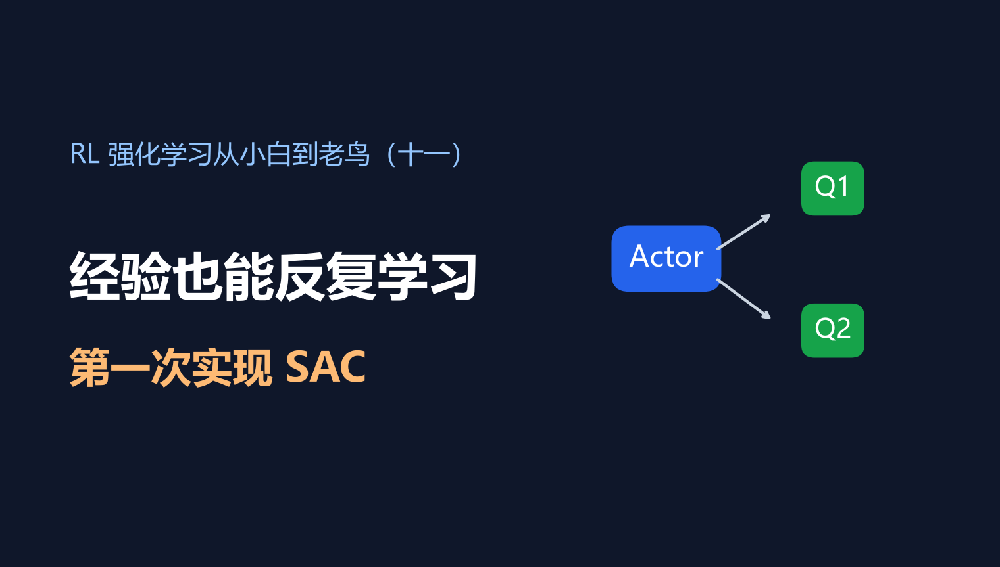
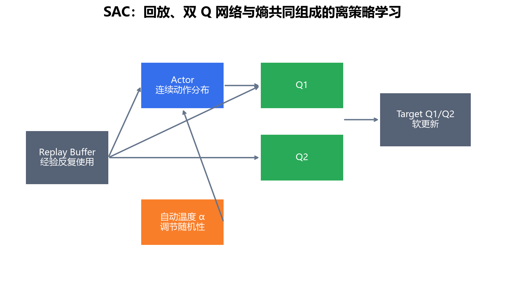
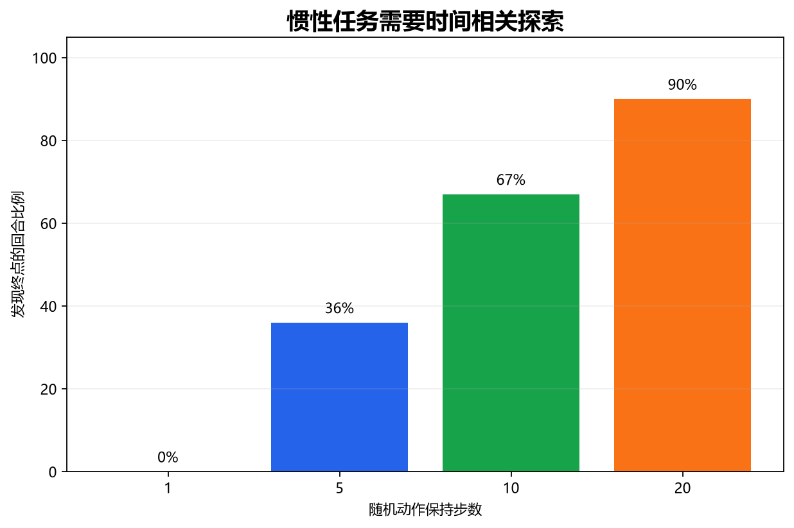
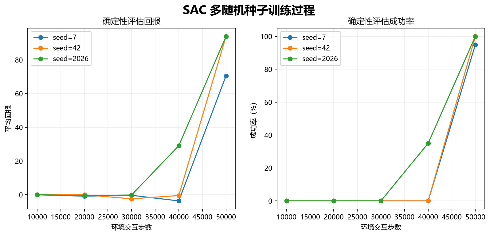
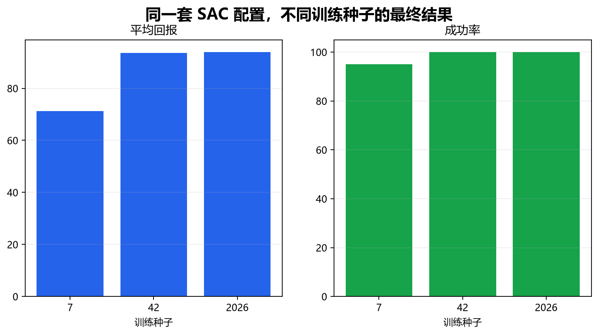
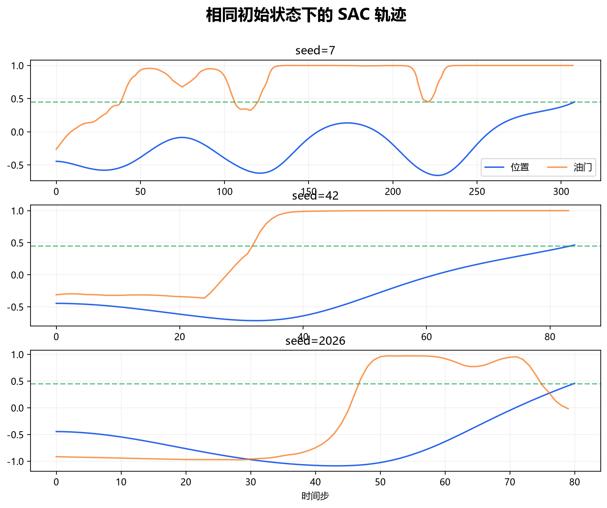

# RL强化学习从小白到老鸟（十一）——经验也能反复学习：第一次实现 SAC



> 本文对应代码：`tutorials/11-sac/`
>
> 上一篇：油门到底该踩多少？用 PPO 学会连续控制

上一篇把 PPO 从三个离散动作扩展到了连续油门。三个训练种子中有两个成功，一个却收敛成
几乎不踩油门的策略。PPO 采集一批轨迹、更新若干轮，然后把这批数据丢掉。如果某次采集没有
发现有价值的轨迹，后面的更新也无法凭空知道山顶在哪里。

这一篇换成 Soft Actor-Critic，简称 SAC。它会把走过的状态、动作和奖励放进经验回放池，
旧经验可以被多次抽取；同时使用两个 Q 网络降低过高估计，并用熵奖励保留探索。

实验仍然遵守三个限制：

1. 不修改环境原始奖励；
2. 不使用规则策略或教师示范；
3. 继续使用 `7、42、2026` 三个训练种子和同一批 100 个测试起点。

## 一、PPO 和 SAC 的根本差别

PPO 是 on-policy 算法。训练数据必须来自当前附近的策略，策略更新后，旧数据很快失去使用
价值。SAC 是 off-policy 算法，只要回放池中的转移仍然有效，就可以反复用它们更新网络。

一次环境交互会保存五项内容：

```text
(state, action, reward, next_state, terminated)
```

这里保存的是 `terminated`，而不是把 `truncated` 也当成真正终止。达到时间上限只表示本次
采样停止，状态本身未必没有后续价值，因此 Q 目标仍然应该自举。



当前实现包含五个关键组件：

- Actor：输出高斯分布，再通过 `tanh` 压缩到 `[-1, 1]`；
- Q1、Q2：分别估计同一个状态动作对的价值；
- Target Q1、Target Q2：缓慢跟随在线 Q 网络；
- Replay Buffer：随机抽取过去的交互经验；
- 温度参数 `alpha`：自动调节策略随机性。

## 二、为什么要使用两个 Q 网络

单个价值网络有可能把某些动作估得过高。Actor 又总想选择价值更高的动作，两者结合后，
估计误差可能被不断放大。

SAC 同时训练 Q1 和 Q2，计算目标时取二者较小值：

```text
target = reward + gamma * (1 - terminated)
         * (min(target_q1, target_q2) - alpha * next_log_probability)
```

它并不能保证估计绝对准确，但会让 Actor 不容易利用某一个 Q 网络偶然产生的乐观误差。

目标网络不直接参与梯度更新，而是进行软更新：

```text
target = (1 - tau) * target + tau * online
```

本实验使用 `tau=0.005`。目标变化得更慢，Q 学习时面对的参照也更稳定。

## 三、熵不是越大越好

SAC 的策略目标同时考虑价值和随机性：

```text
actor_loss = mean(alpha * log_probability - min(q1, q2))
```

`alpha` 大时，更重视随机探索；`alpha` 小时，更重视当前看来价值高的动作。代码没有固定这个
权重，而是根据目标熵自动训练 `log_alpha`。训练初期策略更随机，找到有效轨迹后逐渐集中。

连续动作仍然使用重参数化采样，让梯度可以穿过动作返回 Actor。动作经过 `tanh` 后改变了
概率密度，因此必须像连续 PPO 一样加入概率修正，不能直接使用原高斯分布的对数概率。

## 四、第一个版本为什么完全失败

最初实现让前 5000 步的随机油门每一步都独立变化。直觉上动作很随机，探索似乎应该很充分；
实际结果却是小车在谷底附近抖动，随机策略一次也没有到达山顶。

问题不在“随机程度”不够，而在随机动作没有时间相关性。连续山地车必须先持续向一侧加速，
再借助惯性转向。每一步都改变方向的随机油门会相互抵消。

为验证这一点，使用相同的 100 个环境种子，只改变一个随机动作保持多少步：

| 随机动作保持步数 | 成功率 | 平均回报 |
|---:|---:|---:|
| 1 | 0% | -33.31 |
| 5 | 36% | 6.63 |
| 10 | 67% | 43.89 |
| 20 | 90% | 74.29 |



正式训练选择保持 10 步。它仍然只是随机动作，没有读取速度方向，也没有复刻第九篇的惯性
规则。这个改动只是让随机探索符合系统具有惯性的事实。

## 五、训练流程

默认配置为：

| 配置 | 数值 |
|---|---:|
| 总环境步数 | 50000 |
| 随机探索步数 | 5000 |
| 随机动作保持 | 10 步 |
| 回放池容量 | 100000 |
| 批量大小 | 128 |
| 学习率 | 0.0003 |
| 折扣率 | 0.99 |
| 软更新系数 | 0.005 |
| 初始温度 | 0.2 |

训练单个种子：

```powershell
python .\连续控制\train_sac.py --seed 42
```

完成三个种子和统一测试：

```powershell
python .\连续控制\benchmark_sac.py
```

训练前 5000 步只采集随机经验。之后每执行一步环境动作，就从回放池随机抽取 128 条经验，
依次更新双 Q、Actor、温度参数和目标网络。为了控制 CPU 成本，每个环境步只更新一次。

## 六、三种子实验结果



三条曲线都不是平滑上升。前 3 万步几乎看不到成功；`seed=2026` 在 4 万步达到 35%，另外
两个种子仍然为 0%。到第 5 万步，三个模型才明显跃迁。

最终在相同的 100 个测试起点上进行确定性评估：

| 训练种子 | 平均回报 | 成功率 | 平均步数 | 平均动作成本 |
|---:|---:|---:|---:|---:|
| 7 | 71.24 | 95% | 525.29 | 23.76 |
| 42 | 93.63 | 100% | 119.39 | 6.37 |
| 2026 | 93.92 | 100% | 77.56 | 6.08 |
| 三种子平均 | 86.26 | 98.3% | 240.75 | 12.07 |



与第十篇 PPO 的 `66.7%` 三种子平均成功率相比，这一版 SAC 的最终成功率更高。不过现在还
不能直接宣布 SAC 全面胜出，因为两者虽然都用了 5 万环境步，网络更新次数、计算量和探索
方式并不相同。公平比较留到下一篇单独完成。

## 七、三个模型学出的动作并不一样



`seed=2026` 学出的策略最接近快速摆动：先向左积累势能，然后大油门向右冲坡，平均只需
77.56 步。`seed=42` 同样可靠，但摆动更慢。`seed=7` 会在中途多次改变油门，最终仍有 5%
的测试起点失败，动作成本也明显更高。

这说明“三个种子最终都学会”不代表它们学到完全相同的控制规律。成功率、速度和油耗仍需
同时观察。

播放最佳模型：

```powershell
python .\连续控制\play_sac.py .\runs\sac\seed-42\checkpoints\best.pt
```

## 八、实验结论

SAC 的经验回放提高了历史成功经验的利用率，三个种子最终都能形成有效策略。但本实验更值得
这次实验支持下面三点，不足以证明“SAC 比 PPO 强”：

1. 稀疏奖励任务首先取决于能不能发现成功经验；
2. 在具有惯性的系统中，时间相关探索比逐步独立噪声更有效；
3. 即使最终成功率相近，不同种子学出的速度和动作成本仍可能相差很大。

下一篇会固定环境步数、训练种子和测试起点，统一整理 PPO 与 SAC 的成功率、样本效率、
CPU 用时和动作成本。只有把训练代价也纳入，才能回答“谁更适合这个任务”。
