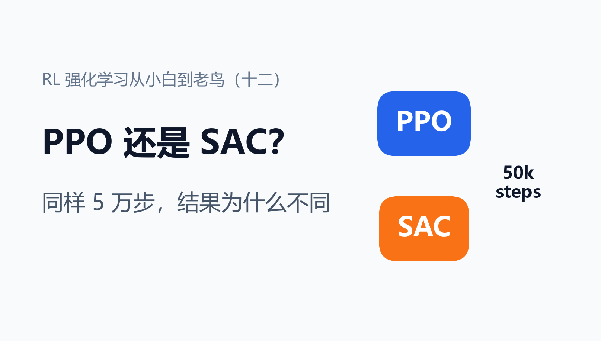
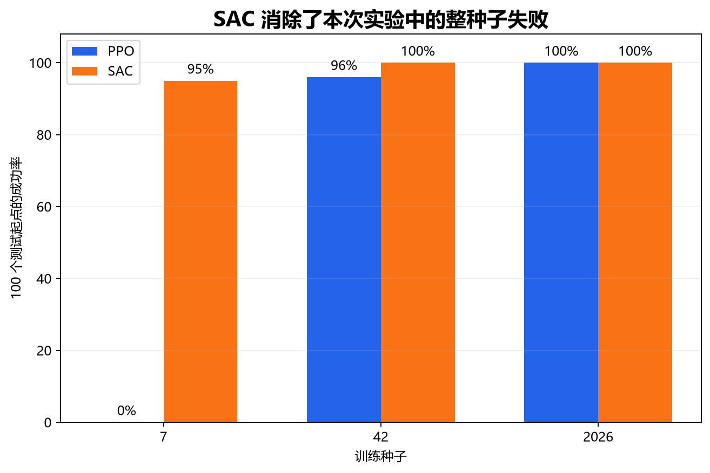
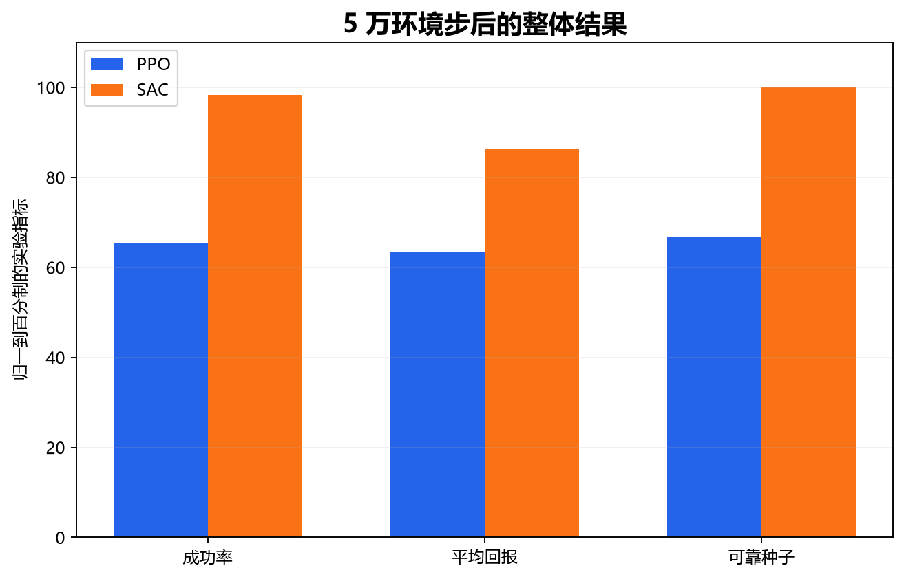
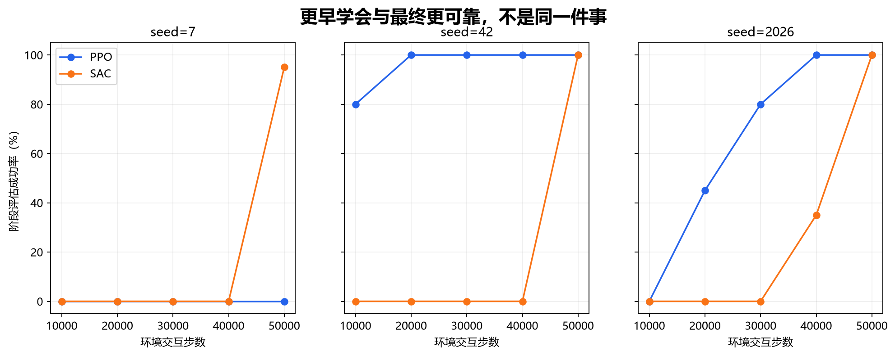
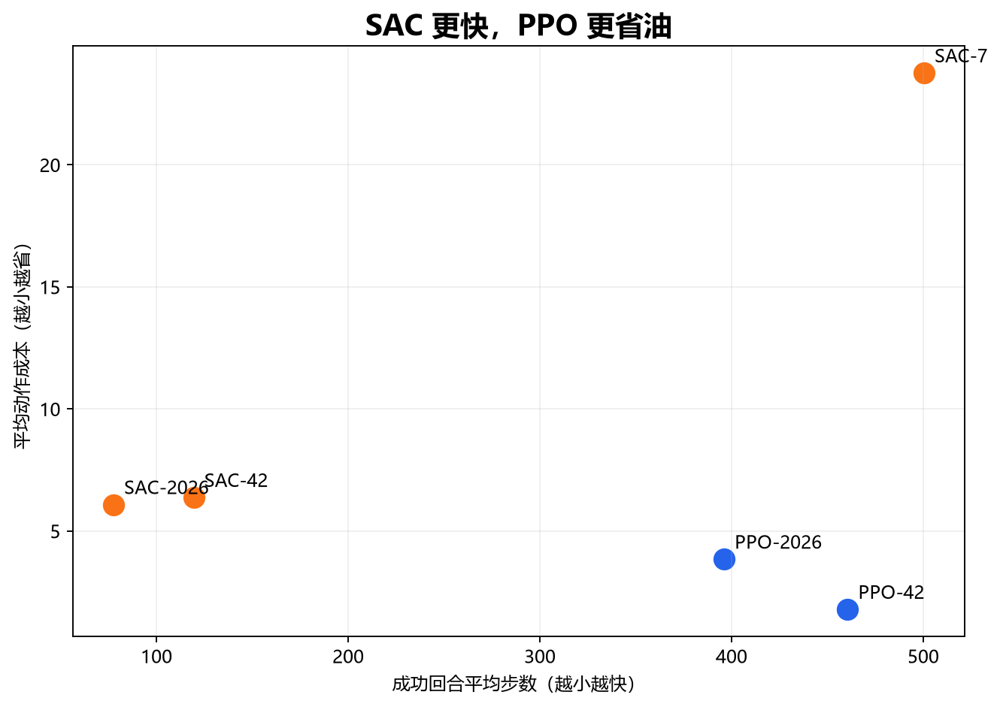

# RL强化学习从小白到老鸟（十二）——PPO 还是 SAC？同样 5 万步，结果为什么不同



> 本文对应代码：`tutorials/12-ppo-vs-sac/`
>
> 数据来自第十篇连续 PPO 和第十一篇 SAC 的原始实验文件。

前两篇让 PPO 和 SAC 分别控制同一辆连续山地车。现在终于可以把结果放到一起。不过“哪个
算法更好”不是看一眼最高回报就能回答的问题。

本篇重点回答四个更具体的问题：

1. 相同环境交互次数下，谁最终更可靠？
2. 谁更早学会完成任务？
3. 成功策略在速度和油耗上有什么差异？
4. 相同的 5 万环境步，是否意味着相同计算成本？

## 一、先确认比较条件真的相同

比较脚本会先读取两个原始报告，并检查以下字段：

| 条件 | PPO | SAC |
|---|---:|---:|
| 训练种子 | 7、42、2026 | 7、42、2026 |
| 每种子环境步数 | 50000 | 50000 |
| 测试起点 | 2026～2125 | 2026～2125 |
| 每模型测试回合 | 100 | 100 |
| 测试动作 | 确定性 | 确定性 |
| 人工奖励塑形 | 无 | 无 |
| 教师示范 | 无 | 无 |

运行比较：

```powershell
python .\连续控制\compare_ppo_sac.py
```

程序不会重新训练模型，而是对已经保存的逐回合数据进行配对整理。这样不会因为重跑产生新的
随机差异，也不会在看到结果后偷偷调整某一方参数。

两者仍有一个不能抹掉的差异：SAC 前 5000 步使用每个油门保持 10 步的时间相关随机探索；
PPO 从开始就使用自己的随机策略。这属于各自训练流程的一部分，比较时必须明确写出来。

## 二、最终可靠性：SAC 占优



| 训练种子 | PPO 成功率 | SAC 成功率 |
|---:|---:|---:|
| 7 | 0% | 95% |
| 42 | 96% | 100% |
| 2026 | 100% | 100% |
| 三种子平均 | 65.3% | 98.3% |

如果把最终成功率不低于 90% 定义为“可靠训练种子”，PPO 是 `2/3`，SAC 是 `3/3`。SAC
最大的优势不是把已经成功的种子再提高几个百分点，而是让 PPO 完全失败的 `seed=7` 也学会
了任务。



三种子平均回报也从 PPO 的 `63.46` 提高到 SAC 的 `86.26`。但这个平均值受到 PPO 失败种子
影响很大，不能把差值全部理解成成功策略质量的提升。

## 三、样本效率：结论没有总分那么简单



按照每一万环境步的阶段评估观察：

- `seed=42`：PPO 在 1 万步已经达到 80%，2 万步达到 100%；SAC 到 4 万步仍为 0%，5 万步
  才达到 100%。
- `seed=2026`：PPO 从 2 万步的 45% 逐渐提升，4 万步达到 100%；SAC 在 4 万步达到 35%，
  5 万步达到 100%。
- `seed=7`：PPO 直到 5 万步仍为 0%；SAC 在 5 万步达到 95%。

所以不能简单说“SAC 样本效率更高”。更准确的描述是：

> PPO 在成功种子上学得更早，SAC 在本次最终预算下对训练种子更可靠。

SAC 的曲线在后期突然跃升，是因为成功经验一旦进入回放池，就能被反复抽取。早期回放池里
没有成功轨迹时，经验复用也无法制造不存在的信息。

## 四、速度与油耗：两种算法学出了不同风格

只看双方都成功的 `seed=42` 和 `seed=2026`：

| 种子 | 算法 | 成功回合平均步数 | 平均动作成本 | 平均回报 |
|---:|---|---:|---:|---:|
| 42 | PPO | 460.52 | 1.79 | 94.21 |
| 42 | SAC | 119.39 | 6.37 | 93.63 |
| 2026 | PPO | 396.06 | 3.84 | 96.16 |
| 2026 | SAC | 77.56 | 6.08 | 93.92 |



SAC 明显更快，PPO 明显更省油。MountainCarContinuous 的回报是到达奖励减去动作平方成本，
并不直接惩罚耗时。因此 PPO 可以用更轻的油门慢慢摆动，得到更高回报；SAC 则学出了更接近
全油门冲坡的策略。

这再次说明平均回报不等于所有意义上的“更好”。如果控制目标强调响应速度，SAC 更合适；
如果强调动作成本，成功的 PPO 策略更有吸引力。

## 五、5 万环境步不等于相同计算量

环境步数衡量样本使用量，却不能代表训练耗时。

当前实现的参数规模为：

| 算法 | 训练期参数量 | 推理期参数量 |
|---|---:|---:|
| PPO | 4483 | 4483 |
| SAC | 22407 | 4482 |

SAC 训练时需要 Actor、两个在线 Q 网络和两个目标 Q 网络；部署时只留下 Actor，所以推理参数
反而与 PPO 几乎相同。

在单个 5 万步训练中：

- PPO 大约执行 7820 个小批量更新周期，每周期更新一个共享 Actor-Critic；
- SAC 在 5000 步预热后执行 45000 个更新周期，每周期分别更新双 Q、Actor 和温度参数。

这些数字不能直接换算成严格的耗时比例，因为网络结构和每次更新内容不同；但足以说明 SAC
用更多计算换取了更高的最终训练可靠性。若目标是现实机器人或昂贵仿真器，环境样本可能比
GPU 计算更贵，此时这种交换往往值得；若环境极便宜而计算受限，结论可能不同。

## 六、应该选 PPO 还是 SAC

在当前连续山地车实验中，可以这样选择：

- 希望代码和训练结构较简单：选 PPO；
- 希望少受训练种子影响：选 SAC；
- 希望策略动作更轻柔、省油：成功的 PPO 更好；
- 希望尽快到达终点：SAC 更好；
- 真实交互昂贵但离线计算便宜：优先考虑 SAC 的经验复用；
- 计算预算很紧：不能只根据 5 万环境步的最终分数选择 SAC。

这里的结论只适用于当前网络、预算和环境，不应扩展成“SAC 永远优于 PPO”。强化学习算法的
表现与奖励设计、动作维度、任务难度和实现细节高度相关。

## 七、连续山地车阶段到这里结束

第九篇建立连续动作和规则基线，第十篇实现连续 PPO，第十一篇实现 SAC，本篇完成相同预算
下的对照。连续山地车已经完成它作为教学载体的任务。

下一阶段不继续给这辆小车堆算法，而是进入具有两个连续控制量的 LunarLander。新项目会先
拆解二维动作、着陆奖励和失败模式，再把已经掌握的 PPO 与 SAC 迁移过去。
