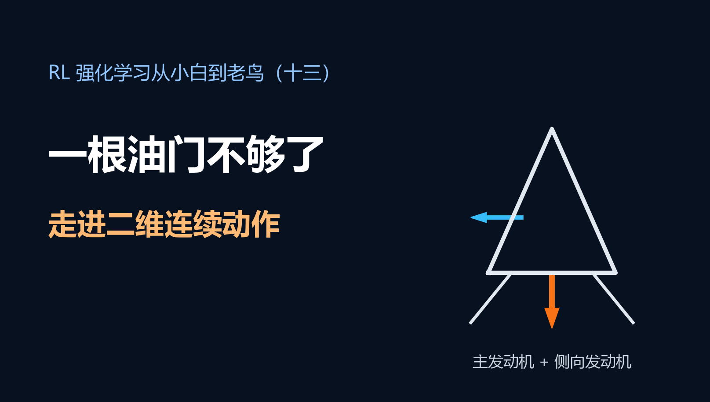
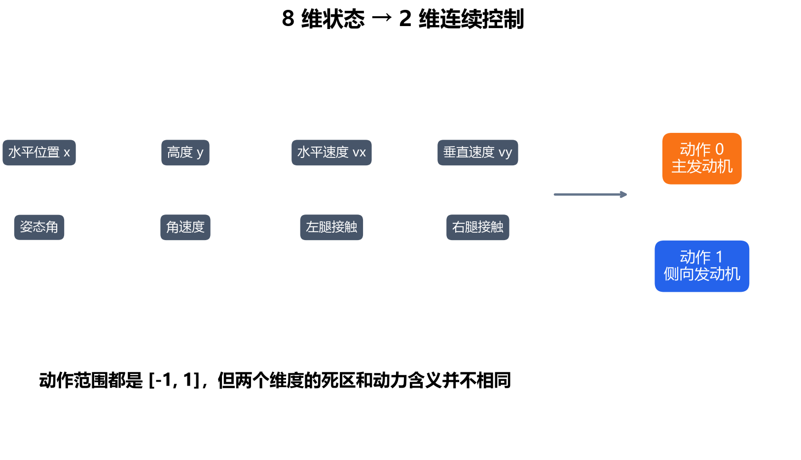
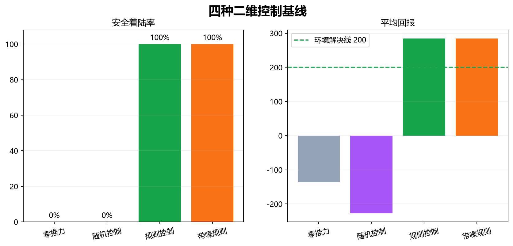
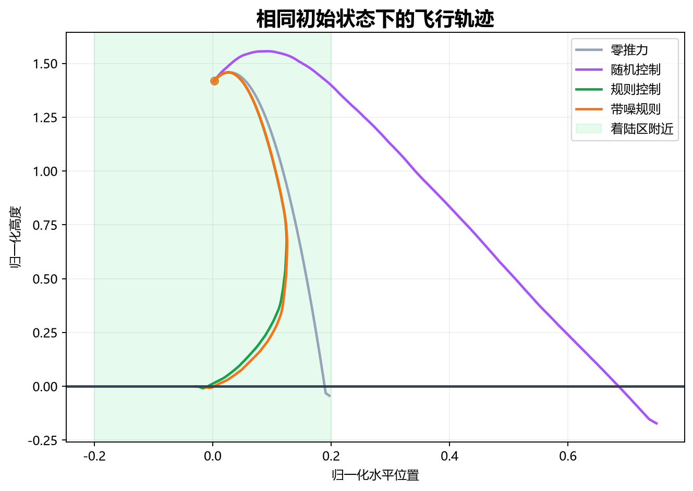
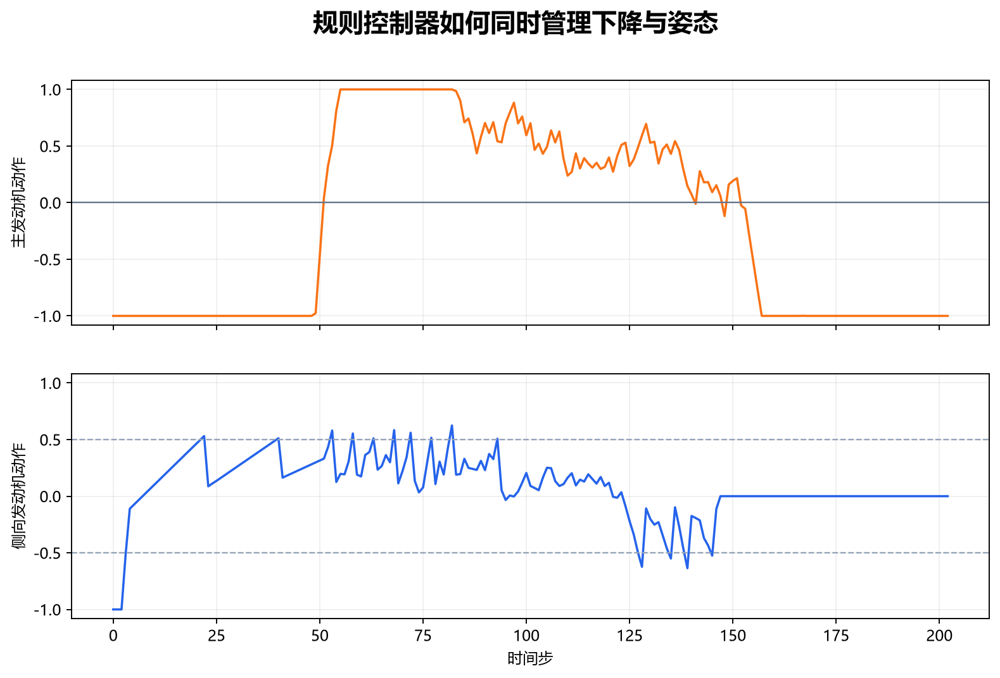

# RL强化学习从小白到老鸟（十三）——一根油门不够了：走进二维连续动作



> 本文对应代码：`tutorials/13-lunar-baselines/`

连续山地车阶段已经完成。小车只有位置、速度两个状态，策略只需输出一根左右油门。现在换成
月球着陆器：它不仅要控制下降速度，还要修正水平位置和姿态，而且两条腿都应稳定接触地面。

这一篇先不训练模型。我们只完成三件事：理解 8 维状态、弄清两个连续动作的真实含义、建立
随机与规则基线。先把问题定义正确，下一篇的 PPO 与 SAC 才有可信的比较标准。

## 一、安装 Box2D 环境

LunarLander 使用 Box2D 物理引擎，普通的 Gymnasium 安装不一定包含它。项目依赖已经改为：

```text
gymnasium[box2d]>=1.0,<2.0
```

安装全部依赖：

```powershell
python -m pip install -r requirements.txt
```

本篇使用 `LunarLanderContinuous-v3`。不要与离散动作的 `LunarLander-v3` 混淆。

## 二、状态从 2 维增加到 8 维



每一步观测包含：

| 下标 | 状态 | 含义 |
|---:|---|---|
| 0 | `x` | 相对着陆区中心的水平位置 |
| 1 | `y` | 高度 |
| 2 | `vx` | 水平速度 |
| 3 | `vy` | 垂直速度 |
| 4 | `angle` | 着陆器姿态角 |
| 5 | `angular_velocity` | 角速度 |
| 6 | `left_contact` | 左腿是否接触地面 |
| 7 | `right_contact` | 右腿是否接触地面 |

山地车只需决定“往左还是往右、踩多大”。着陆器则必须同时判断位置、速度和姿态。水平位置
正确但下降太快会坠毁；速度很慢但倾角过大也可能侧翻；一条腿接触后继续错误点火，还可能
把已经接触的着陆器重新推离地面。

## 三、两个动作的范围相同，含义却不同

动作是形状为 `(2,)` 的数组：

```text
[main_engine, side_engine]
```

两个数都在 `[-1, 1]`，但环境对它们的解释并不对称。

主发动机：

- `action[0] <= 0`：关闭；
- `action[0] > 0`：点火；
- 实际动力从 50% 到 100%，不存在 1% 的轻微点火。

侧向发动机：

- `abs(action[1]) <= 0.5`：关闭；
- 超过死区后按正负号选择方向；
- 动力范围为 50% 到 100%。

这意味着网络输出 `0.1` 时，主发动机已经点火；侧向动作 `0.1` 却完全没有效果。仅知道动作
范围还不够，必须阅读环境语义。

## 四、奖励不只是“落地加 100”

环境每一步通过状态变化进行塑形，鼓励：

- 靠近着陆区中心；
- 降低水平和垂直速度；
- 减小姿态角；
- 让两条腿稳定接触地面。

主发动机和侧向发动机还会产生燃料惩罚。坠毁或飞出边界时终局奖励为 `-100`，安全着陆时为
`+100`。官方通常把平均回报 `200` 作为解决环境的参考线。

本项目额外记录安全着陆率、坠毁率、主发动机使用量、侧向发动机使用量、最终速度和回合
长度，避免只用一个总回报掩盖失败方式。

## 五、四种基线

实验使用四种控制方式：

1. 零推力：两个发动机永远关闭；
2. 随机控制：两个动作每步独立从 `[-1, 1]` 采样；
3. 规则控制：根据位置、速度和姿态计算目标角度与悬停高度；
4. 带噪规则：在规则动作上增加标准差为 `0.15` 的高斯噪声。

第四种基线用于检查规则是否只在完全精确的动作下有效。它不是训练教师，只是环境难度与
控制裕量的参考。

运行完整实验：

```powershell
python .\月球着陆\benchmark_lunar_baselines.py
```

## 六、100 个固定起点的结果



| 策略 | 平均回报 | 着陆率 | 坠毁率 | 平均步数 |
|---|---:|---:|---:|---:|
| 零推力 | -135.83 | 0% | 100% | 68.57 |
| 随机控制 | -226.98 | 0% | 100% | 106.43 |
| 规则控制 | 284.28 | 100% | 0% | 200.01 |
| 带噪规则 | 284.14 | 100% | 0% | 200.24 |

随机控制比完全不点火更差。它虽然延长了飞行时间，却消耗燃料、破坏姿态，最后仍然全部
坠毁。动作更多并不代表探索自动变好，二维连续空间中的无结构随机性同样低效。

规则控制和带噪规则都达到 100% 安全着陆，平均回报超过 280。轻微动作噪声没有破坏结果，
说明这套控制逻辑存在一定裕量，可以作为下一篇学习算法的高质量上界。

## 七、相同起点，轨迹为什么完全不同



在 `seed=42` 的相同初始状态下：

- 零推力几乎沿抛物线直接落地；
- 随机控制把着陆器推向远离中心的位置；
- 规则控制和带噪规则先修正水平位置，再控制下降速度，轨迹几乎重合。



规则控制器开始时先关主发动机并用侧向发动机修正姿态，随后主发动机进入较强推力，接近地面
时逐渐减小。侧向动作在 `[-0.5, 0.5]` 内不会点火，所以曲线经过零附近并不代表发动机持续
小幅工作。

播放任意基线：

```powershell
python .\月球着陆\play_lunar_baseline.py heuristic --seed 42
python .\月球着陆\play_lunar_baseline.py random --seed 42
```

## 八、下一篇要解决什么

这一篇已经建立了清晰的上下界：随机控制全部坠毁，规则控制全部成功。下一篇会把连续 PPO
和 SAC 从一维动作扩展到二维动作，并回答：

1. 原来的 `tanh` 高斯策略是否可以直接扩展到两个输出；
2. 两个动作维度的概率修正与目标熵如何变化；
3. 模型能否在不模仿规则控制器的情况下超过平均回报 200；
4. 学到的策略更接近省油慢降，还是快速强推力着陆。

从这一阶段开始，模型面对的不再是“选对一个方向”，而是同时协调位置、速度、姿态和接触
状态。这才是二维连续控制项目真正增加的难度。
