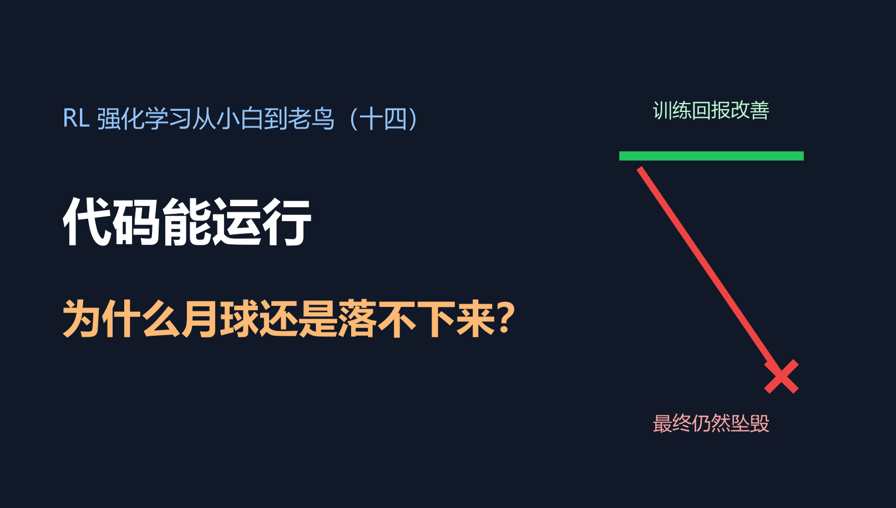
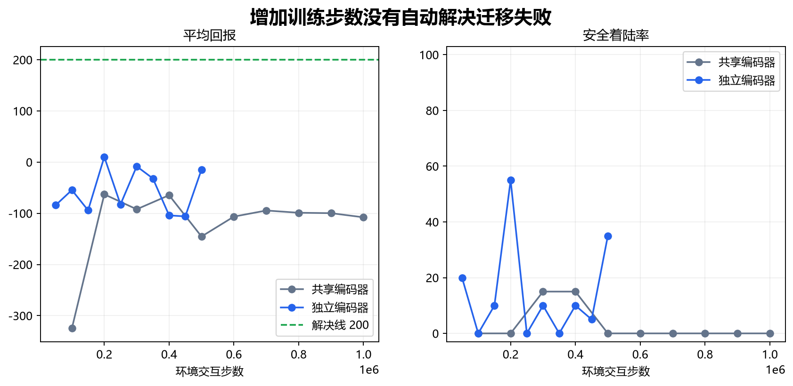
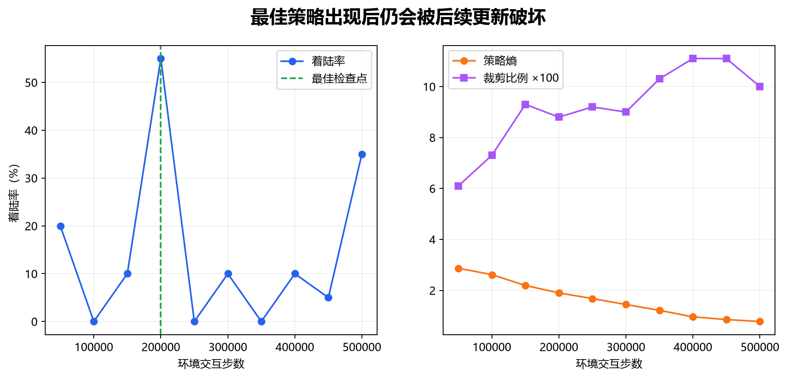
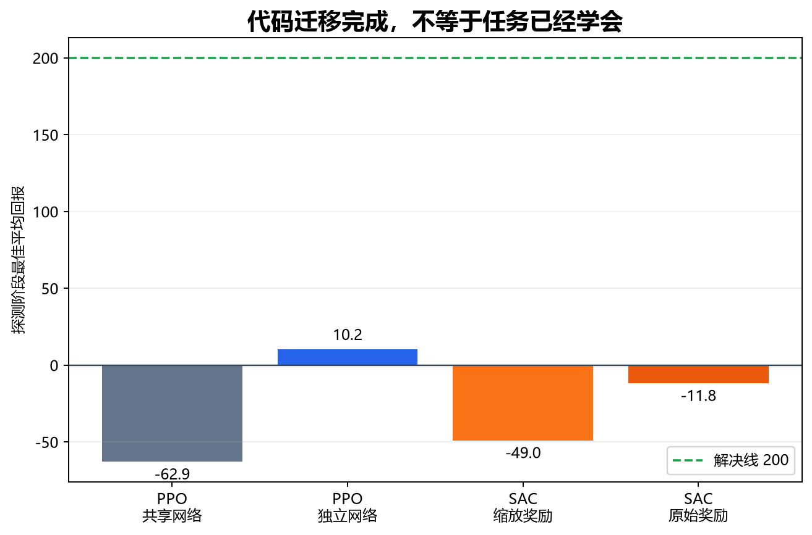

# RL强化学习从小白到老鸟（十四）——代码能运行，为什么月球还是落不下来？

> 本文对应代码：`tutorials/14-lunar-transfer-diagnostics/`

上一篇已经把 LunarLander 的 8 维状态、二维动作和规则基线跑通。规则控制器在 100 个起点上
全部安全着陆，说明环境和评估流程没有问题。接下来把连续 PPO 和 SAC 的输入输出维度改掉，
训练程序也能正常运行，但模型始终落不好。

这不是一篇成功案例，而是一篇迁移诊断。它要回答的是：代码没有报错，损失也在更新，为什么
算法仍然没有学会任务？

## 一、直接迁移做了哪些修改

PPO 和 SAC 的动作分布本来就支持多个维度。MountainCar 输出一个均值和标准差；LunarLander
改为两个输出，分别对应主发动机和侧向发动机。`tanh` 压缩和概率修正对两个维度分别计算后
求和。

状态从 2 维增加到 8 维，并按物理量范围进行缩放。训练仍然正确区分：

- `terminated`：坠毁、飞出边界或完成着陆；
- `truncated`：到达环境时间上限；
- 真正终止不再自举，时间截断仍保留下一状态价值。

检查点、固定起点评估、最佳模型和最新模型也全部可以正常保存。因此失败不是接口没接通。

## 二、MountainCar PPO 原样搬过来

第一版继续使用共享的 64×64 Actor-Critic 编码器、`0.01` 奖励缩放、每批数据更新 10 轮。
为了排除“训练不够久”，同一个 `seed=42` 最终跑到 100 万环境步。

| 步数 | 平均回报 | 着陆率 |
|---:|---:|---:|
| 200k | -62.9 | 0% |
| 300k | -92.1 | 15% |
| 400k | -64.6 | 15% |
| 500k | -145.3 | 0% |
| 1M | -107.8 | 0% |

训练变长没有带来稳定提升。策略偶尔学会接触地面，随后又被新的更新破坏。最终模型甚至比中期
检查点更差。

## 三、共享网络可能互相干扰

MountainCar 状态简单，共享特征足够。LunarLander 中，Actor 需要理解姿态与发动机控制，
Critic 则要估计长期着陆价值。二者共用编码器时，价值损失和策略损失会同时修改同一组特征。

第二版改为：

- Actor 与 Critic 各自使用两层 64 单元网络；
- 隐藏层使用正交初始化；
- Actor 输出层使用较小初始化增益；
- Critic 输出层独立初始化。

结果明显改善：20 万步时平均回报达到 `10.2`，着陆率达到 `55%`。但这仍不是稳定成功。

## 四、最好模型为什么又坏了

独立网络 PPO 的着陆率从 55% 跌到 0%，之后在 0%～35% 之间波动。与此同时：

- 策略熵从约 `2.87` 持续降低到 `0.78`；
- 平均 KL 从约 `0.005` 上升到 `0.008` 附近；
- 裁剪比例从约 `6%` 增加到 `10%～11%`。

这些指标不能单独证明因果，但共同说明策略越来越确定，而每批数据仍被重复更新 10 轮。在
着陆策略尚不稳定时，一次偏大的更新就可能破坏已经学会的接触动作。

如果只保存最终模型，就会得到“PPO 完全没学会”的结论；保存阶段最佳模型后，才能看到它曾经
达到 55%，随后发生退化。

## 五、SAC 也没有自动解决问题

SAC 进行了两轮探测：

| 配置 | 最佳阶段 | 最佳平均回报 | 着陆率 |
|---|---:|---:|---:|
| 64×64、奖励缩放 0.01 | 50k | -49.0 | 0% |
| 原始奖励、Q 学习率 0.001 | 50k | -11.8 | 0% |

第二组配置让 Q 网络更快适应原始奖励，早期回报明显改善，但仍没有形成安全着陆，随后还出现
退化。经验回放可以反复使用经验，却不能保证回放池里存在高质量接触轨迹，也不能自动修复
错误的 Q 估计。

## 六、为什么平均回报改善仍然不够

LunarLander 的稠密塑形奖励会鼓励靠近中心、减小速度和姿态角。模型即使最后坠毁，也可能在
前面的下降过程中得到不少正向变化。因此平均回报从 -300 提升到 -20，只能说明飞行过程更
合理，不能说明模型已经掌握安全接触。

本项目后续必须同时报告：

- 平均回报；
- 安全着陆率；
- 坠毁率；
- 超时率；
- 主、侧发动机用量；
- 最佳检查点之后是否退化。

## 七、下一步不再盲目增加训练步数

现有实验已经证明，把预算从 300k 增加到 1M 无法自动解决 PPO。下一篇将针对策略崩塌做
受控改造：

1. 更新轮数从 10 降至 5；
2. 加入目标 KL，更新过大时提前停止；
3. 使用线性学习率退火；
4. 记录策略熵、KL、裁剪比例、梯度范数和价值解释方差；
5. 用三个训练种子的 200k 小实验筛选配置；
6. 只有通过预设门槛的配置才进入完整训练。

这次真正学到的不是某个超参数，而是一条更重要的工程原则：

> 算法接口迁移成功，只代表程序可以运行；只有独立评估稳定通过，才代表任务真正学会。
