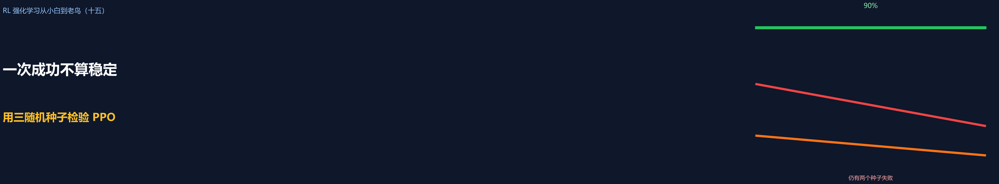
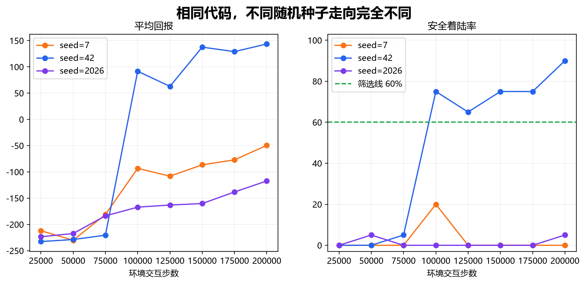
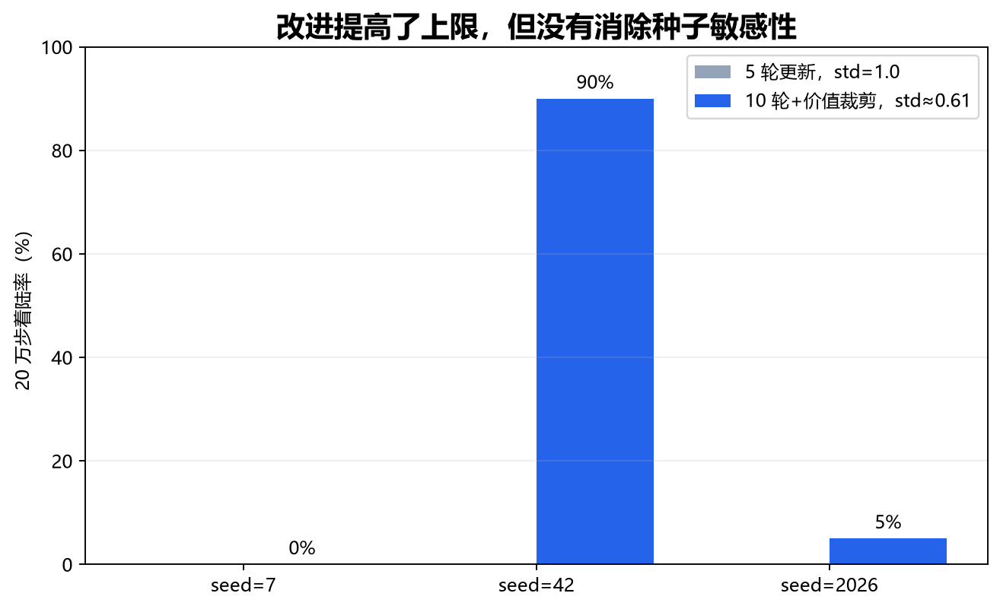
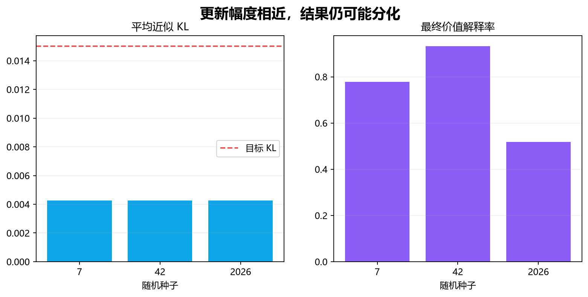

# RL强化学习从小白到老鸟（十五）——一次成功不算稳定，用三随机种子检验 PPO



> 本文对应代码：`tutorials/15-stable-lunar-ppo/`

上一篇中，LunarLander PPO 曾在 20 万步达到 55% 着陆率，随后又跌回 0%。这说明模型不是
完全学不会，而是更新过程会破坏刚形成的策略。本篇不再用单次最好成绩宣布成功，而是先写出
筛选标准：三个训练种子都跑 20 万步，至少两个种子的最终着陆率达到 60%，才算通过。

## 一、先验证“少更新几轮”

第一版稳定化配置把每批数据的更新轮数从 10 降到 5，并加入目标 KL `0.015`。直觉是少重复
使用一批数据，可以降低策略突然改变的风险。

实际结果却是：三个种子的峰值着陆率只有 15%、35% 和 25%，最终全部为 0%。训练记录中，
平均近似 KL 约为 `0.003`，没有一次触发提前停止。问题并非更新越过 KL 上限，而是学习强度
被削弱后，策略尚未掌握完整的着陆动作。

这次反例很重要：超参数名称里的“稳定”不等于训练效果稳定。保护机制只有真正触发，或者与
足够强的更新配合，才可能产生作用。

## 二、第二版具体改了什么

第二版保留目标 KL，同时做三项修改：

1. 每批数据恢复 10 轮更新；
2. Critic 使用裁剪价值损失，限制新旧价值预测一次变化过大；
3. 高斯策略的初始 `log_std` 从 `0` 改为 `-0.5`，即标准差从 `1.0` 降到约 `0.61`。

前两项与常见 PPO 连续动作实现保持一致。初始方差降低则来自任务语义：LunarLander 有两个
发动机，初始标准差为 1 时，经过 `tanh` 后经常给出接近极限的随机推力；适度收窄分布仍然
保留探索，但减少了无意义的大动作。

价值裁剪的核心代码如下：

```python
value_errors = (values - returns).square()
clipped_values = old_values + (values - old_values).clamp(-clip_ratio, clip_ratio)
clipped_errors = (clipped_values - returns).square()
value_loss = 0.5 * torch.maximum(value_errors, clipped_errors).mean()
```

这里取两个误差中更大的一个，意味着 Critic 不能通过跨出裁剪区间轻易获得更小的损失。

## 三、三随机种子结果



| 种子 | 10 万步着陆率 | 20 万步着陆率 | 最终平均回报 |
|---:|---:|---:|---:|
| 7 | 20% | 0% | -49.5 |
| 42 | 75% | 90% | 143.6 |
| 2026 | 0% | 5% | -117.3 |

种子 42 从 10 万步起持续保持 65%～90% 着陆率，没有重现上一篇“学会后立刻坍缩”的现象。
但另两个种子仍未学成，所以预先约定的 `2/3` 门槛没有通过。



这不是一个可以隐藏的坏结果。若只展示种子 42，结论会变成“PPO 已稳定解决任务”；加入另
两个种子后，准确结论应是：新配置显著提高了可达到的上限，并稳定了一条成功轨迹，但没有
消除初始化和采样顺序带来的敏感性。

## 四、为什么 KL 看起来正常，结果仍然不同



三个种子的平均 KL 都在 `0.0043` 左右，裁剪比例都约为 `4.6%`，目标 KL 从未触发。成功种子
和失败种子的更新幅度非常接近。最终价值解释率分别约为 `0.78`、`0.93`、`0.52`，失败的
种子 2026 对回报的解释明显较差，但这仍只是相关证据。

这说明 KL 只能回答“新策略离旧策略多远”，不能回答“策略是否走向正确的着陆方式”。如果
采样数据中缺少高质量接触轨迹，再安全的小步更新也可能稳定地走向悬停、耗尽时间或缓慢坠毁。

## 五、为什么要同时保存 best 和 latest

本项目每次固定起点评估后都会保存：

- `best.pt`：平均回报最高时的模型，适合演示与复盘；
- `latest.pt`：训练结束时的模型，用于判断训练是否稳定收敛。

只看 `best.pt` 容易把一次幸运峰值当作最终能力；只看 `latest.pt` 又会错过策略曾经学会过的
证据。实验报告同时保留每个阶段的平均回报、着陆率、坠毁率、KL、熵、梯度范数与价值解释率，
才能区分“从未学会”和“学会后退化”。

## 六、本篇结论

本篇得到三个可复用的经验：

1. 先写筛选门槛，再看结果，避免根据最好种子临时改变成功定义；
2. KL 早停是保险丝，不是学习方向；没有触发时，继续降低更新强度反而可能学得太慢；
3. 连续控制至少要同时报告多随机种子、阶段曲线和任务指标，单个最高回报不够。

PPO 现在有了一条可靠的成功运行，但三种子筛选仍未通过。下一篇将转向 SAC：调整双 Q 网络、
更新节奏和探索数据质量，并使用完全相同的训练步数、训练种子与固定测试起点。只有这样，最后
的 PPO/SAC 对照才是在比较算法，而不是比较两套不同的实验规则。

## 运行方式

```powershell
python 月球着陆/train_lunar_ppo.py --seed 42 --total-steps 200000 `
  --eval-interval 25000 --eval-episodes 20 `
  --output-dir runs/lunar-ppo-stable-v2/seed-42

python 月球着陆/benchmark_lunar_ppo_stability.py
python 月球着陆/visualize_lunar_ppo_stability.py
```

完整实验数据保存在：

- `docs/experiments/15-lunar-ppo-stability.json`
- `docs/experiments/15-lunar-ppo-stability.csv`

