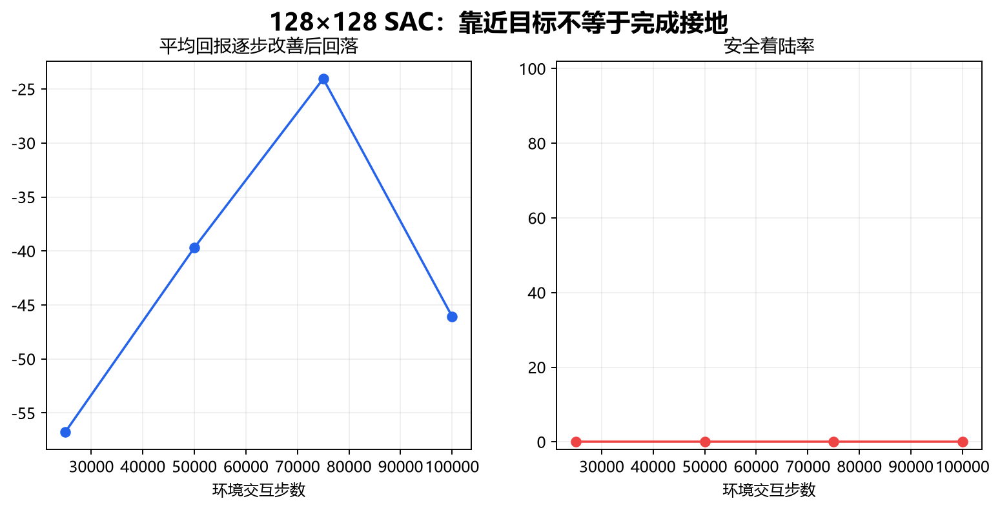
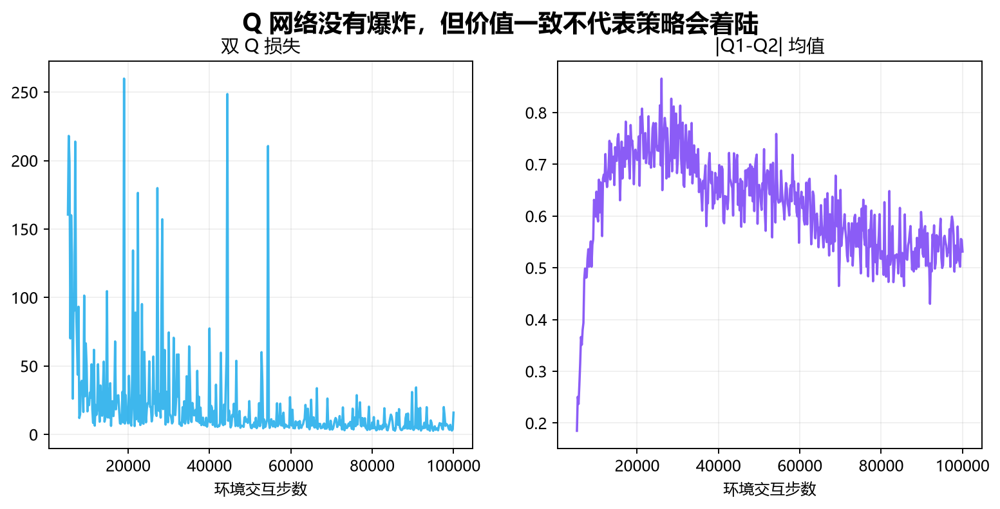
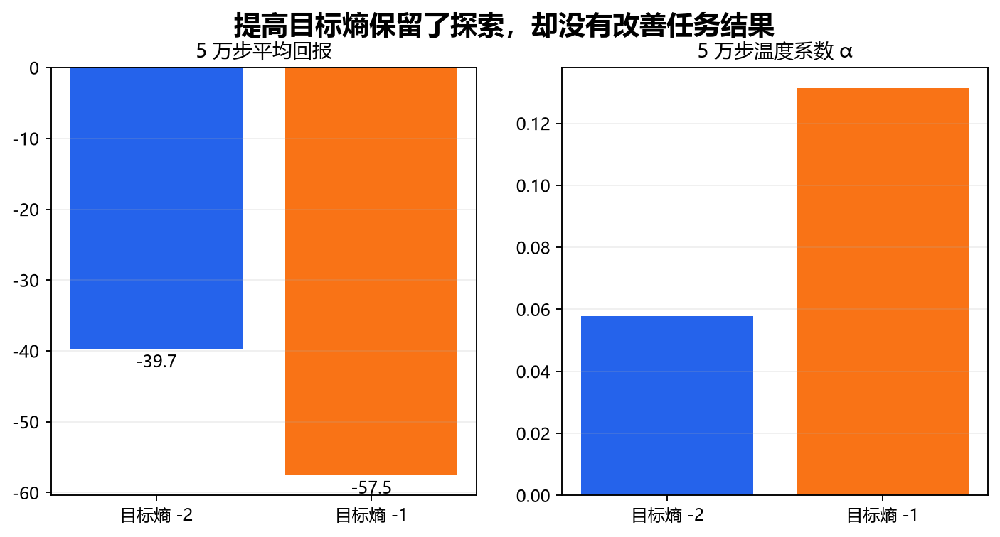

# RL强化学习从小白到老鸟（十六）——网络更大、探索更多，SAC 就一定会着陆吗？


> 本文对应代码：`tutorials/16-lunar-sac-stability/`

上一篇用三随机种子检查 PPO，得到一条 90% 着陆率的成功运行，也看到了另外两个失败种子。
本篇转向 SAC。目标不是换个算法名称继续碰运气，而是分别检查网络容量、更新成本、双 Q 一致性
和自动温度调节到底解决了什么。

## 一、原始 SAC 为什么值得怀疑

第 14 篇直接迁移的 SAC 使用 64×64 Actor 和双 Q 网络。5 万步时最好平均回报为 -11.8，
但没有安全着陆。可能原因包括：

- 八维状态和二维发动机控制需要更强的函数逼近能力；
- 每两步才更新一次，回放数据利用不足；
- 温度系数下降太快，接地前已经失去探索；
- Q 值即使数值稳定，也可能没有见过足够的成功轨迹。

因此本篇为更新日志增加 `|Q1-Q2|`、平均对数概率和温度系数，并把网络宽度做成配置项。

## 二、先做计算成本筛选

第一组尝试使用 256×256 网络，并在每个环境步后更新一次。它更接近常见 SAC 的高容量配置，
但在当前 CPU 上超过三分钟仍未完成 2.5 万步。对于面向初学者、需要跑多个种子的教程，这个
成本不可接受，所以实验被主动停止。

默认配置最终定为：

- Actor、Q1、Q2 都使用 128×128 隐藏层；
- 前 5000 步使用均匀随机动作；
- 之后每两个环境步更新一次；
- 批量大小 256，回放容量 50 万；
- Actor、Critic 和温度学习率统一为 `3e-4`；
- 奖励不缩放，目标网络软更新系数 `0.005`。

这不是追求最快训练，而是在模型容量与普通 CPU 可复现性之间取折中。

## 三、128×128 的训练结果



| 步数 | 平均回报 | 着陆率 | 坠毁率 |
|---:|---:|---:|---:|
| 25k | -56.7 | 0% | 5% |
| 50k | -39.7 | 0% | 0% |
| 75k | -24.1 | 0% | 0% |
| 100k | -46.1 | 0% | 5% |

回报逐步改善到 -24.1，说明策略学会了靠近中心、降低速度并减少直接坠毁。但评估回合大量达到
1000 步上限，安全着陆率始终为 0%。与 PPO 类似，稠密塑形奖励改善并不等于最后接地成功。

## 四、双 Q 没有爆炸，为什么仍然失败



5 万步附近，Q1 与 Q2 的平均绝对分歧约为 `0.66`，两个网络的均值也处于相近范围。Q 损失
有噪声但没有持续单调爆炸。因此这次失败不能简单归因于“双 Q 发散”。

双 Q 取最小值主要抑制高估。它能让价值目标更保守，却不能凭空创造安全接地经验。当回放池
主要由坠毁和超时轨迹组成时，两个 Q 网络可以对这些失败轨迹达成稳定的一致意见。

## 五、保留更多探索有用吗

默认目标熵为动作维度的负数，即 `-2`。训练到 5 万步时，温度系数 α 已从 `0.2` 降到
`0.058`。为了检查策略是否过早确定，第二组实验把目标熵提高到 `-1`，其余设置完全相同。



| 目标熵 | 50k 平均回报 | 着陆率 | α | 双 Q 分歧 |
|---:|---:|---:|---:|---:|
| -2 | -39.7 | 0% | 0.058 | 0.66 |
| -1 | -57.5 | 0% | 0.131 | 0.77 |

目标熵 `-1` 的确把 α 保持在更高水平，证明自动温度机制按预期工作；但任务成绩反而更差，
坠毁率达到 30%。更多探索只是增加动作随机性，并不保证随机动作恰好覆盖精细的接地控制。

## 六、这次实验真正排除了什么

本篇没有得到一个成功 SAC，却排除了三种过于简单的解释：

1. 不是把 64 宽网络改大就会自动着陆；
2. 不是双 Q 数值接近就代表策略正确；
3. 不是让 α 更大、探索更多就一定能发现高质量轨迹。

SAC 的主要瓶颈已经从“代码是否正确、Q 是否爆炸”收窄到“回放池里的轨迹质量”。后续如果
继续推进 LunarLander SAC，优先级应是成功轨迹采集、分阶段任务或示范数据，而不是继续盲调
网络宽度和目标熵。

## 七、为什么不直接跑到 100 万步

延长训练只有在曲线和机制给出合理信号时才值得。当前默认配置 7.5 万步达到最好回报，10 万
步又回落，且从未出现一次安全着陆。直接把同样的实验扩大十倍，只能证明投入了更多计算，
不能识别新的原因。

因此第 16 篇在这里结束：保留完整的失败数据，把 128×128 作为可复现 SAC 基线。下一篇做
公平对照时，会把 PPO 的成功与失败种子、SAC 的回报改善和 0% 着陆放到同一张表里，并复盘
固定危险场景。结论将回答“现阶段哪个算法更值得继续投入”，而不是硬宣布某个算法获胜。

## 运行方式

```powershell
python 月球着陆/train_lunar_sac.py --seed 42 --total-steps 100000 `
  --eval-interval 25000 --eval-episodes 20 `
  --output-dir runs/lunar-sac-stable-128/seed-42

python 月球着陆/benchmark_lunar_sac_stability.py
python 月球着陆/visualize_lunar_sac_stability.py
```

原始报告位于：

- `docs/experiments/16-lunar-sac-stability.json`
- `docs/experiments/16-lunar-sac-stability.csv`

