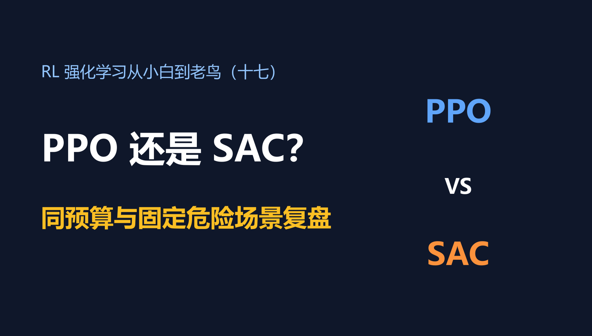
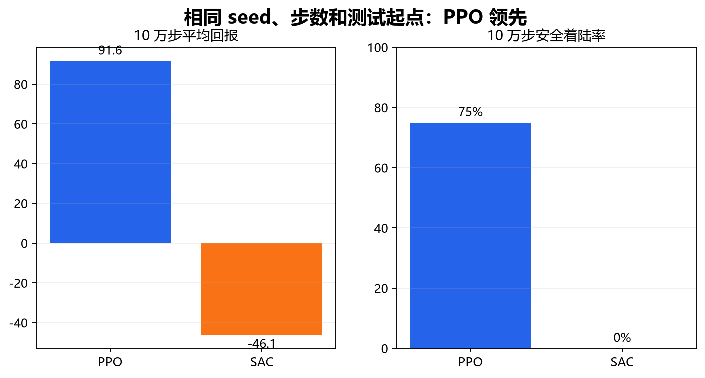
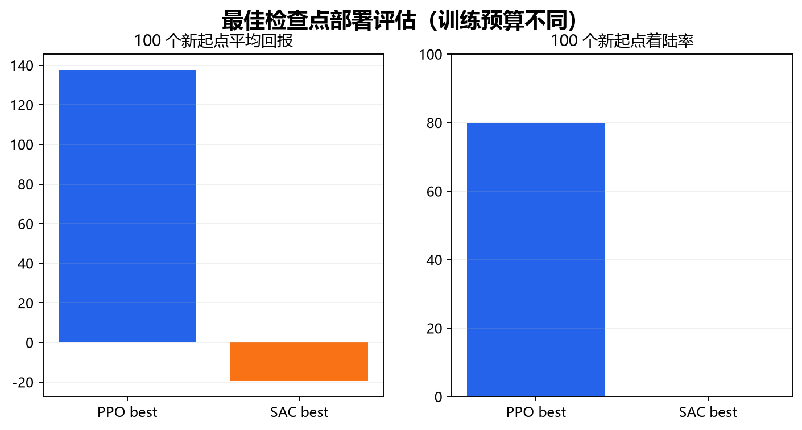
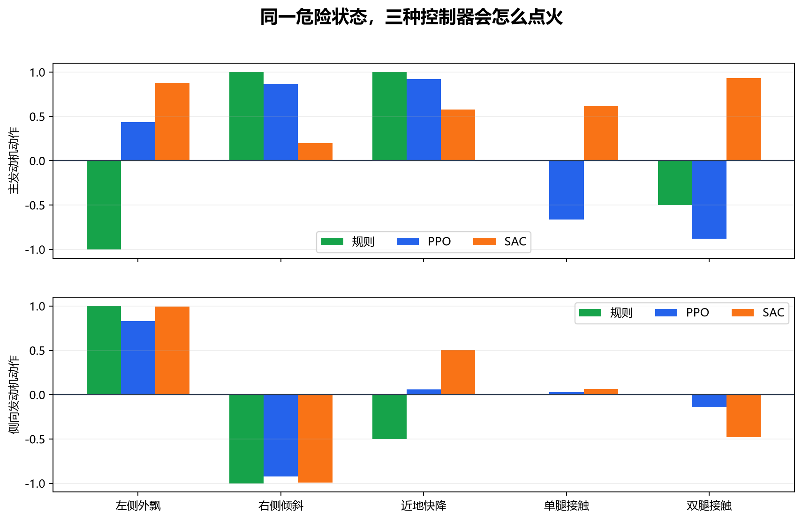

# RL强化学习从小白到老鸟（十七）——PPO 还是 SAC？同预算与固定危险场景复盘



> 本文对应代码：`tutorials/17-lunar-ppo-vs-sac/`

前四篇完成了 LunarLander 环境基线、迁移失败诊断、PPO 稳定化和 SAC 消融。本篇不再继续
调参，而是用两种明确口径回答：在相同训练预算下谁学得更好？各自最好模型面对同一危险状态
时，具体会怎样点火？

## 一、先把两种比较口径分开

算法对照最容易犯的错误，是拿 PPO 的最好模型和 SAC 的最终模型比较，或者双方使用不同测试
起点。本篇严格区分：

### 公平学习效率对照

- 训练种子都是 `42`；
- 都训练 10 万环境步；
- 都在种子 `50000～50019` 的 20 个固定起点上评估；
- 使用训练日志中当时的真实结果。

### 最佳部署模型复盘

- PPO 使用训练过程中平均回报最高的 `best.pt`；
- SAC 同样使用自己的 `best.pt`；
- 在 100 个全新起点 `60000～60099` 上重新评估；
- 明确标注两者训练预算不同，这部分只回答“现在手里的最好模型谁更能用”。

## 二、相同 10 万步，PPO 明显领先



| 算法 | 平均回报 | 着陆率 | 坠毁率 | 平均回合长度 |
|---|---:|---:|---:|---:|
| PPO | 91.6 | 75% | 25% | 737.2 |
| SAC | -46.1 | 0% | 0% | 1000.0 |

PPO 已经在大多数起点完成接地。SAC 很少直接坠毁，却全部运行到时间上限。也就是说，SAC
学到的不是“更安全”，而是“长时间维持飞行但不完成任务”。

这个差异也解释了为什么只看坠毁率会误判：0% 坠毁听起来很好，但若同时是 0% 着陆和 100%
超时，它只是另一种失败。

## 三、最佳检查点能否泛化到新起点



在 100 个训练和调参过程中从未使用的新起点上：

| 最佳模型 | 平均回报 | 着陆率 | 坠毁率 | 超时率 |
|---|---:|---:|---:|---:|
| PPO best | 137.7 | 80% | 15% | 5% |
| SAC best | -19.5 | 0% | 0% | 100% |

PPO 的 80% 表明种子 42 的成功不是只记住 20 个评估起点。它仍有 15% 坠毁，距离可靠控制
还有差距，但已经形成可部署的着陆策略。SAC 平均回报进一步接近 0，却仍全部超时，再次说明
塑形奖励与任务完成率必须同时报告。

## 四、固定危险场景比总分更能解释行为

环境总分告诉我们谁更好，却没有告诉我们为什么。于是本篇构造五个固定状态：

1. 左侧高空并继续向外漂移；
2. 右侧倾斜并快速下降；
3. 近地面快速下降；
4. 单腿已经接触地面；
5. 双腿都已接触地面。

对每个状态，规则控制器、PPO 和 SAC 都只做一次确定性决策。



### 高空纠偏

左侧外飘时，三者都向右点火；右侧倾斜时，三者也都向左纠偏。这说明 SAC 并非完全没有
学会方向控制。

### 近地快速下降

规则控制器主发动机输出 `1.00`，PPO 输出 `0.92`，SAC 只有 `0.58`，同时还给出恰好触发
侧向发动机的 `0.50`。PPO 更接近“先减速、少横移”的接地逻辑。

### 腿部已经接触

差异在这里最明显：

| 场景 | 规则主动作 | PPO 主动作 | SAC 主动作 |
|---|---:|---:|---:|
| 单腿接触 | 0.00 | -0.66 | 0.62 |
| 双腿接触 | -0.50 | -0.88 | 0.93 |

连续环境中，主动作小于等于 0 表示关闭主发动机。规则控制器和 PPO 在接触后都会关机，让
着陆器稳定落下；SAC 在双腿接触时仍以约 97% 实际功率点火。这与 100% 超时完全吻合：它
学会持续托住着陆器，却没有学会“任务已经结束，现在应该停火”。

## 五、为什么本阶段 PPO 更适合继续投入

这个项目里的 PPO 优势不是理论上永远优于 SAC，而是当前证据支持：

- PPO 在相同 10 万步预算下已经形成接地策略；
- 成功检查点能泛化到 100 个新起点；
- 固定场景动作符合减速、纠偏和接触后停火的任务语义；
- SAC 虽然 Q 值稳定、回报改善，却把“延长飞行”学成了局部最优。

因此下一阶段若目标是尽快提高 LunarLander 成功率，应优先在 PPO 上做多环境采样、更多种子
和失败场景再训练。若继续研究 SAC，则应改变数据质量：加入成功示范、课程学习或对接触状态
进行重点采样，而不是继续扩大网络。

## 六、连续控制阶段到这里真正学会了什么

从 MountainCar 到 LunarLander，我们依次看到：

- 动作从离散选择变为连续力度；
- PPO 使用 on-policy Rollout，SAC 使用经验回放与双 Q；
- 同一算法换任务后不会自动成功；
- 平均回报、着陆率、坠毁率和超时率回答不同问题；
- 多随机种子用于检查训练稳定性；
- 固定状态决策用于解释模型到底学会了什么。

本篇之后，LunarLander 项目牵引的主线可以阶段性结束。后续不应再围绕同一环境无限调参，
而应换一个能引入新问题的项目，例如图像观测、稀疏奖励、多智能体或真实设备约束。算法会
重复出现，但每个新项目必须带来新的工程与研究问题。

## 运行方式

```powershell
python 月球着陆/compare_lunar_agents.py
python 月球着陆/visualize_lunar_comparison.py
```

完整数据位于：

- `docs/experiments/17-lunar-ppo-vs-sac.json`
- `docs/experiments/17-lunar-fixed-scenarios.csv`

