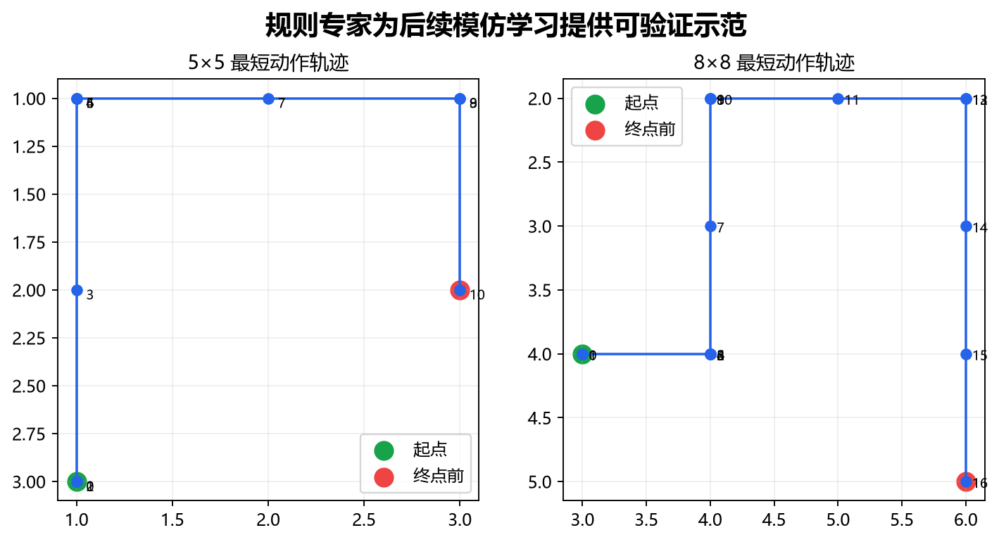
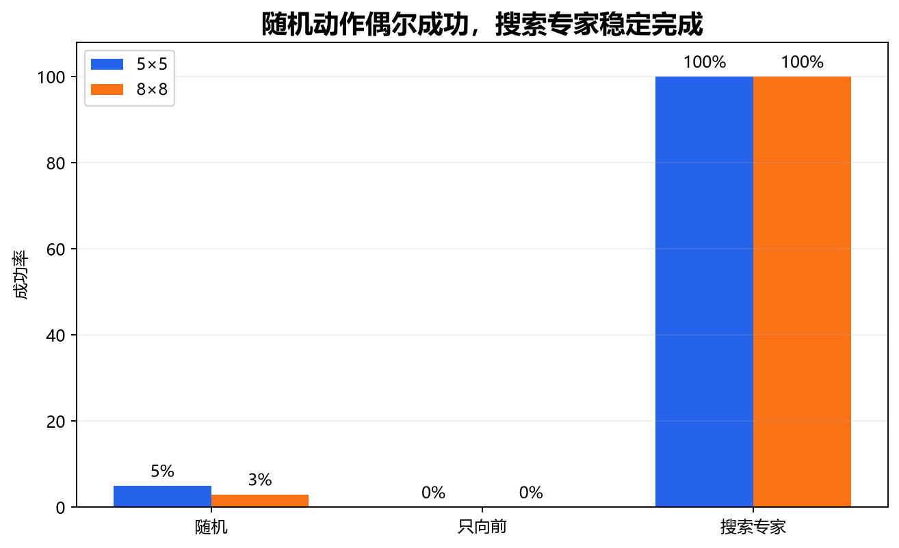
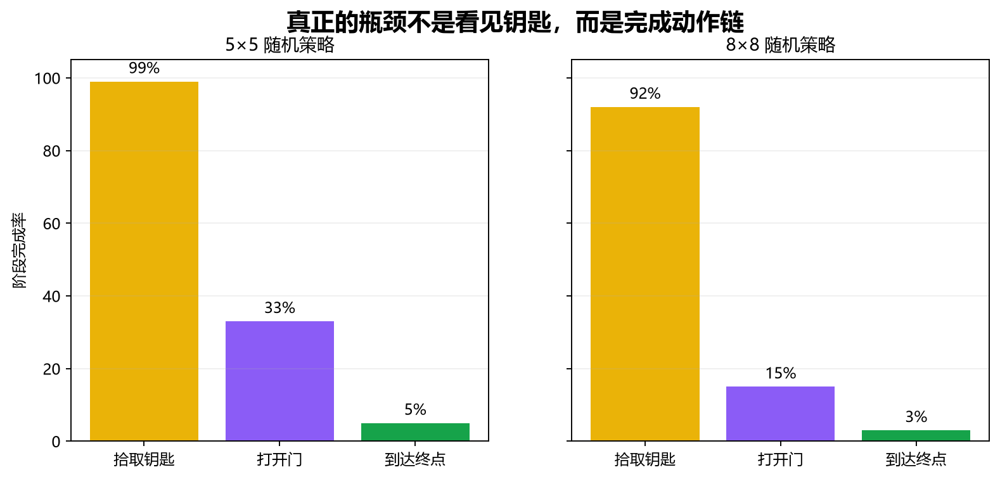

# RL强化学习从小白到老鸟（十八）——门就在眼前，为什么没有钥匙还是过不去？


> 本文对应代码：`tutorials/18-doorkey-baselines/`

连续控制阶段结束后，新项目切换到 MiniGrid DoorKey。智能体需要先找到钥匙、把钥匙捡起来、
走到锁住的门前、开门，最后进入绿色终点。动作重新变为离散，但问题并没有变简单：奖励只在
整条任务链完成后出现，而且智能体默认只能看到周围的局部区域。

## 一、状态、动作和奖励

默认观测是一个字典：

- `image`：`7×7×3` 的局部网格编码；
- `direction`：智能体朝向；
- `mission`：自然语言任务描述。

这里的三个图像通道不是 RGB，而是物体类型、颜色和状态编码。动作空间共有 7 个动作：左转、
右转、前进、拾取、放下、开关物体和结束。DoorKey 实际需要前进、转向、拾取与开门五类动作。

成功奖励为：

```text
1 - 0.9 × 当前步数 / 最大步数
```

失败和超时奖励都是 0。因此走得越短，成功奖励越高；但在成功之前，智能体几乎得不到方向
提示。

## 二、为什么要先写规则专家

规则专家能够验证三件事：环境接口正确、任务确实可解、评估指标没有写反。本篇专家读取完整
网格，并在以下状态上做广度优先搜索：

```text
(横坐标, 纵坐标, 朝向, 是否持有钥匙, 门是否打开)
```

搜索器严格执行环境语义：钥匙没有拾取前不能穿过钥匙格；锁门未打开前不能穿门；只有钥匙在
正前方才能拾取，只有持有钥匙且门在正前方才能开门。它不是直接修改环境状态，而是生成一串
合法动作，再逐步交给环境执行。



这个专家还会在第 23 篇提供行为克隆示范，因此它必须从一开始就可验证、可复现。

## 三、三种基线

本篇比较：

- 随机策略：7 个动作均匀采样；
- 只向前：永远执行前进，用于验证“动作不变化”的下限；
- 搜索专家：使用最短合法动作序列。

每种策略在 5×5 和 8×8 地图各运行 100 个相同随机种子。



| 地图 | 策略 | 成功率 | 平均步数 | 平均回报 |
|---|---|---:|---:|---:|
| 5×5 | 随机 | 5% | 246.8 | 0.0167 |
| 5×5 | 只向前 | 0% | 250.0 | 0 |
| 5×5 | 专家 | 100% | 9.8 | 0.9648 |
| 8×8 | 随机 | 3% | 636.4 | 0.0080 |
| 8×8 | 只向前 | 0% | 640.0 | 0 |
| 8×8 | 专家 | 100% | 16.8 | 0.9764 |

随机策略不是绝对无法成功，但成功率低且绝大多数回合耗尽步数。专家在两种尺寸上全部完成，
也证明任务生成和搜索器在不同布局下工作正常。

## 四、随机策略到底卡在哪里

只报告成功率会丢失大量信息。本项目额外记录三个里程碑：是否捡到钥匙、是否打开门、是否
到达终点。



| 地图 | 捡到钥匙 | 打开门 | 到达终点 |
|---|---:|---:|---:|
| 5×5 | 99% | 33% | 5% |
| 8×8 | 92% | 15% | 3% |

随机策略很容易在漫长回合中碰巧捡起钥匙，真正困难的是把“已经持有钥匙”与“走到门前执行
开门”联系起来；开门以后还要继续寻找终点。任务难点不是单个动作，而是跨时间保持任务阶段。

## 五、这对后续算法意味着什么

DoorKey 同时包含三类问题：

1. 稀疏奖励：失败回合几乎没有学习信号；
2. 部分可观测：钥匙和门离开视野后，当前画面不包含完整历史；
3. 长动作链：拾取、开门和到达终点必须按正确顺序发生。

下一篇先暂时移除“看不全”这个难点，让智能体观察完整地图，并训练一个全局状态 DQN。这样
可以把问题拆开：如果完整地图都学不会，问题主要在稀疏奖励与规划；如果完整地图能学会而
局部观测失败，差异才真正来自感知和记忆。

## 运行方式

```powershell
python 迷你网格/benchmark_doorkey_baselines.py
python 迷你网格/visualize_doorkey_baselines.py
```

实验数据保存在：

- `docs/experiments/18-doorkey-baselines.json`
- `docs/experiments/18-doorkey-baselines.csv`

