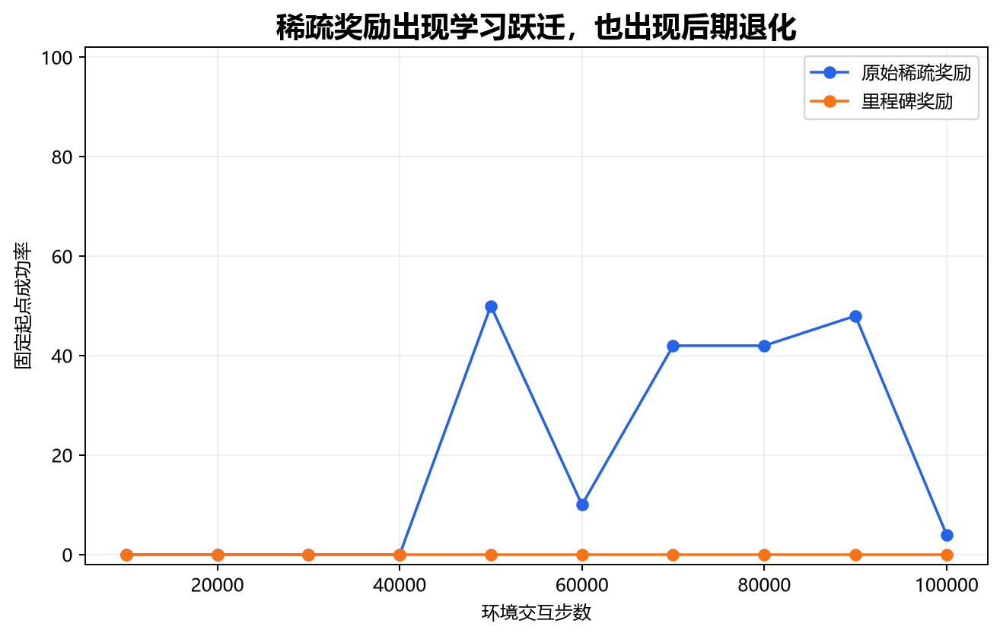
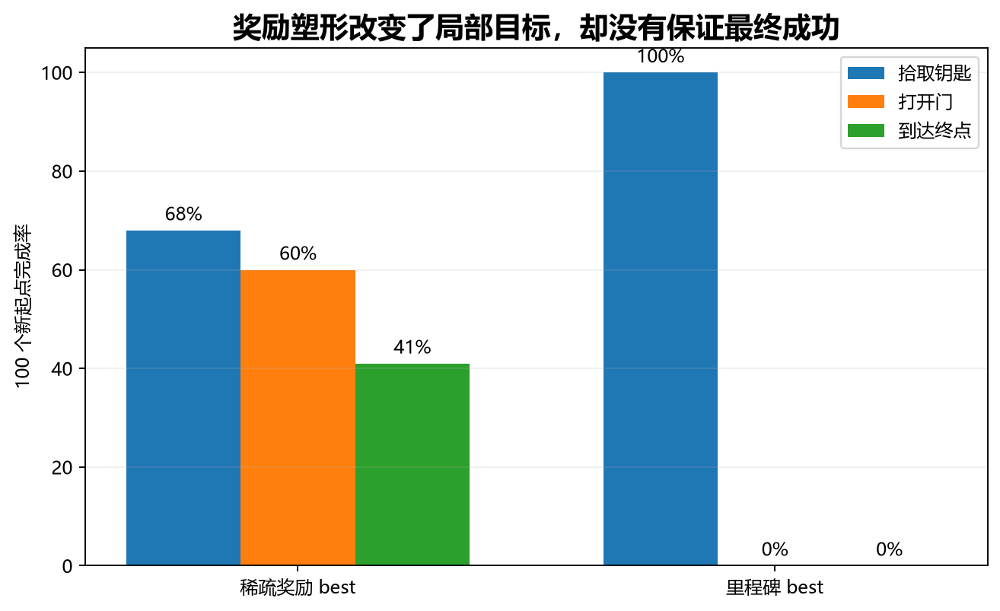

# RL强化学习从小白到老鸟（十九）——看见完整地图，DQN 就能稳定学会开门吗？


> 本文对应代码：`tutorials/19-full-observation-dqn/`

第十八篇证明了 DoorKey 可解。本篇先把局部观测换成完整地图，只保留稀疏奖励与长动作链，
用 Double DQN 结构验证规划能力。

## 结果



原始稀疏奖励在 5 万步评估达到 50%，随后波动；最佳检查点在 100 个新起点上成功率 41%。
这说明完整地图确实让 DQN 找到了成功轨迹，但最终模型并不稳定。

| 奖励 | 最佳阶段 | 新起点成功率 | 拾钥匙 | 开门 |
|---|---:|---:|---:|---:|
| 稀疏奖励 | 50k | 41% | 68% | 60% |
| 里程碑奖励 | 10k | 0% | 100% | 0% |



里程碑奖励的反例很有价值：它让智能体稳定学会捡钥匙，却没有学会继续走到门前。奖励塑形
改变了局部目标，并没有自动提供正确的任务顺序。

## 结论

完整地图解决了感知遮挡，却没有解决稀疏奖励、经验分布和策略退化。下一篇切回局部观测，
比较真正的部分可观测影响。

## 运行

```powershell
python 迷你网格/train_doorkey_dqn.py --reward-mode sparse --total-steps 100000
python 迷你网格/benchmark_doorkey_dqn.py
```
