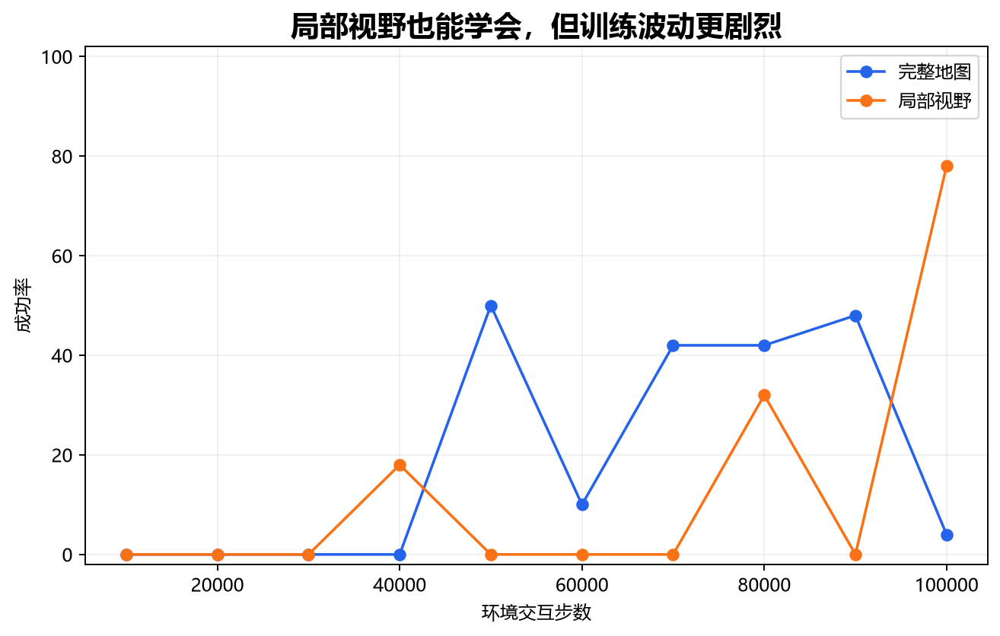
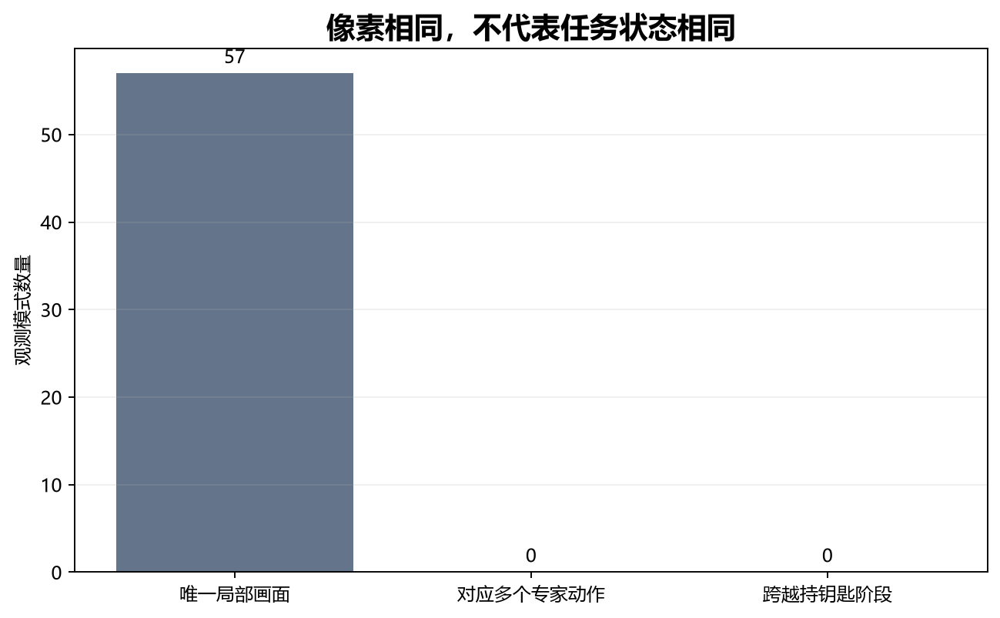

# RL强化学习从小白到老鸟（二十）——视野缩小以后，同一画面可能需要不同动作


> 本文对应代码：`tutorials/20-partial-observation/`

这次只改变观测：从完整地图改成 MiniGrid 默认的 `7×7` 局部网格，网络和稀疏奖励保持一致。

## 一个反直觉结果

局部 DQN 的最佳检查点在 100 个新起点上成功率达到 78%，高于完整地图 DQN 的 41%。这不
意味着局部观测包含更多信息，而是固定朝向的局部编码更容易让卷积网络学习“附近物体—动作”
关系；完整地图输入反而增加了无关位置。



但局部训练曲线在 4 万、8 万和 10 万步之间剧烈波动，说明成功策略并不稳定。

## 观测别名

在 500 个 8×8 专家回合中，收集到 1633 种局部画面，其中 48 种画面对应多个专家动作，
动作别名率约 2.9%。单帧画面不能完整表达地图位置和任务阶段。



因此下一篇加入 GRU，并比较“拥有记忆结构”和“学会使用记忆”之间的差距。

## 运行

```powershell
python 迷你网格/train_doorkey_dqn.py --observation-mode compact_partial --total-steps 100000
python 迷你网格/benchmark_partial_observation.py
```
