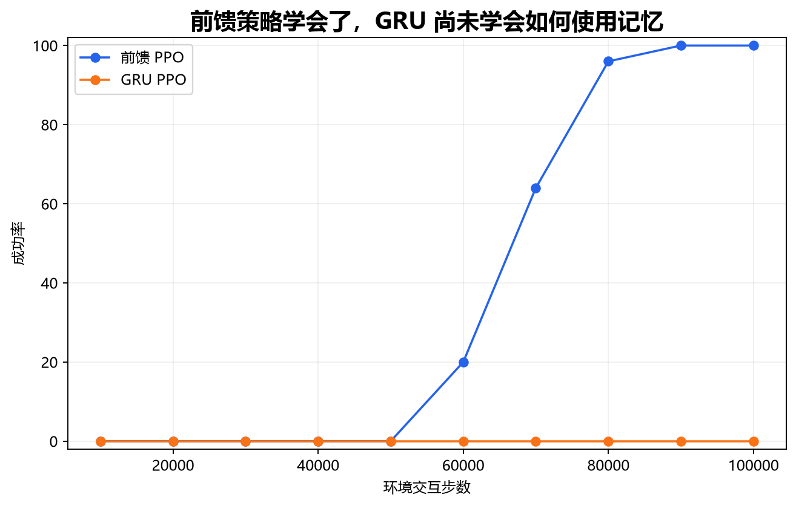
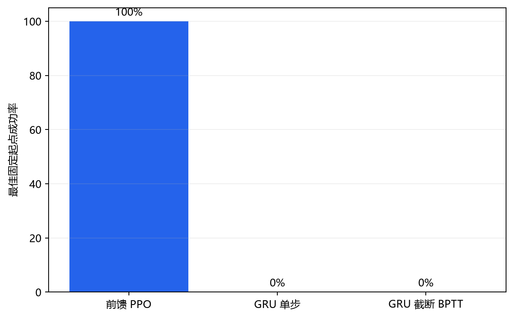

# RL强化学习从小白到老鸟（二十一）——记忆不是自动学会的：GRU 与 PPO 对照


> 本文对应代码：`tutorials/21-memory-ppo/`

第 20 篇找到了局部观测的别名。本篇把前馈策略换成 GRU，并实现 32 步截断反向传播。

## 对照结果



在 5×5、10 万步、相同种子下：

| 模型 | 最佳成功率 | 最终成功率 |
|---|---:|---:|
| 前馈 PPO | 100% | 100% |
| GRU 单步更新 | 0% | 0% |
| GRU 32 步截断 BPTT | 0% | 0% |

前馈 PPO 已经能在 5×5 地图上形成反应式策略，因此记忆不是小地图成功的必要条件。GRU 也
没有因为拥有隐藏状态就自动获得任务记忆；稀疏奖励没有告诉它哪些历史应该保留。



## 工程代价

前馈 PPO 可以把样本打乱成独立小批次；GRU 必须按连续片段更新，并在回合结束时重置隐藏状态。
训练速度下降，优化难度上升。记忆结构是解决更大地图的能力条件，不是成功保证。

## 运行

```powershell
python 迷你网格/train_doorkey_ppo.py --total-steps 100000
python 迷你网格/train_doorkey_ppo.py --recurrent --total-steps 100000
python 迷你网格/benchmark_memory.py
```
