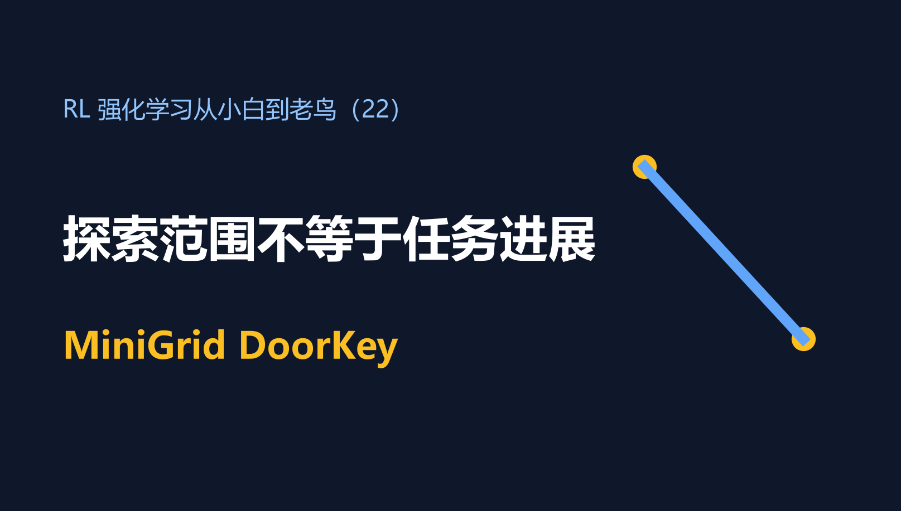
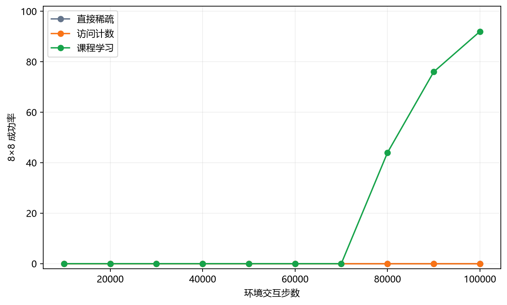

# RL强化学习从小白到老鸟（二十二）——探索范围不等于任务进展：课程学习解决稀疏奖励



> 本文对应代码：`tutorials/22-curriculum-exploration/`

直接把 5×5 的 DoorKey 换成 8×8 后，前馈 PPO 在 10 万步内成功率为 0%。实验比较原始稀疏
奖励、访问计数奖励和课程学习。

## 三种配置

- 直接 8×8：从困难地图开始；
- 访问计数：对首次访问位置增加小奖励；
- 课程学习：前 60% 步数训练 5×5，中间 20% 训练 6×6，最后 20% 训练 8×8。



| 配置 | 10 万步最佳 8×8 成功率 |
|---|---:|
| 直接稀疏奖励 | 0% |
| 访问计数奖励 | 0% |
| 课程学习 | 92% |

访问计数鼓励“去过更多地方”，却没有表达钥匙—门—终点的顺序；课程学习先让策略获得完整
动作链，再逐渐增加布局难度，所以迁移成功。

## 课程学习解决的是什么

课程学习让成功经验更早出现，并在后续难度中继续复用；单纯增加随机探索没有形成完整动作链。

## 运行

```powershell
python 迷你网格/train_doorkey_ppo.py --size 8 --curriculum --total-steps 100000
python 迷你网格/benchmark_exploration.py
```
