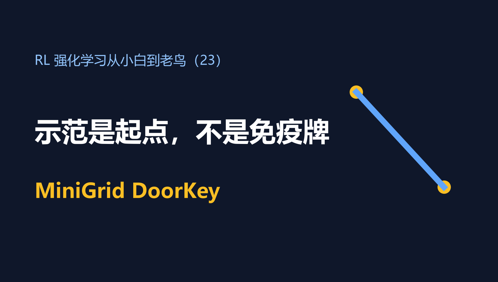
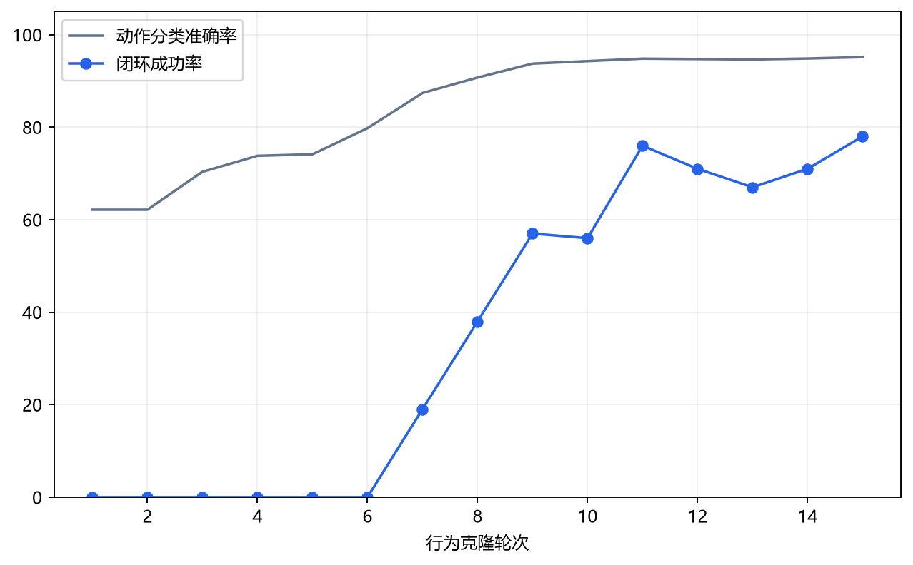
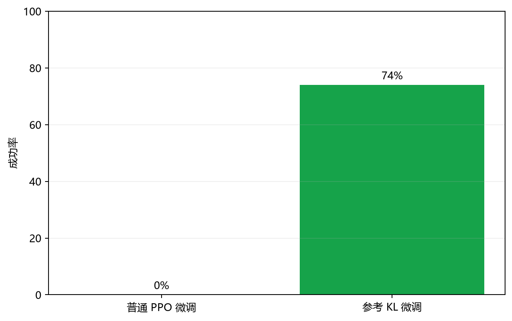

# RL强化学习从小白到老鸟（二十三）——示范是起点，不是免疫牌：行为克隆与保守微调



> 本文对应代码：`tutorials/23-imitation-ppo/`

第 22 篇用课程学习解决了 8×8 稀疏奖励。这里利用第 18 篇的搜索专家生成 1000 条轨迹，
先做行为克隆，再尝试 PPO 微调。

## 分类准确率不是闭环成功率

行为克隆第 15 轮验证动作准确率达到 95.1%，100 个新起点成功率为 78%。准确率提高过程中，
成功率并不单调，因为一个关键的拾取或开门动作错误就会让整局失败。



## 普通微调会遗忘

加载行为克隆检查点后，使用默认 PPO 学习率微调，5000 步成功率跌到 0%。即使降低学习率并
关闭熵奖励，仍会迅速退化。稀疏回报批次里没有足够成功样本，策略梯度会破坏专家已经学会的
动作。

加入参考策略 KL 约束后，2 万步成功率仍保持 74%。



示范后的强化学习需要显式的策略保持约束、混合专家数据或 DAgger，避免分布偏移和灾难性遗忘；
直接接上普通 PPO 在本实验中会迅速破坏已有策略。

## 运行

```powershell
python 迷你网格/train_doorkey_imitation.py --size 8
python 迷你网格/benchmark_imitation.py
```
