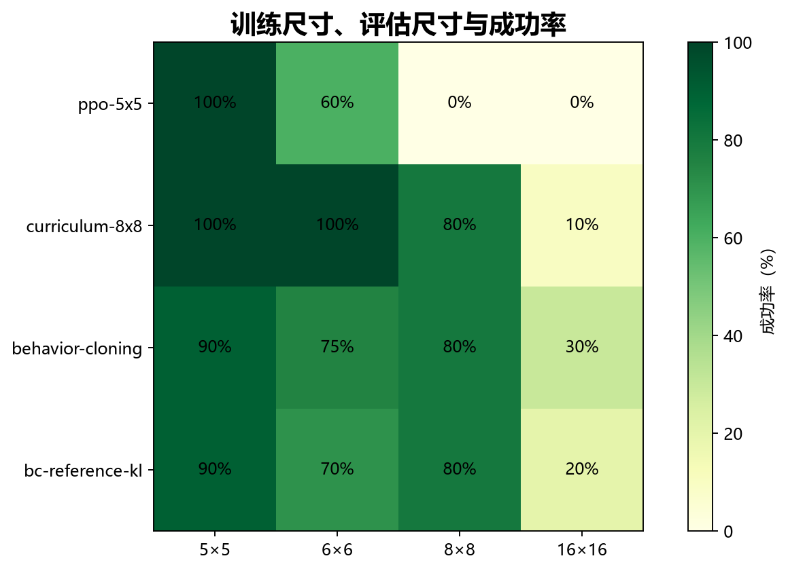
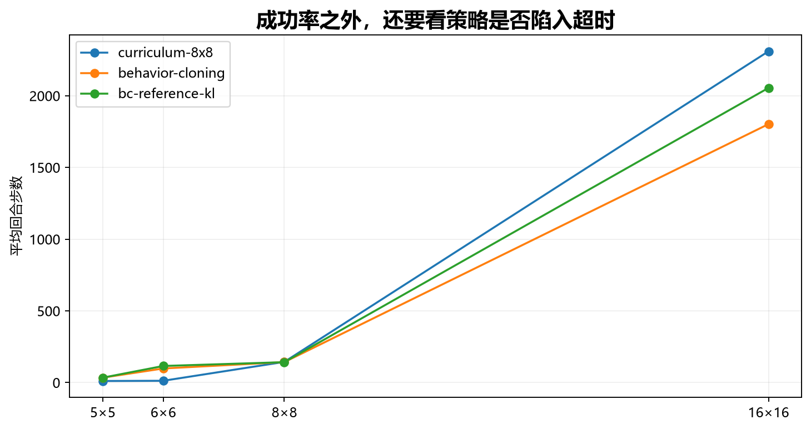

# RL强化学习从小白到老鸟（二十四）——训练成功不等于泛化成功：DoorKey 跨尺寸评估


> 本文对应代码：`tutorials/24-generalization/`

前面几篇都在固定地图尺寸上报告成功率。本篇把训练和评估尺寸彻底分开，在 5×5、6×6、8×8、
16×16 上使用未参与训练的随机种子测试。

## 泛化矩阵



| 模型 | 5×5 | 6×6 | 8×8 | 16×16 |
|---|---:|---:|---:|---:|
| 5×5 PPO | 100% | 60% | 0% | 0% |
| 8×8 课程 PPO | 100% | 100% | 80% | 10% |
| 8×8 行为克隆 | 90% | 75% | 80% | 30% |
| 参考 KL 微调 | 90% | 70% | 80% | 20% |

课程模型在训练尺寸 8×8 上最稳定；行为克隆在 16×16 上反而保留了更高成功率，说明专家数据
覆盖了更丰富的动作组合。任何模型都没有自动泛化到 16×16。

## 评估协议的重要性

只报告训练尺寸上的成功率，会把“记住布局分布”误认为“学会任务”。真正的泛化报告至少要
包含：未见随机种子、未见地图尺寸、成功率、回合长度和超时率。



## 连续控制主线后的方法论

到这里，MiniGrid 主线完成了从环境基线、全局 DQN、局部观测、GRU、课程学习、行为克隆到
跨尺寸泛化的闭环。下一阶段可以切换到图像输入、真正的稀疏奖励探索、多智能体协作或真实
设备约束；继续堆叠 DoorKey 调参的边际收益已经很低。

## 运行

```powershell
python 迷你网格/benchmark_doorkey_generalization.py
python 迷你网格/visualize_doorkey_generalization.py
```
