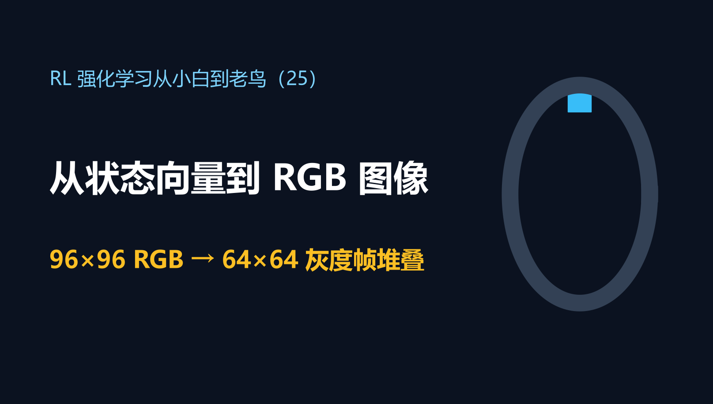
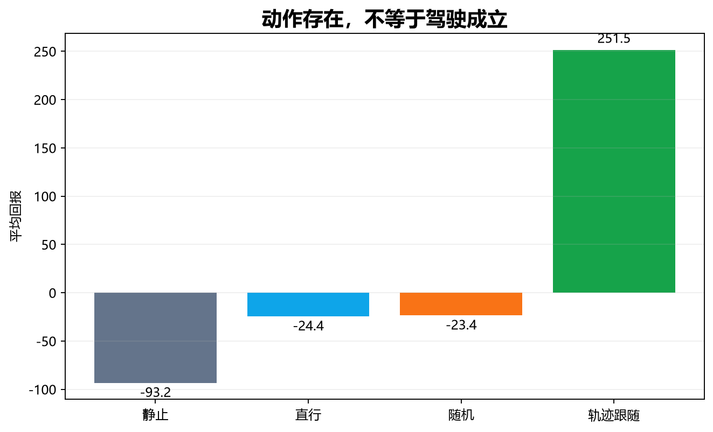
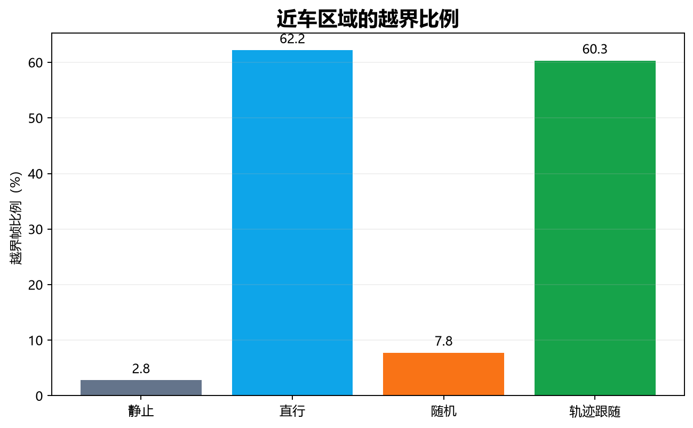
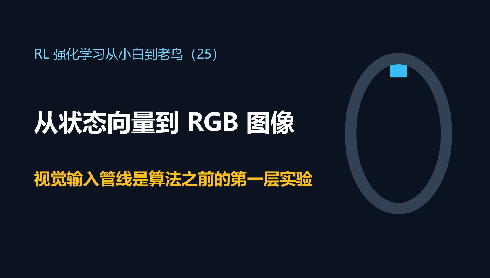

# 从状态向量到 RGB 图像：先把 CarRacing 的视觉输入管线搭对



上一阶段的 DoorKey 虽然已经涉及局部观测，但网络看到的仍然是经过编码的物体类别。现在把输入换成原始像素：`CarRacing-v3` 每一步返回一张 `96×96×3` 的 RGB 图片，智能体还要同时输出方向、油门和刹车。

这篇先不急着比较算法。图像强化学习中，裁剪、缩放、帧跳过和评价口径都会直接改变任务。输入管线没有固定下来，后面的 DQN 与 PPO 对照就没有意义。

## 1. 为什么不能直接把原图塞进网络

原图底部包含仪表盘。仪表盘能提供速度信息，却也可能让网络记住界面颜色，而不是理解赛道。为了让实验重点落在道路几何上，本系列统一采用以下处理：

1. 保留图像上方 84 行，去掉 HUD；
2. 缩放为 `64×64`；
3. 默认转为灰度图；
4. 每个决策重复执行 4 个物理步；
5. 默认堆叠最近 4 帧。

处理后的观测形状为 `4×64×64`。数据范围固定在 `[0, 1]`，通道放在最前面，可以直接输入 PyTorch 的卷积层。

```python
cropped = frame[:84]
resized = cropped[y_index][:, x_index].astype(np.float32) / 255.0
gray = np.dot(resized[..., :3], [0.299, 0.587, 0.114])
observation = gray[None]
```

这里使用确定性的最近邻采样，而不是额外依赖 OpenCV。它不是画质最好的办法，却让教程安装更简单、测试结果也更容易复现。

## 2. 帧跳过改变了“训练步数”的含义

本系列中的一个训练步指一次策略决策。由于 `frame_skip=4`，一次决策会推进最多 4 个模拟器物理步。因此正式实验的 10,000 个决策步大约对应 40,000 个环境物理步。

这个区别必须写进实验记录，否则一个使用帧跳过的 10,000 步实验，不能与逐帧决策的 10,000 步实验直接比较。

## 3. 连续动作如何映射

CarRacing 的三个动作维度范围并不相同：

- 转向：`[-1, 1]`
- 油门：`[0, 1]`
- 刹车：`[0, 1]`

PPO 策略统一输出 `[-1, 1]`，环境包装器再把后两个维度映射到 `[0, 1]`。这样高斯策略可以用同一套 `tanh` 压缩处理全部动作，又不会向环境发送越界值。

## 4. 四种不学习的策略

在训练神经网络之前，我固定 5 条赛道，测试了四种基线：静止、只向前、随机动作和读取模拟器轨迹点的局部跟随器。最后一种策略拥有普通智能体看不到的信息，所以只能作为“任务确实可解”的特权参照，不能冒充视觉算法。



实验结果如下：

| 策略 | 平均回报 | 成功率 | 平均决策步数 |
|---|---:|---:|---:|
| 静止 | -93.2 | 0% | 250.0 |
| 直行 | -24.4 | 0% | 57.4 |
| 随机动作 | -23.4 | 0% | 250.0 |
| 特权局部跟随 | 251.5 | 60% | 250.0 |

“直行”比静止回报高，不代表它学会了驾驶。它只是在冲出赛道前碰到了少量奖励。随机策略也会偶然经过赛道块，因此单看回报大于静止基线仍然不够。



越界率是在车辆附近的图像区域中估计绿色地面占比得到的诊断指标。它不是环境的官方状态，也不是训练奖励，只用于解释行为。直行策略很快离开赛道；轨迹跟随器虽然能取得正回报，但在急弯处仍有明显越界，说明它也不是完美专家。

## 5. 评价口径从一开始就固定

后续所有模型都报告同一组指标：

- 环境原始回报，而不是塑形后的训练奖励；
- 回报达到 200 的比例；
- 越界帧比例；
- 相邻动作的平均变化量；
- 固定未见种子上的均值与尾部表现。

训练奖励可以变化，最终评价口径不能跟着模型变化。否则奖励塑形版本可能只是在自己的计分规则下显得更好。

## 6. 输入管线先于算法



像素强化学习的第一个问题不是选 DQN 还是 PPO，而是明确网络究竟看到了什么、一次“步”推进了多久，以及最后按照什么标准评价。

下一篇将在完全相同的 Double DQN 配置下比较单帧与 4 帧堆叠。车辆的位置可以从一张图里看出来，但速度与运动方向未必可以。

完整代码位于 `视觉驾驶/carracing_env.py`，原始结果位于 `docs/experiments/25-visual-baselines.json`。
