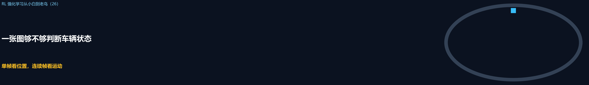
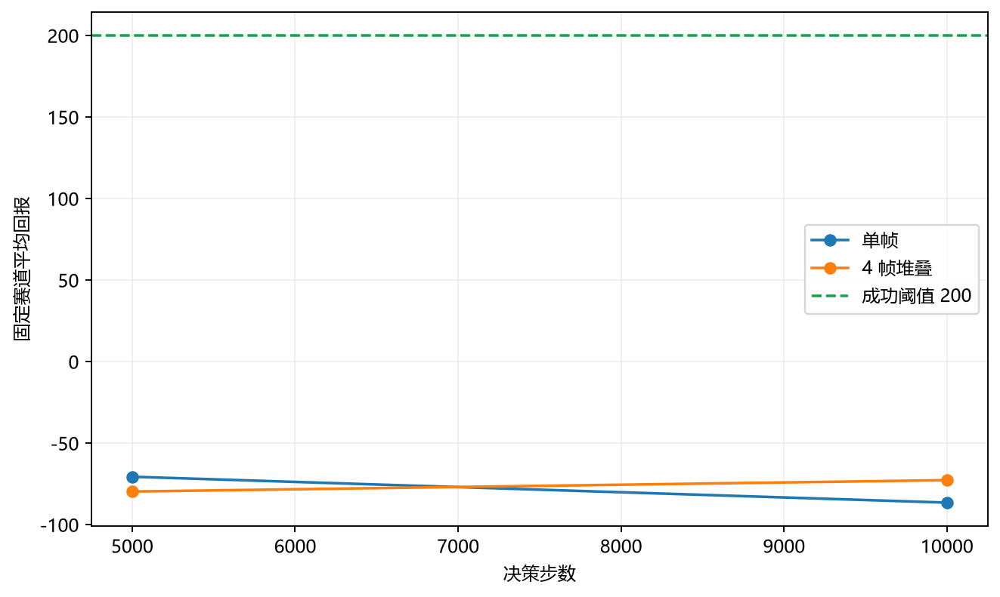
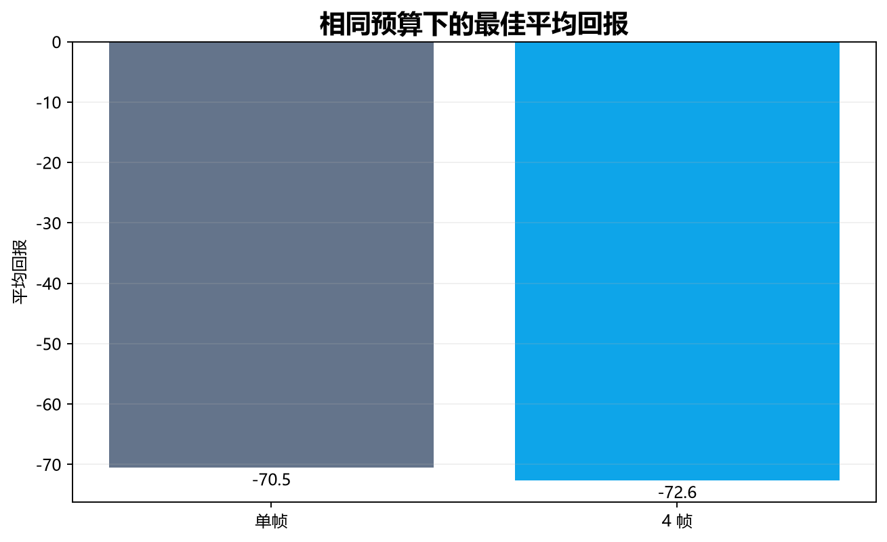
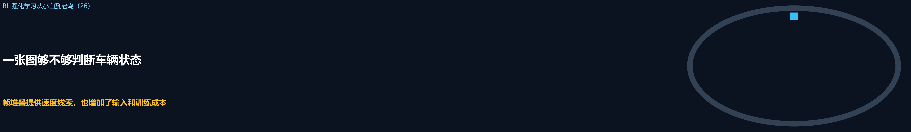

# 一张图够不够判断车辆状态：单帧与 4 帧堆叠对照



一张驾驶画面能够告诉我们车辆在哪里，却很难直接告诉我们车辆正在向哪个方向滑、速度是多少。这个问题不是卷积网络层数不够，而是单帧观测本身缺少时间信息。

本篇不更换算法，只给视觉 Double DQN 两种输入：

- 单帧：`1×64×64`
- 4 帧堆叠：`4×64×64`

训练预算均为 10,000 个决策步，动作集、随机种子、评估赛道和超参数保持一致。

## 1. 相同画面不一定对应相同动作

车辆位于直道中央时，单张画面可能几乎相同，但实际状态可能完全不同：一辆车正在稳定前进，另一辆车可能正以横向速度向赛道外滑。前者应该保持油门，后者应该反打方向甚至减速。

这与 DoorKey 中的观测别名是同一个问题：观测相同，不代表隐藏状态相同。区别是 DoorKey 缺少地图外信息，CarRacing 缺少运动历史。

4 帧堆叠没有显式计算光流，而是让卷积网络自己比较连续画面。代价也很直接：第一层卷积的输入通道数变为 4，回放缓存中每条状态占用的空间同样扩大。

## 2. 为什么仍然使用 Double DQN

这一篇的实验问题是“时间信息是否重要”，不是“哪种算法最强”。因此继续使用同一个 9 动作 Double DQN：

```text
静止、左转、右转、加速、
左转加速、右转加速、刹车、
左转刹车、右转刹车
```

经验回放中的图像以 `uint8` 保存，采样时再恢复到 `[0,1]`，避免 4 帧版本的内存占用扩大四倍后继续使用 `float32`。

## 3. 固定评估结果



单帧在 5,000 步取得本次最佳平均回报 -70.5，继续训练到 10,000 步反而降至 -86.4；此时越界率很低，但原因是策略接近停止，而不是驾驶更稳。4 帧版本从 -79.6 改善到 -72.6，仍没有超过随机策略的 -23.4。短预算下，额外时间信息并没有转化为更高成绩。

| 输入 | 最佳评估步数 | 最佳平均回报 | 成功率 |
|---|---:|---:|---:|
| 单帧 | 5,000 | -70.5 | 0% |
| 4 帧堆叠 | 10,000 | -72.6 | 0% |



这里需要避免一个常见误解：帧堆叠提供了更多信息，但不保证在短预算下成绩更高。输入维度增加后，网络需要更多数据才能学会利用帧间差异。如果两者都没有学会，结论应该是“当前预算不足以验证优势”，而不是强行宣布某一种结构胜出。

## 4. 为什么不用循环网络

GRU 或 LSTM 可以压缩更长历史，但会同时引入隐藏状态初始化、截断反向传播和序列采样。第 21 篇已经看到，拥有记忆结构不等于学会使用记忆。

帧堆叠的优势是实验变量更少：网络每次看到固定长度的图像张量，回放缓存仍然可以随机采样单条转移。这使它更适合成为视觉控制的第一种时间表示。

## 5. 本篇结论



单帧更省内存、更容易优化；4 帧输入提供运动方向和速度线索，却增加了样本复杂度。是否值得使用，必须在相同预算与相同测试赛道上比较，而不能只凭“信息更多”推断结果。

下一篇将在 4 帧输入上专门拆解离散 Double DQN：为什么动作离散化让经验回放变得简单，又为什么它给精细驾驶设置了上限。
