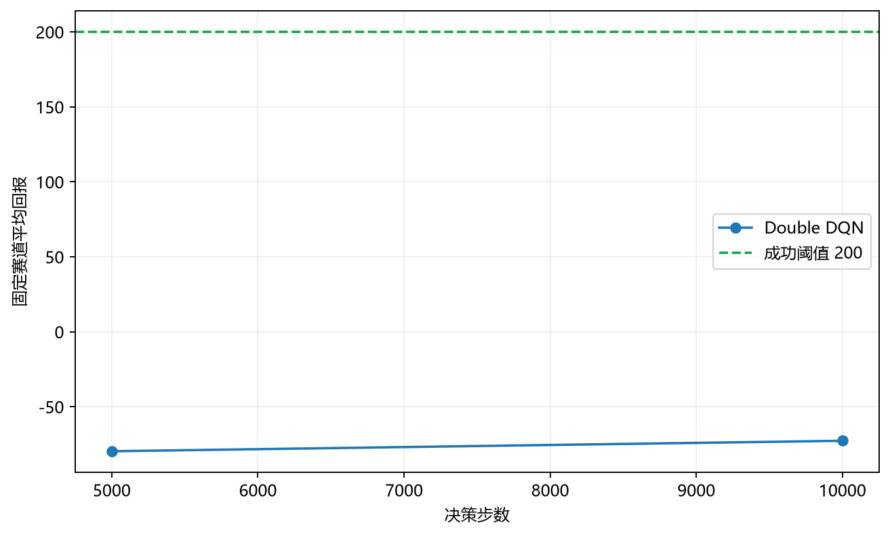
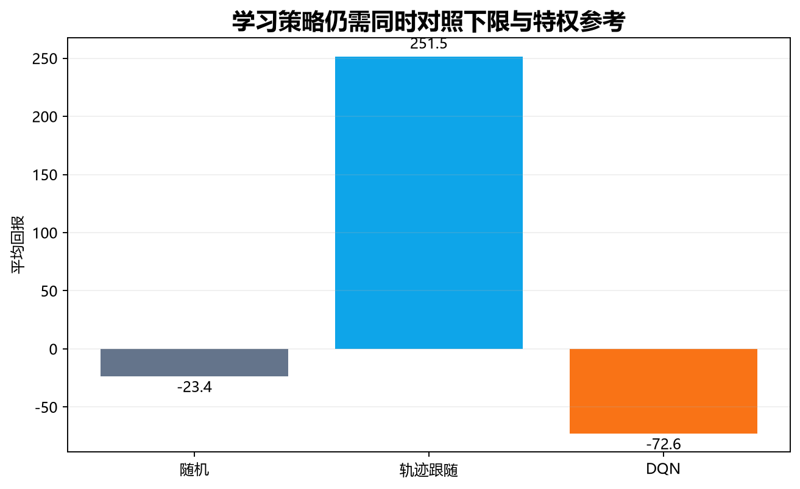
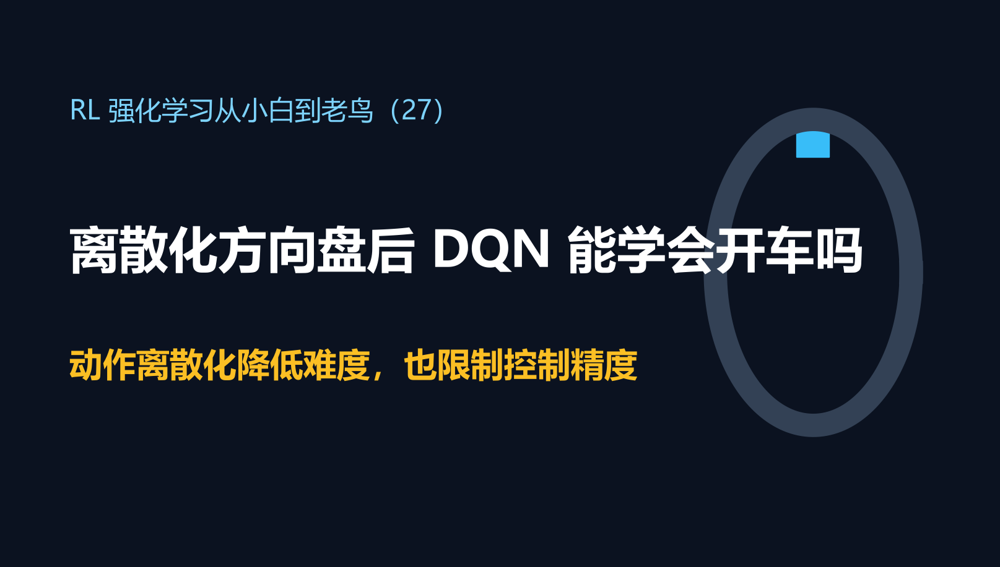

# 离散化方向盘后，DQN 能学会开车吗


CarRacing 原本是连续动作任务。为了复用 DQN，我们先把方向、油门和刹车组合成 9 个离散动作。这样做把“输出三个连续控制量”变成“从九个按钮中选一个”，同时也把控制精度限制在预先设计的动作格点上。

## 1. 九个动作如何设计

动作集覆盖四类必要行为：保持、转向、加速和制动，并加入转向与纵向控制的组合。没有为每个维度简单划分多个档位后做笛卡尔积，因为 `5×5×5` 会立刻产生 125 个动作，大量组合还没有驾驶意义。

动作数量过少时，策略只能在“完全左转”和“完全右转”之间抖动；动作数量过多时，每个动作获得的经验太少。九个动作是一种教学折中，不是理论最优答案。

## 2. 卷积 Double DQN

网络先用三层卷积把 `4×64×64` 的帧堆叠编码为 256 维特征，再为每个动作输出一个 Q 值。目标值采用 Double DQN：

```text
a* = argmax_a Q_online(s', a)
y  = r + γ Q_target(s', a*)
```

在线网络选择动作，目标网络评价动作，避免同一个带噪估计同时承担选择与评价。

经验回放容量为 30,000 条转移，先收集 2,000 步再开始更新；每 1,000 步同步目标网络。探索率从 1.0 线性下降到 0.05。

## 3. 训练结果



4 帧 Double DQN 从 5,000 步的 -79.6 改善到 10,000 步的 -72.6，但依旧落后于随机策略。固定评估中的动作变化量只有 0.048，没有出现剧烈左右抖动；策略仍未建立足够的赛道进度，低动作变化也可能只是长期维持同一错误动作。

最佳检查点位于第 10,000 步，固定赛道平均回报为 -72.6，成功率为 0%。



对照基线能够帮助我们判断成绩的含义：随机策略平均回报约为 -23.4，而读取轨迹点的特权局部跟随器约为 251.5。DQN 如果只超过静止策略，却没有稳定超过随机策略，就不能说它学会了沿赛道驾驶。

## 4. 离散动作的结构性限制

即使 Q 值完全正确，离散动作也存在三个限制：

1. 转向档位固定，弯道半径与动作格点不匹配时容易左右切换；
2. 油门与刹车组合由人预先规定，网络无法选择中间力度；
3. 增加动作精度会扩大 Q 网络输出和探索空间。

动作抖动不是单纯的视觉识别错误，也可能来自控制接口本身。后面的可靠性评估会把相邻动作变化量单独报告。

## 5. 负结果同样回答了问题

像素 DQN 同时学习视觉特征、赛道进度和九个动作的长期价值。在 CPU 低预算实验中，没有达到 200 分成功阈值并不意外。重要的是保留固定评估曲线，说明它究竟没有超过随机、只学会短期前进，还是已经能完成部分赛道。

## 6. 离散化的代价



动作离散化让 DQN 可以处理驾驶任务，但它不是免费的转换。我们用更简单的价值学习换来了控制精度上限。下一篇将保持相同视觉输入，改用连续动作 PPO，直接学习转向、油门和刹车的分布。
