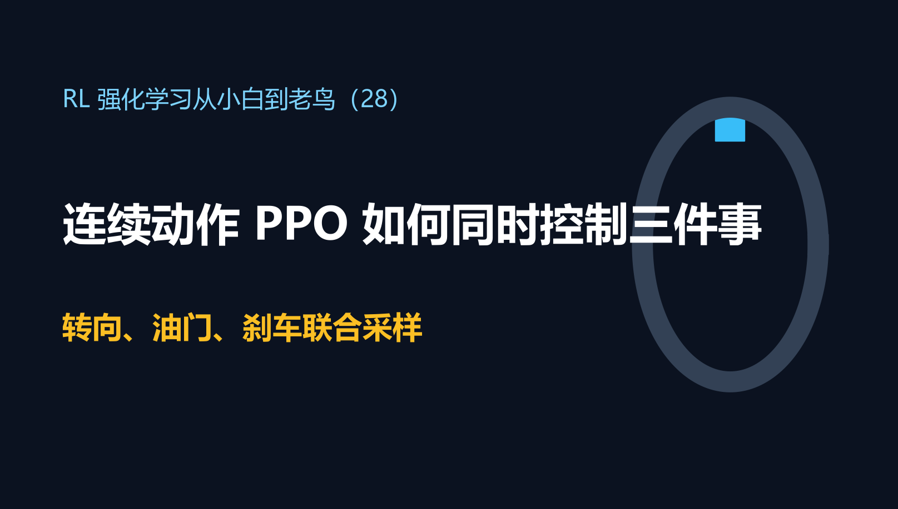
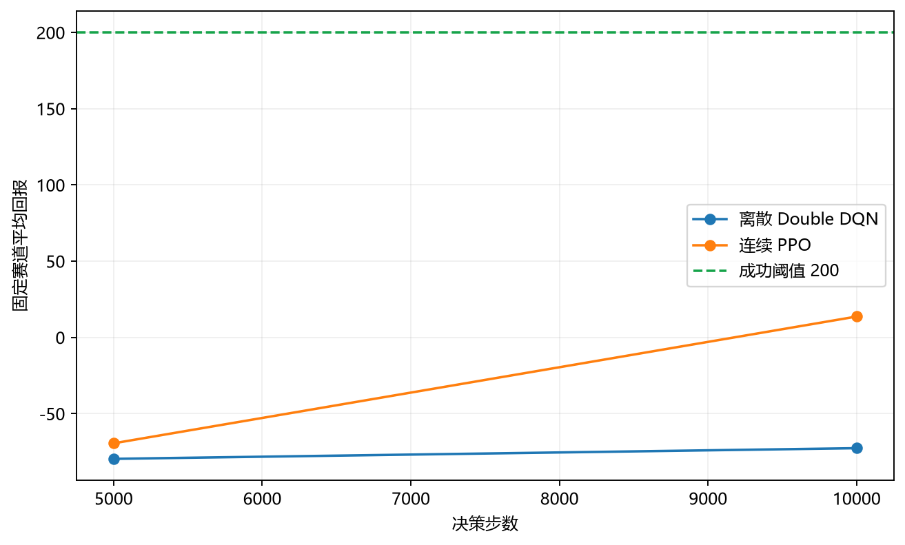
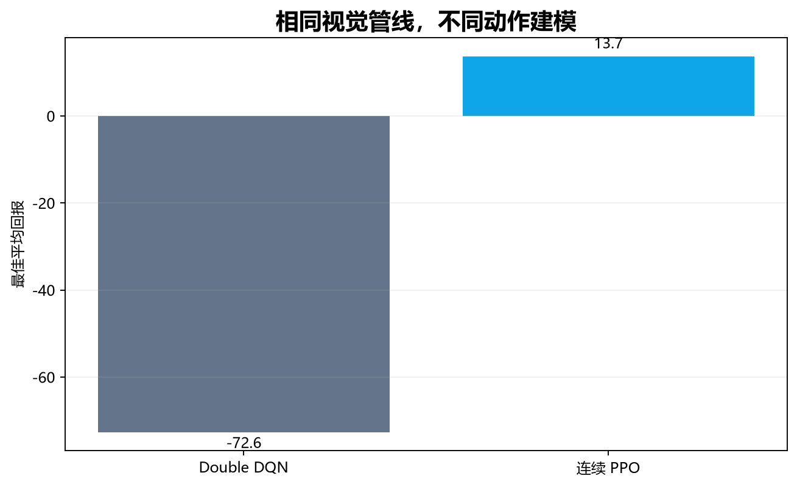
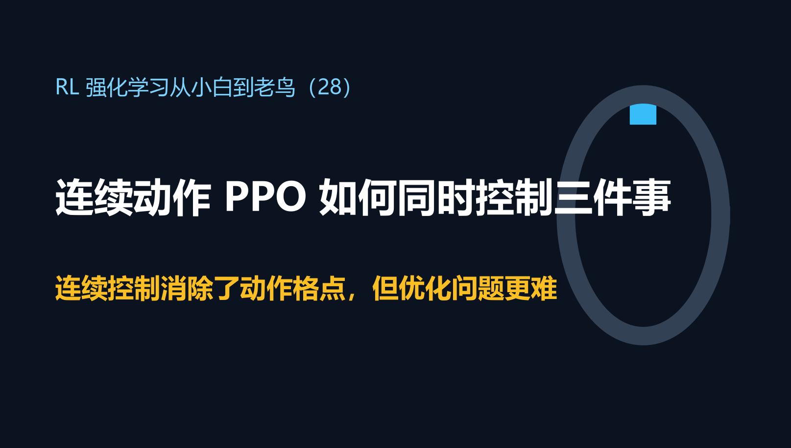

# 连续动作 PPO：如何同时控制转向、油门和刹车



上一章的 DQN 从九个固定动作中做选择。现在取消动作格点，让 PPO 每一步直接输出三个连续控制量。视觉输入仍然是 `4×64×64` 灰度帧堆叠，改变的只有策略头和训练方法。

## 1. 三维高斯策略

卷积编码器输出 256 维特征，Actor 预测三个高斯分布的均值，并学习三个全局标准差。采样结果经过 `tanh` 压缩到 `[-1,1]`：

```text
u ~ Normal(mean, std)
a = tanh(u)
```

转向可以直接使用 `[-1,1]`。油门和刹车再线性映射到 `[0,1]`。计算 PPO 概率比时必须扣除 `tanh` 变换的雅可比修正，否则保存的旧动作概率与更新时重新计算的概率并不一致。

刹车输出层的初始偏置设为负值。若三个均值都从零开始，映射后的油门和刹车都会接近 0.5，车辆会同时踩下两块踏板。

## 2. 图像 PPO 的 Rollout

每轮收集 512 个决策步，计算 GAE 后更新 4 个 epoch。环境奖励乘以 0.1 后进入价值目标，最终评估仍报告没有缩放的原始回报。奖励缩放只改善数值尺度，不改变最优策略。

截断与真正终止继续分开处理：时间上限可以从下一状态价值自举，真正终止则不能；GAE 也不能跨越环境重置传播。

## 3. 与离散 Double DQN 对照



离散 Double DQN 在 10,000 步的最佳回报仍为 -72.6。连续 PPO 在 5,000 步为 -69.4，到 10,000 步提高到 13.7，已经明显超过随机策略，但三条固定评估赛道都没有达到 200 分。连续策略在相同短预算下更早学到赛道进展，距离完整驾驶仍有很大差距。

| 算法 | 动作表示 | 最佳平均回报 | 成功率 |
|---|---|---:|---:|
| Double DQN | 9 个组合动作 | -72.6 | 0% |
| PPO | 三维连续动作 | 13.7 | 0% |



连续动作能够表达更平滑的控制，却不会自动带来更高回报。PPO 是在线算法，每批轨迹通常只使用几轮；DQN 则可以反复抽取旧经验。低预算下二者的数据效率差异，可能比动作精度更早决定结果。

## 4. 诊断连续策略

只看回报无法判断问题出在感知还是控制。训练日志还应检查：

- 策略熵是否过快下降；
- 近似 KL 是否突然增大；
- 价值损失是否远高于策略损失；
- 油门与刹车是否长期同时为正；
- 相邻动作变化量是否过大。

在像素任务中，价值网络和策略共享卷积编码器。价值损失过大时，它会通过共享特征间接破坏策略，因此奖励缩放和价值损失系数都比低维任务更敏感。

## 5. 连续动作解决了什么



连续 PPO 解决了动作格点的表达限制，但把问题转移到了概率分布、奖励尺度和在线采样效率上。算法接口更符合真实控制，不代表短预算训练一定优于 DQN。

下一篇将只改变训练奖励，检验转向平滑、少刹车和少越界这些“看起来合理”的偏好，是否真的能提高环境原始回报。
