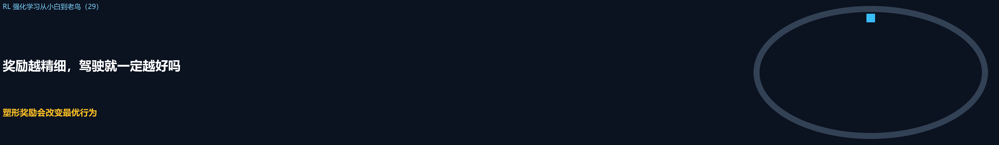
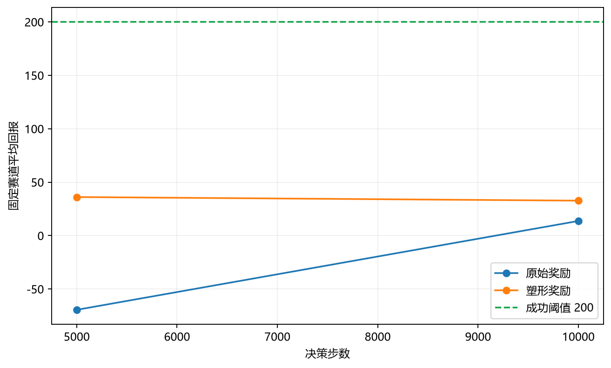
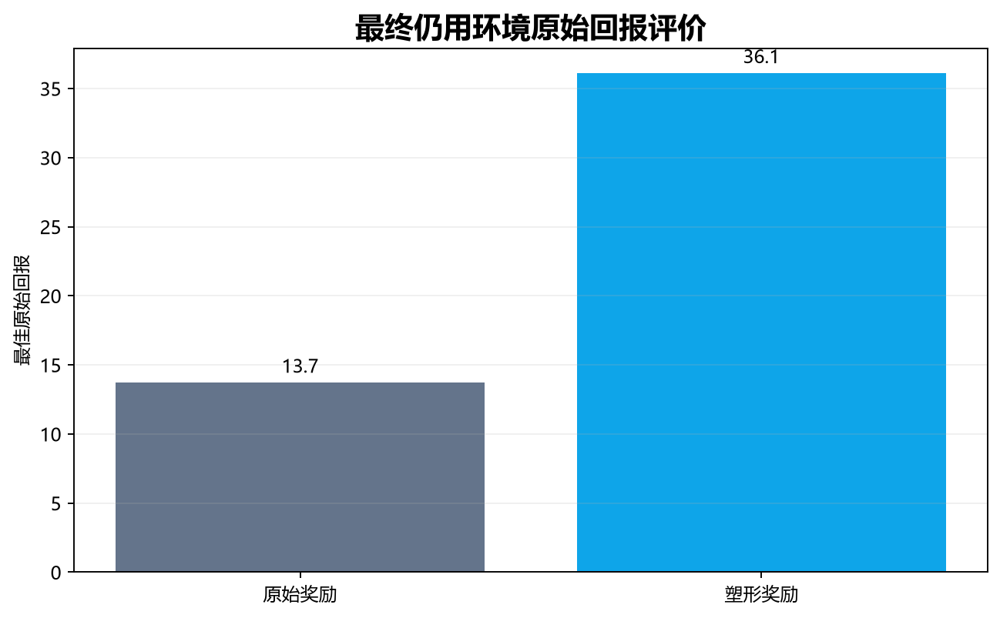
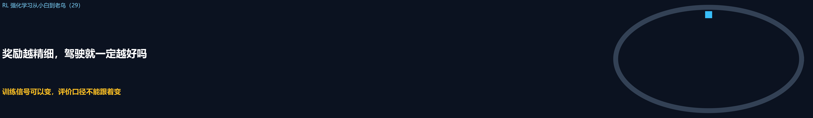

# 奖励越精细，驾驶就一定越好吗



CarRacing 已经提供赛道进度奖励和每步时间代价。我们仍然可能不满意策略的驾驶方式：方向盘抖动、频繁刹车、驶向草地。最直接的想法是继续往奖励里加惩罚。

本篇比较两个 PPO：一个使用环境原始奖励，另一个加入轻量行为塑形。网络、训练预算、随机种子与评估赛道完全相同。

## 1. 三个塑形项

每次决策的塑形奖励为：

```text
r_train = r_env
          - 0.04 × |steering|
          - 0.08 × brake
          - 0.15 × max(0, offroad_ratio - 0.55)
```

这些系数刻意设置得较小，目的是提供偏好，而不是覆盖赛道进度奖励。越界比例由车辆附近图像区域中的绿色像素估计，不读取赛道内部状态。

## 2. 为什么评价必须使用原始奖励

如果塑形版本最终报告 `r_train`，原始版本报告 `r_env`，两者已经不在同一个坐标系里。塑形策略还可能因为“少转向”获得较小惩罚，却根本没有通过弯道。

所以训练时可以使用不同信号，固定评估时统一记录：环境原始回报、成功率、越界率和动作抖动。

## 3. 实验结果



原始奖励 PPO 从 -69.4 持续提高到 13.7。塑形 PPO 在 5,000 步已经达到 36.1，10,000 步为 32.7，短预算学习明显更快；不过两个版本成功率仍为 0%，塑形带来的优势应解释为“走过了更多赛道”，还不是“学会了完整驾驶”。

| 训练奖励 | 最佳原始回报 | 成功率 |
|---|---:|---:|
| 环境原始奖励 | 13.7 | 0% |
| 行为塑形奖励 | 36.1 | 0% |



塑形奖励常见的失败方式不是数值发散，而是产生新的局部最优。例如方向惩罚过大后，车辆宁愿直行冲出弯道；刹车惩罚过大后，策略在急弯也拒绝减速；越界检测不准时，网络甚至会利用图像指标漏洞。

## 4. 奖励设计的四条检查规则

1. 每个塑形项都应能单独记录和解释；
2. 系数相对于环境奖励的数量级必须明确；
3. 最终排名使用不含塑形项的共同指标；
4. 先检查行为变化，再判断回报变化是否真的来自目标行为。

潜势函数塑形可以在特定条件下保持最优策略不变，但随手加入的动作惩罚通常不具备这个保证。工程中可以接受改变最优解，前提是我们清楚地承认自己修改了任务。

## 5. 本篇结论



更详细的奖励不等于更正确的目标。奖励塑形能加快学习，也能让策略更坚定地学错。共同的原始评价口径，是区分“训练更容易”和“任务完成得更好”的关键。

下一篇把变化从动作和奖励转移到图像本身：当画面变暗、偏色、模糊或被遮挡时，策略还能否认出同一条路？
