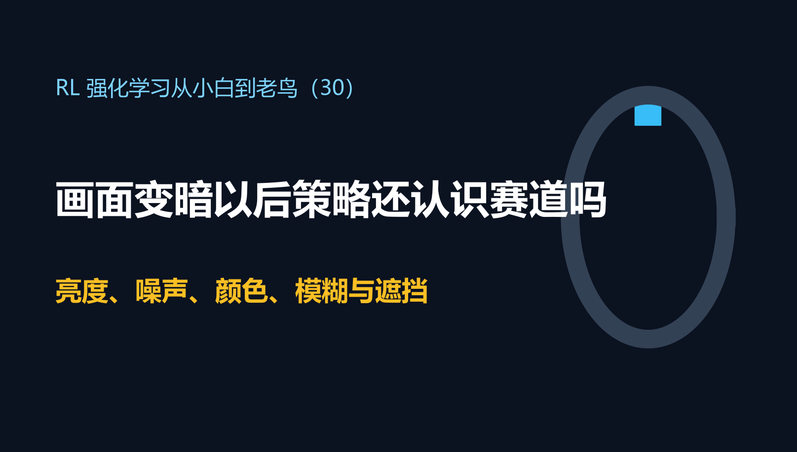
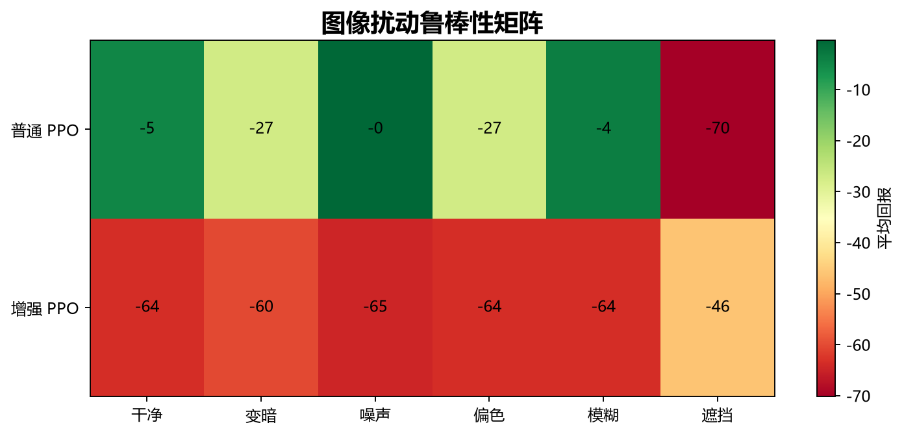
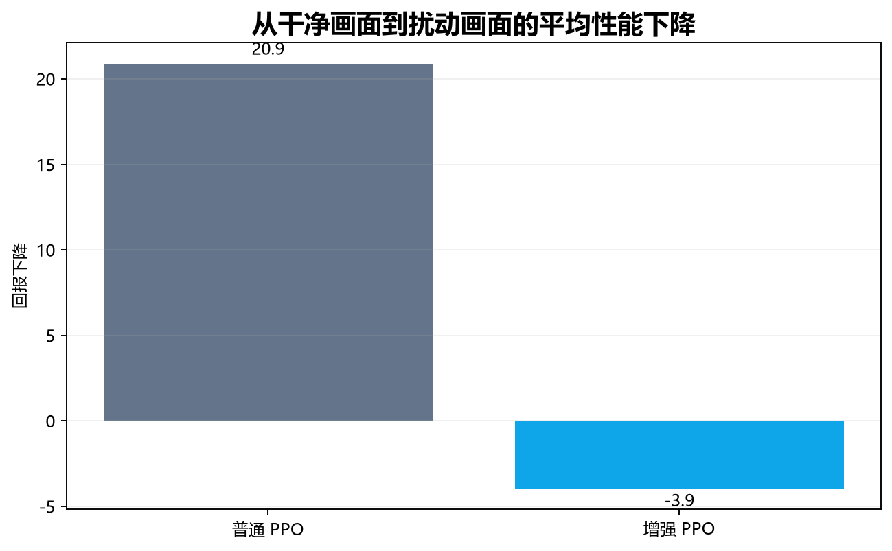
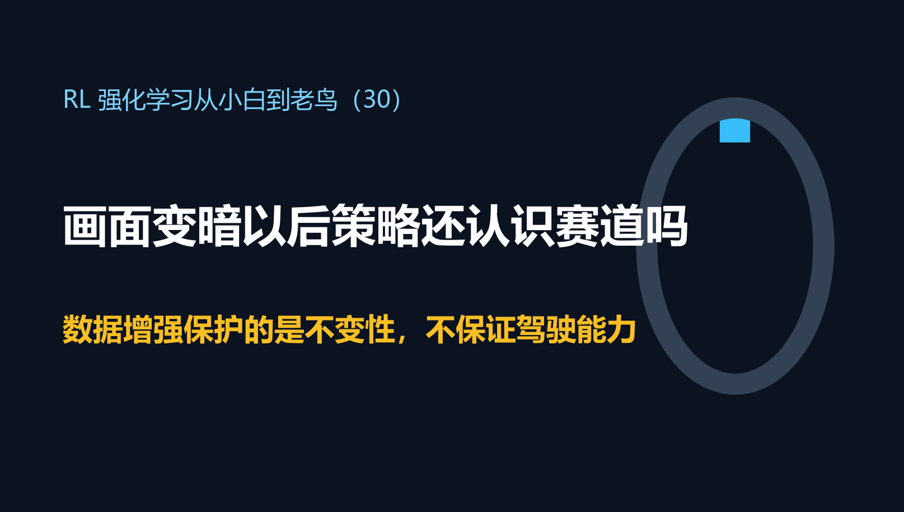

# 画面变暗以后，策略还认识赛道吗

训练赛道和测试赛道都来自 CarRacing，并不意味着视觉分布完全相同。真实摄像头会受到曝光、噪声、色偏、失焦和遮挡影响。只在干净画面上得分高的策略，可能记住的是像素风格，而不是道路结构。

## 1. 五种受控扰动

测试保持赛道种子不变，只修改送入网络的图像：

- 亮度降低；
- 高斯噪声；
- RGB 通道增益变化；
- 邻域平均模糊；
- 中央矩形遮挡。

环境物理状态和原始奖励不变。这样性能下降可以归因于视觉输入，而不是赛道难度变化。

## 2. 训练时数据增强

增强版 PPO 在更新批次上随机应用亮度缩放和最多 2 像素平移。Rollout 仍由原始画面采集，因此增强不会改变环境轨迹或奖励，只改变梯度所看到的样本。

没有把测试中的全部扰动原样加入训练。如果训练时已经见过固定遮挡模板，测试只是在检查记忆，而不是不变性。

## 3. 鲁棒性矩阵

在三条未见赛道上，普通 PPO 的干净画面平均回报为 -4.8；亮度降低和偏色都降至 -27.2，中央遮挡进一步降至 -70.2，但噪声与轻度模糊没有造成同样幅度的损失。增强 PPO 在干净画面只有 -63.6，各种扰动下大多仍在 -65 到 -46 之间。它的曲线更“平”，主要因为基础策略本来就没有学会足够的驾驶能力，不能据此认定模型获得了可靠不变性。

数据增强的作用必须拆成两个问题：

1. 它是否保住干净画面的基础驾驶能力？
2. 相对于自己的干净成绩，它在扰动下下降了多少？

如果增强模型在所有条件下都很差，它的“下降更少”没有实际意义。反过来，干净模型基础成绩更高时，即使绝对扰动成绩仍然领先，也可能暴露更大的相对脆弱性。

## 4. 为什么灰度图仍然会受偏色影响

RGB 输入先经过不同权重转换为灰度。通道增益变化会改变最终亮度与道路边界对比度，因此灰度策略并不会自动免疫色偏。灰度化减少了颜色自由度，但也可能丢掉草地、路肩与赛道之间的有用区别。

## 5. 不要把随机增强当万能药

增强过强会让优化问题变难；增强类型与真实变化不匹配时，模型可能学到错误不变性；几何平移还可能破坏“车辆必须位于图像中央”这类摄像机先验。

更稳妥的做法是为每类扰动保留独立测试集，并同时报告干净成绩、扰动成绩和性能下降。

## 6. 鲁棒性必须建立在基础能力上

视觉鲁棒性不是训练回报的自然副产品。数据增强可以帮助网络忽略无关像素变化，但前提是策略已经学会了基础任务，并且增强没有摧毁真正有用的视觉线索。

下一篇将把离散 DQN、原始 PPO、塑形 PPO 和增强 PPO 放进统一的未见赛道审计，除了均值，还检查 10% 分位、最差轨迹、越界率、动作抖动与推理时间。
