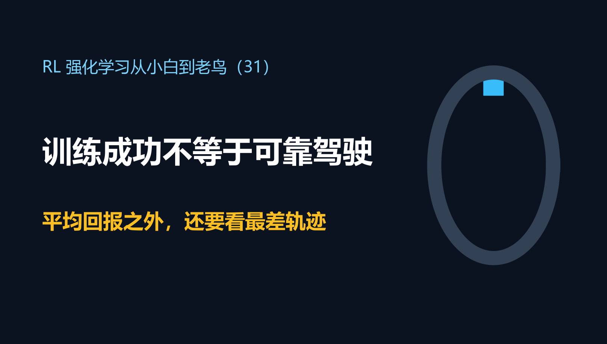
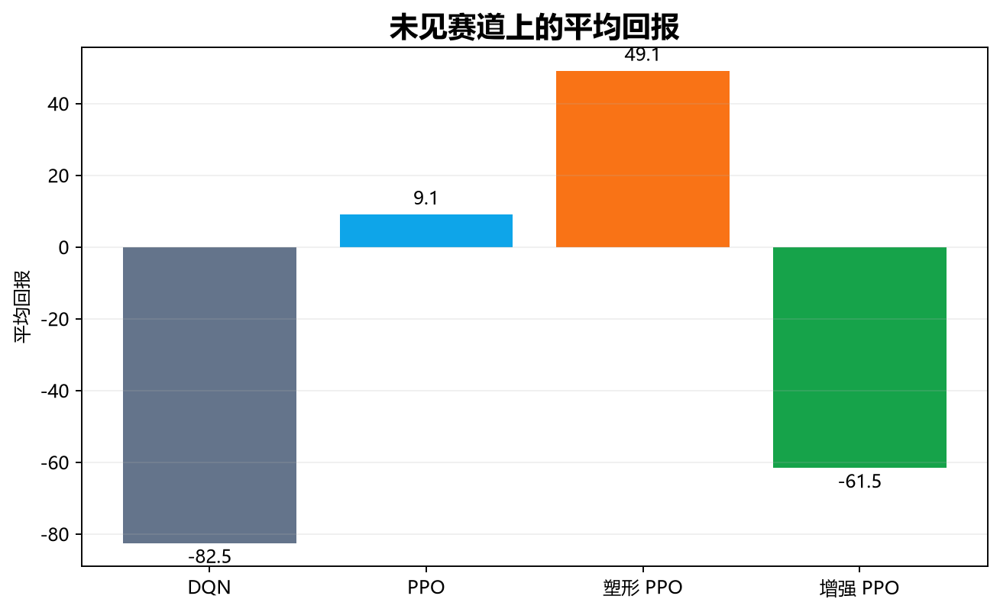
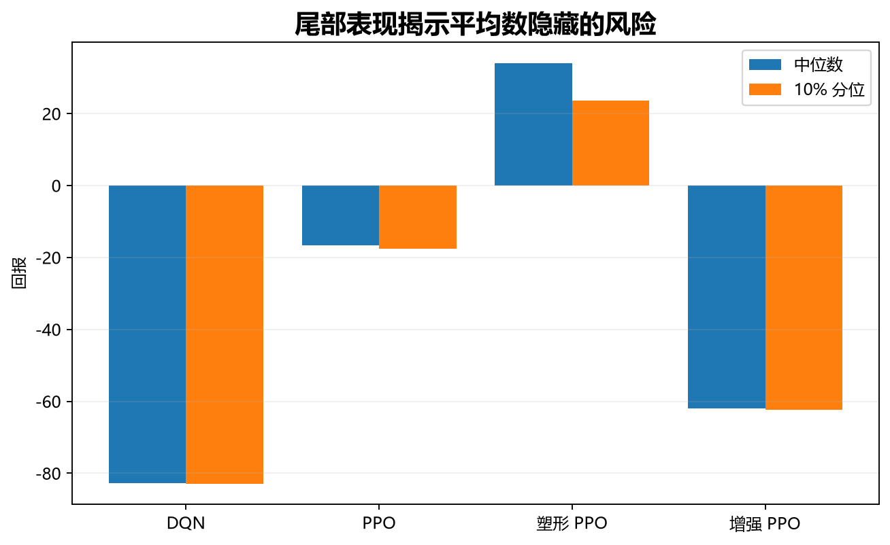
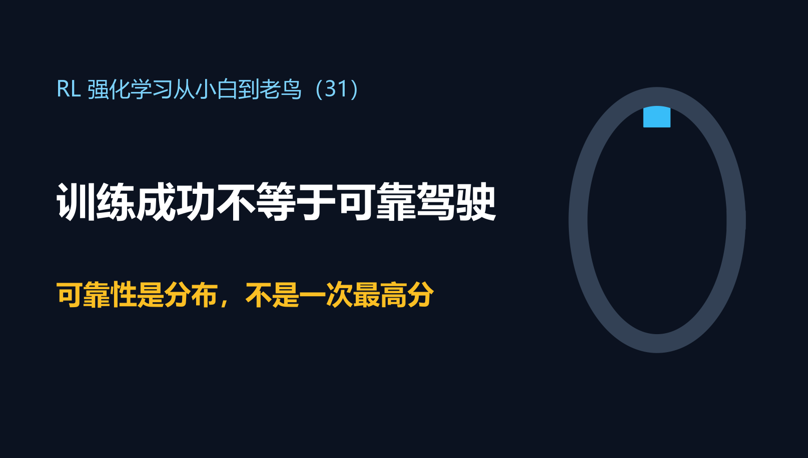

# 训练成功不等于可靠驾驶：视觉控制最终复盘



视觉驾驶阶段已经依次改变了时间表示、动作空间、优化算法、奖励和图像分布。最后一篇不再增加技巧，而是在一组未参与训练的赛道种子上统一审计所有模型。

## 1. 为什么平均回报还不够

一个模型在九条赛道得 300 分、在一条赛道得 -100 分，平均数仍然很好看。但部署时遇到的可能正是那条失败赛道。因此本篇同时报告：

- 平均与中位回报；
- 10% 分位和最差回报；
- 达到 200 分的比例；
- 越界帧比例；
- 相邻动作变化量；
- 单次策略推理时间。

训练检查点按照训练期间固定评估均值选择，最终审计使用另一组种子，避免在测试集上挑模型。

## 2. 四种模型

审计对象包括：

1. 4 帧离散 Double DQN；
2. 原始奖励连续 PPO；
3. 塑形奖励连续 PPO；
4. 带图像增强的连续 PPO。

它们共享同一套图像裁剪、缩放、帧跳过和最大决策步数。DQN 使用九个动作，PPO 使用三维连续动作，所以动作抖动指标用于理解行为，不直接作为唯一排名依据。

## 3. 未见赛道结果



塑形 PPO 的平均回报为 49.1，中位数 34.1，10% 分位仍有 23.6，是本次短预算中尾部表现最好的模型。原始 PPO 平均回报为 9.1，但中位数只有 -16.7，说明均值被少数较好赛道抬高。离散 DQN 和增强 PPO 分别为 -82.5 与 -61.5，几乎没有形成有效赛道进展。四个模型都没有在这五条未见赛道上达到 200 分成功阈值。

| 模型 | 平均回报 | 中位数 | 10% 分位 | 成功率 |
|---|---:|---:|---:|---:|
| 离散 DQN | -82.5 | -82.7 | -82.9 | 0% |
| 原始 PPO | 9.1 | -16.7 | -17.6 | 0% |
| 塑形 PPO | 49.1 | 34.1 | 23.6 | 0% |
| 增强 PPO | -61.5 | -61.9 | -62.3 | 0% |



均值回答“通常能得到多少”，10% 分位回答“较差场景会有多差”。如果两者差距很大，说明模型对赛道几何或初始细节高度敏感。

## 4. 七篇实验形成的链路

视觉阶段建立了一条可以审计的实验链，而没有用短预算结果宣称得到“最强” CarRacing 模型：

```text
原始像素
  → 统一预处理
  → 时间表示
  → 离散/连续动作
  → 奖励设计
  → 视觉扰动
  → 未见场景与尾部风险
```

每次只改变一个主要变量，并保留失败结果。这样即使短预算模型没有达到高分，我们仍然知道问题发生在哪一层，而不是把所有变化堆在一起后只比较最终数字。

## 5. 视觉驾驶阶段总结



可靠驾驶不是一次最高分，也不是一条平滑的训练曲线，而是在未见场景中仍具有可接受的性能分布。图像增强、奖励塑形或连续动作都只是工具，必须通过共同测试集和尾部指标验证。

视觉驾驶阶段在可靠性审计后结束。下一阶段进入多智能体协作：从独立学习、参数共享，到集中训练分散执行和信用分配。研究问题也从“我看到了什么”转向“多个智能体如何共同完成目标”。
