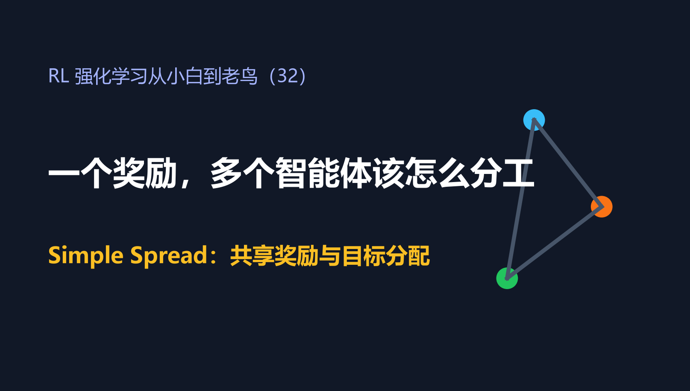
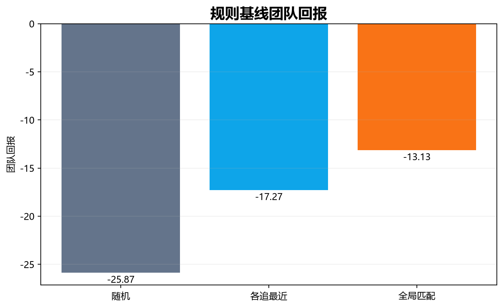
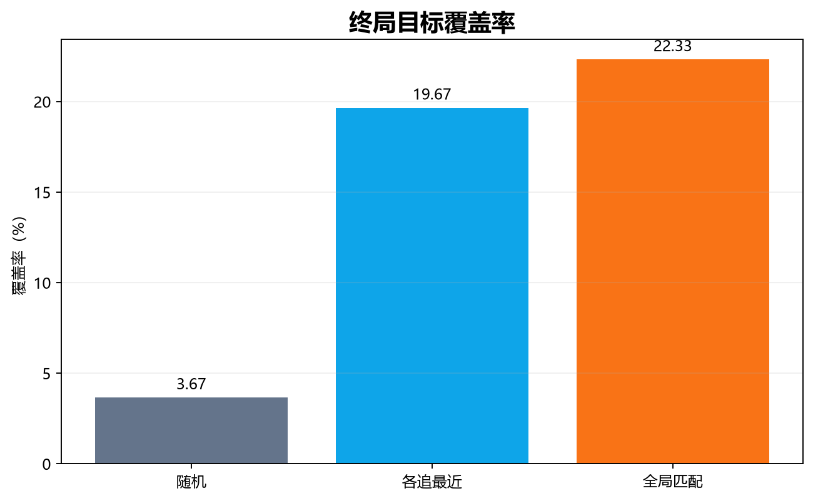

# 一个奖励，多个智能体该怎么分工



此前各阶段都只有一个决策者。现在进入 MPE2 的 `Simple Spread`：3 个智能体需要覆盖 3 个目标点，同时避免彼此碰撞。

环境每一步返回三个局部观测、三个动作和三个奖励。训练时还可以读取 54 维全局状态，但分散执行的策略不能依赖它。

## 1. Parallel API

PettingZoo 的 Parallel API 用智能体名称组织数据：

```python
observations, infos = env.reset(seed=42)
next_obs, rewards, terminated, truncated, infos = env.step(
    {
        "agent_0": 2,
        "agent_1": 4,
        "agent_2": 1,
    }
)
```

每个智能体有 18 维局部观测和 5 个离散动作：静止、左、右、下、上。三个策略在同一个物理步同时行动，不存在“先行动者看到后行动者结果”的顺序优势。

## 2. 评价指标

共享回报会同时惩罚目标距离和碰撞，但一个数字不足以解释协作。统一评估还记录：目标覆盖率、全覆盖率、最近目标平均距离和碰撞率。目标覆盖阈值固定为 0.15。

## 3. 三种非学习基线



在 100 个固定测试种子上：

| 策略 | 团队回报 | 终局覆盖率 | 全覆盖率 | 碰撞率 |
|---|---:|---:|---:|---:|
| 随机动作 | -25.87 | 3.7% | 0% | 1.8% |
| 各自追最近目标 | -17.27 | 19.7% | 0% | 10.2% |
| 全局最小距离匹配 | -13.13 | 22.3% | 1% | 4.0% |



“各追最近”容易让多个智能体抢同一个目标，碰撞率反而最高。全局匹配用穷举排列给每个智能体分配不同目标，因此距离和碰撞都有改善。但它仍只是每步朝目标选择一个方向，没有处理惯性与制动，全覆盖率只有 1%。

## 4. 这不是一个完美专家

全局匹配读取了普通策略看不到的真实位置，只能作为特权参考。它证明目标分配有价值，却没有解决低层控制。后续学习算法如果只超过随机策略，还不能说明已经学会了明确分工。


下一篇让三个 DQN 独立学习。对每个网络来说，另外两个不断变化的策略会成为环境动力学的一部分，这就是多智能体训练最早遇到的非平稳性。
