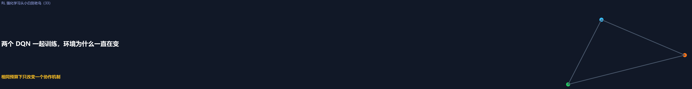
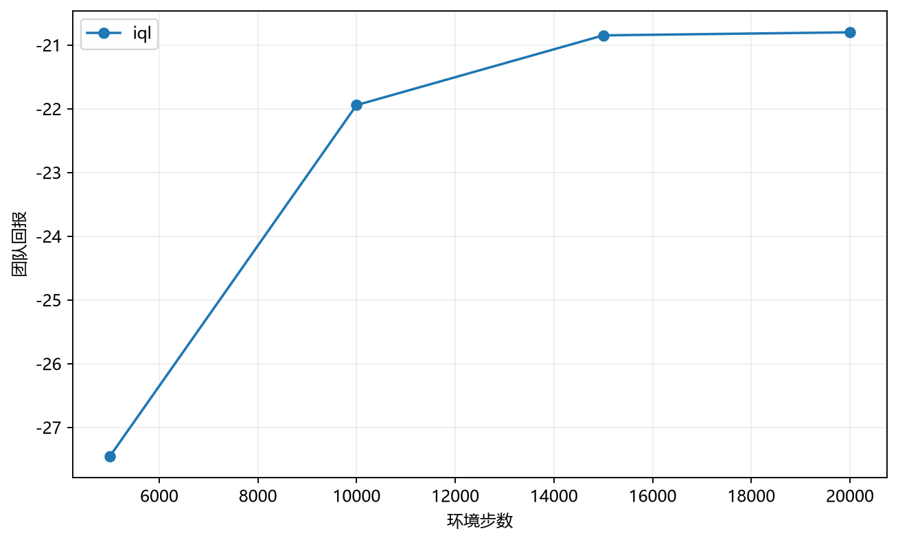
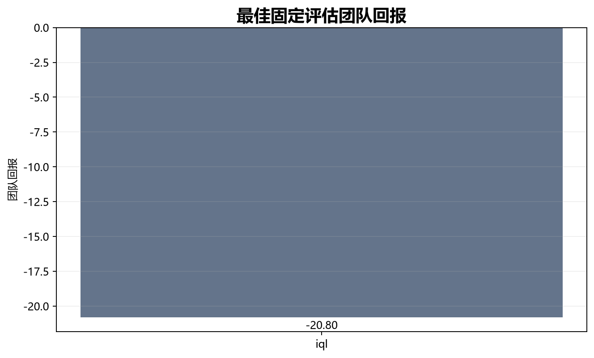
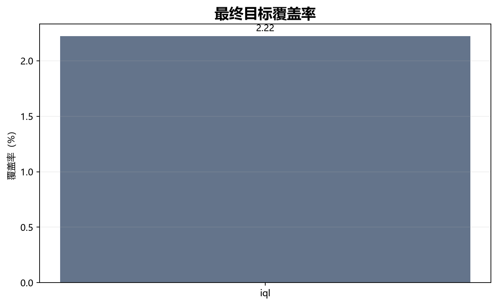

# 两个 DQN 一起训练，环境为什么一直在变

Independent Q-Learning 的做法很直接：每个智能体拥有自己的 Q 网络和目标网络，把队友当成环境的一部分。这让单智能体 DQN 几乎不改代码就能运行，但破坏了经验回放隐含的平稳性假设。

## 1. 同一条经验的含义会变化

在单智能体环境中，固定状态与动作对应的转移分布不会因为网络更新而改变。IQL 中，即使 `agent_0` 选择相同动作，下一状态还取决于另外两个智能体当前的策略。旧经验是在旧队友下收集的，训练时队友已经不同。

本实验给三个智能体分别建立两层 MLP，使用独立 Double DQN 目标，却共享同一个联合回放缓存。训练预算为 20,000 个并行环境步。

## 2. 真实结果

IQL 最佳结果位于 20,000 步：团队回报 -20.80，终局覆盖率 2.2%，碰撞率 2.5%。它超过随机基线的 -25.87，但明显没有达到全局匹配基线的 -13.13。

覆盖率很低说明“回报改善”主要来自减少总体距离或避免碰撞，而不是稳定完成三个目标。每个智能体独立优化自己的估计，没有机制保证它们形成互补角色。

## 3. 非平稳性如何被看见

训练曲线不是单调上升；相同探索率下，不同评估点也可能发生策略退化。目标网络只能减缓单个网络自己的目标变化，无法冻结队友策略。扩大回放缓存甚至可能增加旧队友经验的比例。

IQL 是重要下限：它告诉我们不显式建模协作时能走多远。下一篇不改变 TD 目标，只让三个智能体共享参数，检验对称任务中的数据复用是否比独立身份更重要。
