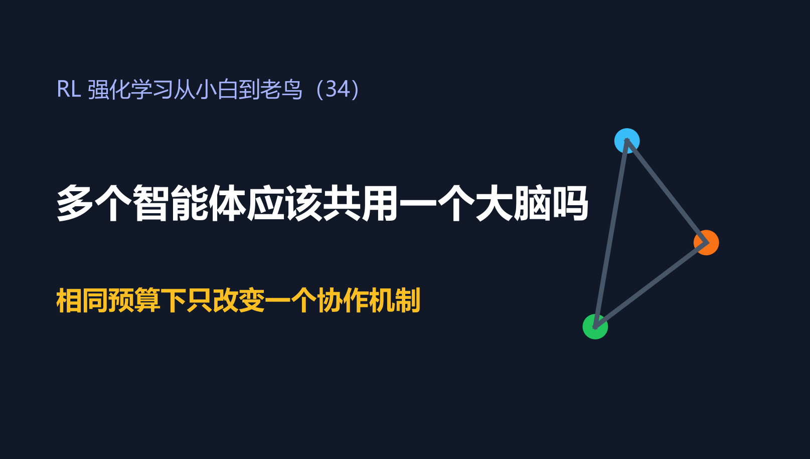
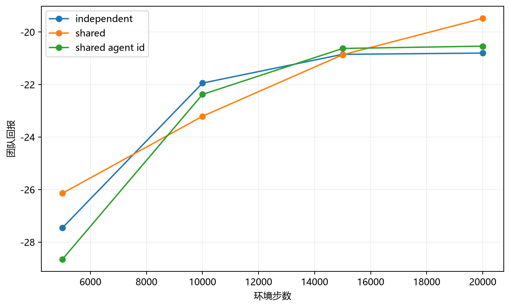
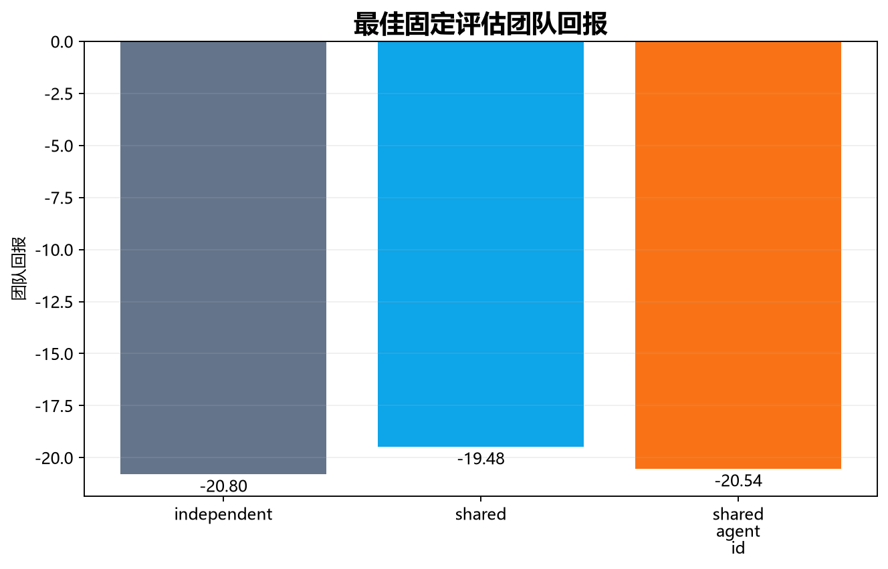
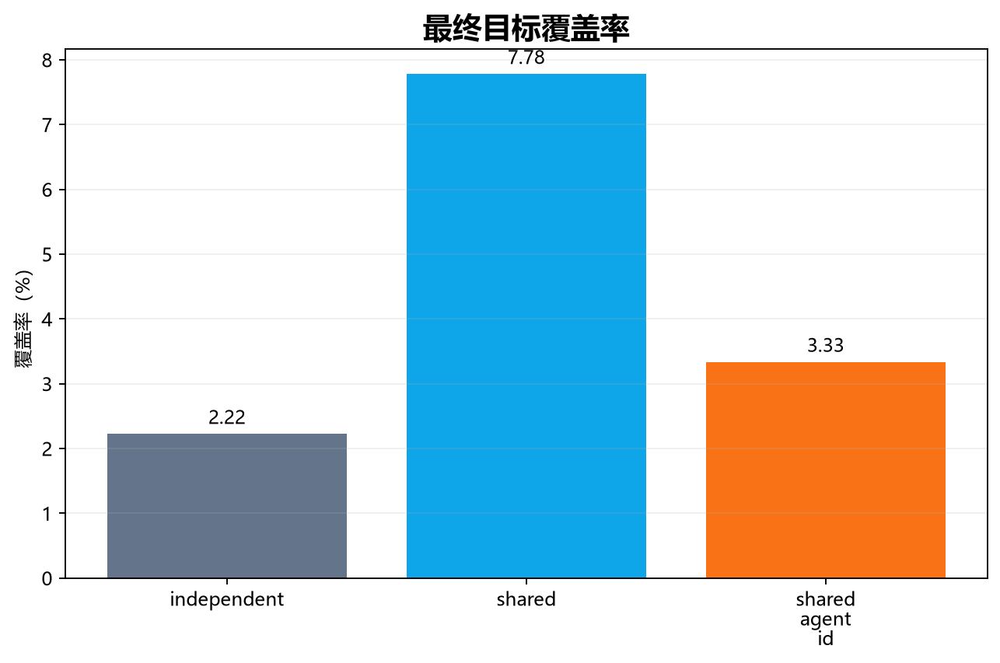

# 多个智能体应该共用一个大脑吗

Simple Spread 中三个智能体能力相同、观测结构相同、动作空间也相同。为它们维护三套网络可能浪费数据。参数共享让每个智能体的转移都更新同一个 Q 网络，相当于扩大了训练样本来源。

实验比较独立网络、纯参数共享，以及“共享网络 + Agent ID”。

## 1. 身份信息的双刃剑

不提供身份时，同样的局部观测必然产生同样的动作偏好，具有置换对称性。追加 one-hot Agent ID 后，网络可以学习不同角色，但也可能记住编号，破坏本来有用的对称结构。

## 2. 实验结果

| 结构 | 最佳团队回报 | 覆盖率 | 碰撞率 |
|---|---:|---:|---:|
| 三套独立网络 | -20.80 | 2.2% | 2.5% |
| 共享网络 | -19.48 | 7.8% | 1.2% |
| 共享网络 + Agent ID | -20.54 | 3.3% | 0.8% |

纯共享网络在本次预算中最好。Agent ID 降低了碰撞，却没有提高目标覆盖，说明网络学会“行为有所不同”不等于学会了正确分工。

参数共享适合能力同质的智能体，也使模型天然可以复用于不同编号。若角色能力、传感器或动作空间不同，就不能简单共用同一个输出头。

下一篇修改联合价值结构：VDN 把团队 Q 值写成各智能体 Q 值之和，让训练直接围绕团队回报展开。
