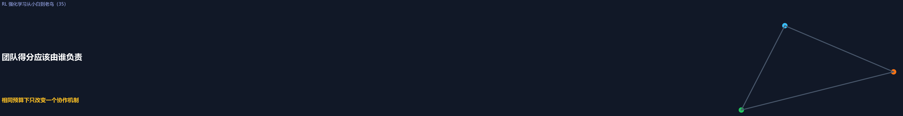
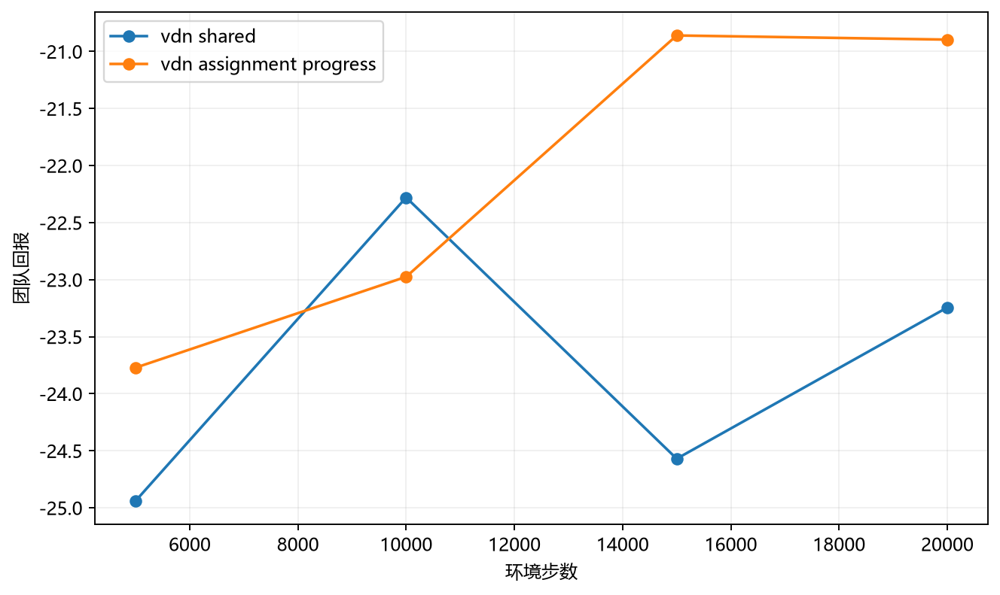
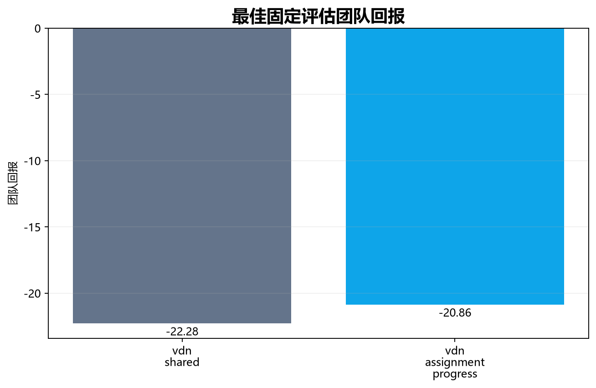
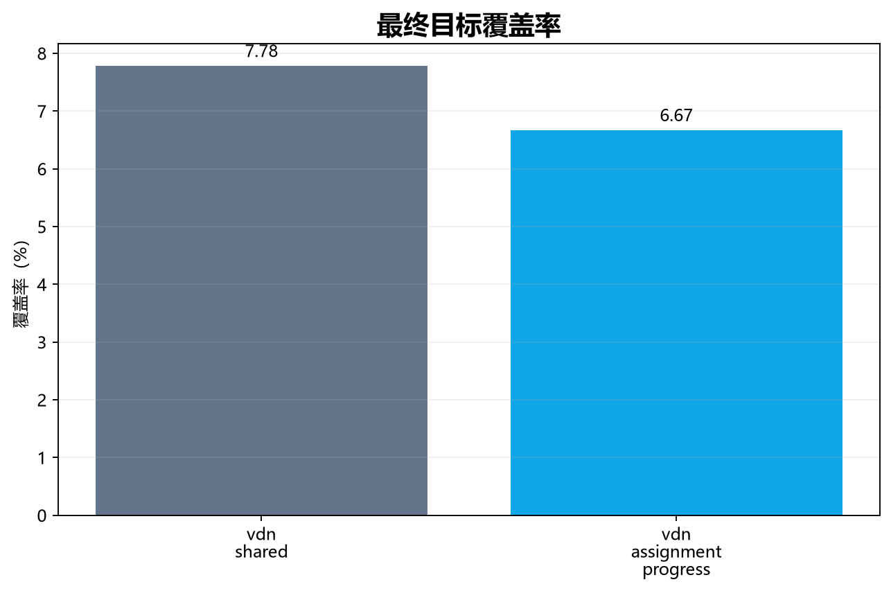

# 团队得分应该由谁负责：VDN 与信用分配



共享奖励告诉团队整体做得好不好，却没有告诉每个智能体自己的动作贡献了多少。VDN 用一个简单假设处理这个问题：联合动作价值等于各智能体局部价值之和。

```text
Q_total = Q_1(o_1,a_1) + Q_2(o_2,a_2) + Q_3(o_3,a_3)
```

执行时每个智能体只需最大化自己的 Q 值；训练时，三个局部 Q 值相加后共同拟合团队 TD 目标。

## 1. 两种训练信号

第一组 VDN 给所有智能体相同团队奖励。第二组在团队奖励上增加“朝全局匹配目标前进”的局部进展信号。这个信号是差分式诊断近似，不是真正逐个重放反事实环境得到的 Difference Reward。

## 2. 实验结果



共享奖励 VDN 最佳回报 -22.28、覆盖率 7.8%、碰撞率 3.9%。加入匹配进展后最佳回报提高到 -20.86，碰撞率降至 1.3%，覆盖率为 6.7%。



局部进展改善了回报和碰撞，却没有同步提升覆盖率。它让每个智能体更明确地朝各自目标移动，但短训练中仍可能停在阈值外。



VDN 的优势也是限制：加法分解无法表达“只有两名智能体同时采取特定动作才有价值”这类非线性交互。下一篇用 QMIX 的单调混合网络放宽加法假设，并检查更强模型是否真的更容易训练。
