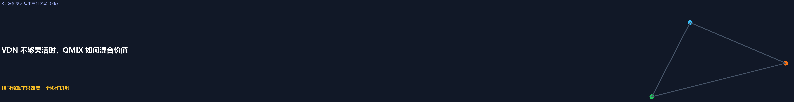
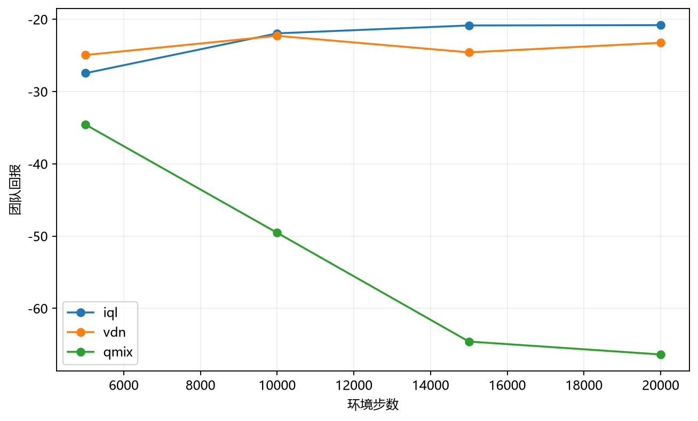
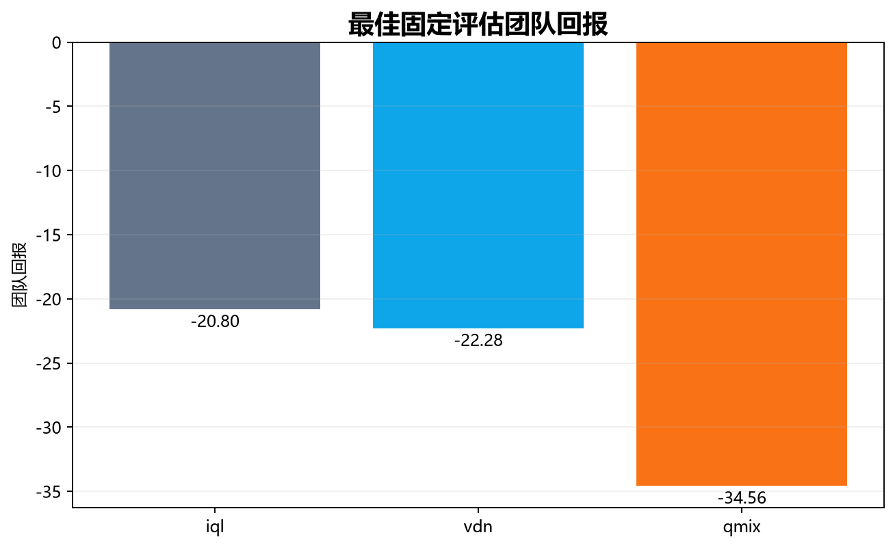
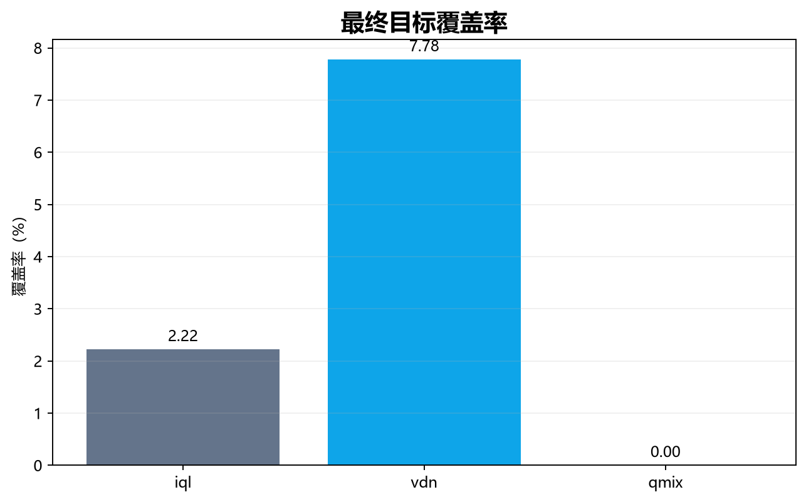

# VDN 不够灵活时，QMIX 如何混合价值



QMIX 不再简单相加局部 Q 值，而是用读取全局状态的超网络生成混合权重。为保证分散贪心动作仍与联合最优一致，混合网络要求：

```text
∂Q_total / ∂Q_i ≥ 0
```

代码中对超网络产生的权重取绝对值，以保证单调性。全局状态只进入训练期混合器，执行时每个智能体仍只看自己的局部观测。

## 1. IQL、VDN 与 QMIX



| 算法 | 最佳团队回报 | 覆盖率 |
|---|---:|---:|
| IQL | -20.80 | 2.2% |
| VDN | -22.28 | 7.8% |
| QMIX | -34.56 | 0% |



QMIX 在 5,000 步取得本次最好结果，之后继续退化，20,000 步时回报降到 -66.37。它没有因为表达能力更强而自动超过 VDN。

## 2. 为什么更强模型反而失败

QMIX 同时学习局部 Q、状态条件混合权重和联合偏置。短预算下，超网络会放大局部 Q 的尺度漂移；全局状态维度也远大于单个局部观测。单调约束保证可分散执行，却不保证优化稳定。



这一结果说明模型容量与样本效率不是同义词。QMIX 仍是重要方法，但需要更长训练、更谨慎的归一化和多随机种子确认。下一篇转向策略梯度：比较各自训练 Critic 的 IPPO 与训练期共享全局状态的 MAPPO。
