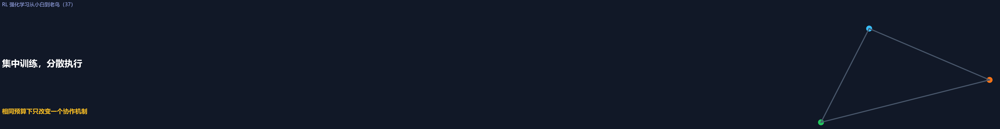
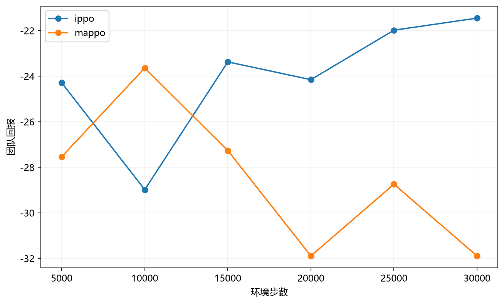
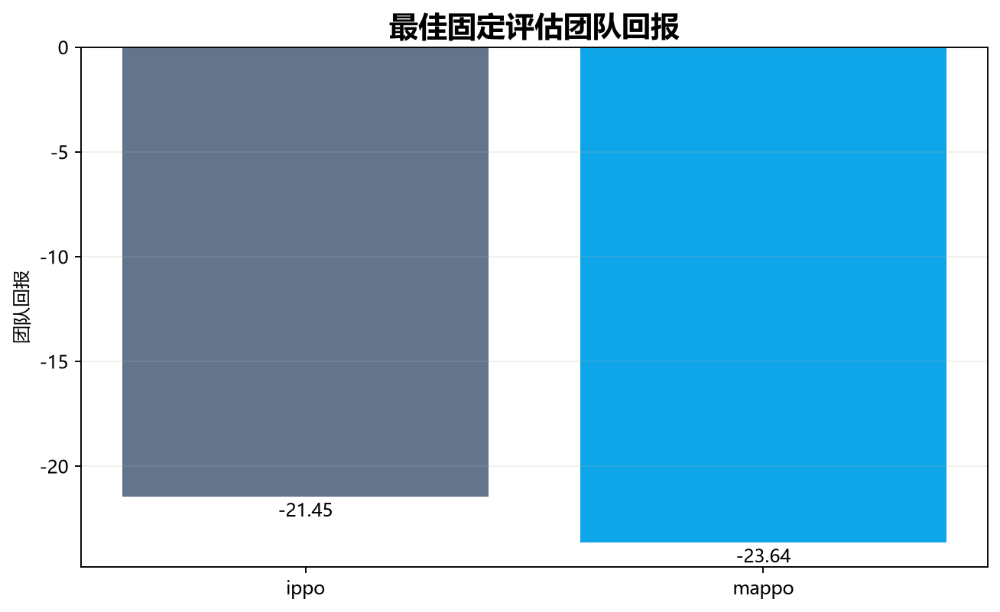
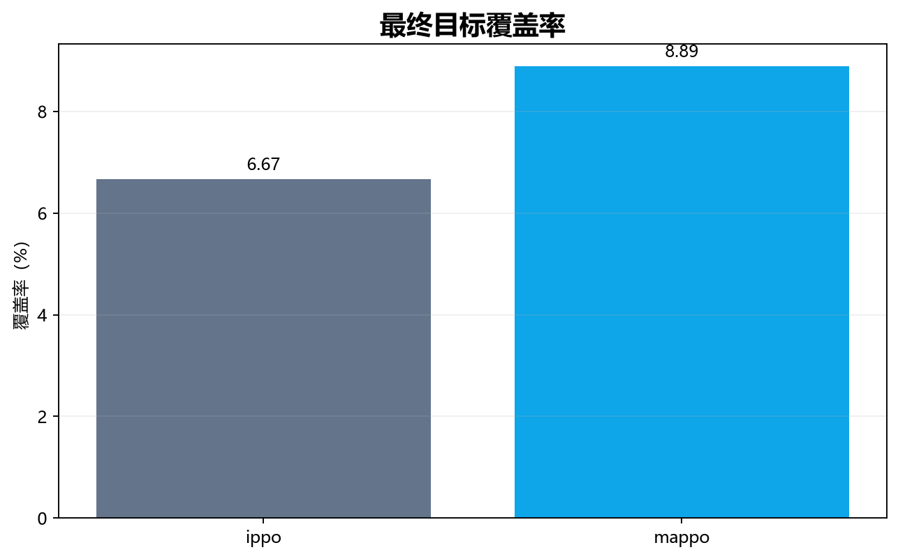

# 集中训练、分散执行：从 IPPO 到 MAPPO

价值分解把局部 Q 值组合成团队价值。MAPPO 采用另一条路线：Actor 执行时只看局部观测，Critic 训练时可以读取完整联合状态。

这就是集中训练、分散执行（CTDE）：额外信息只帮助估计训练基线，不进入部署动作接口。

## 1. IPPO 与 MAPPO 的唯一主要差异

两个版本都使用一套共享 Actor，并追加 Agent ID。IPPO 的 Critic 根据每个智能体局部观测估值；MAPPO 的 Critic 接收 96 维填充全局状态，一次输出三个智能体的价值。

Actor、Rollout 长度、GAE、PPO 裁剪范围和 30,000 步预算保持相同。

## 2. 实验结果

IPPO 最佳结果出现在 30,000 步：团队回报 -21.45，覆盖率 6.7%，碰撞率 1.2%。MAPPO 在 10,000 步达到最佳 -23.64、覆盖率 8.9%，随后退化到 -31.89。

集中 Critic 没有自动胜出。全局状态提供更多信息，也让价值函数维度更高；共享 Actor 的策略变化还会让 Critic 同时追踪三个非平稳目标。短预算中，较简单的局部 Critic 更容易优化。

MAPPO 的早期覆盖率略高，说明集中信息可能帮助识别联合局面，但后续策略退化提醒我们不能只保存最终检查点。本项目统一按照固定评估回报保存最佳模型。

CTDE 的边界必须清楚：如果 Actor 在执行时偷偷读取全局状态，就不再是分散执行，也无法用于通信受限的真实团队。

下一篇给 Actor 增加一个 8 维消息通道，并通过测试时切断消息判断策略是否真的学会使用通信。
