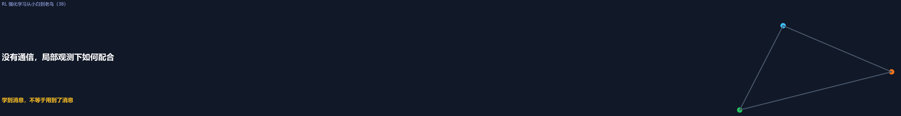
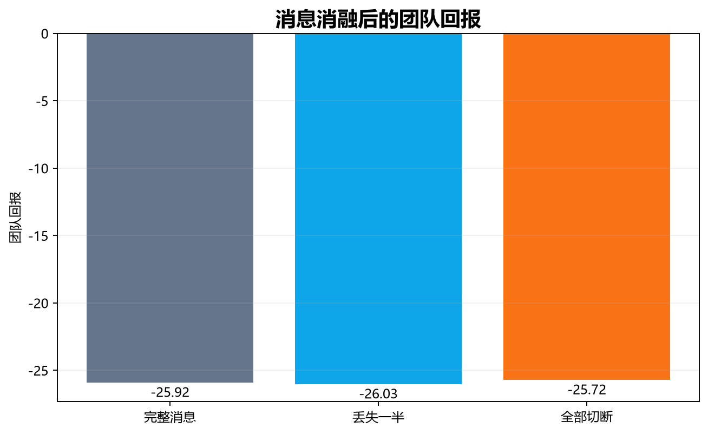
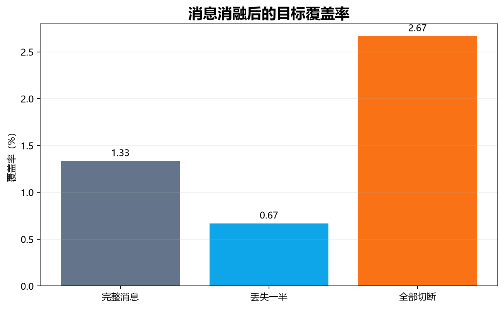
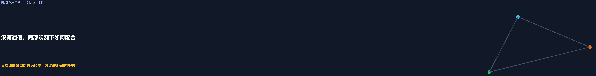

# 没有通信，局部观测下如何配合



每个智能体的局部观测已经包含相对位置，但不等于网络能够轻易提取队友意图。本篇让每个智能体把观测编码成 8 维连续消息，接收其他智能体消息的平均值，再与自己的观测和身份一起选择动作。

## 1. 可微消息通道

```text
m_i = encoder(o_i)
received_i = mean(m_j, j != i)
a_i ~ actor(o_i, id_i, received_i)
```

消息编码器与 Actor 一起通过 PPO 损失训练。训练期间随机丢弃 10% 的接收消息，避免策略完全依赖理想通信。

这不是离散语言，也没有规定每个维度的语义。它只是一个低带宽连续向量。

## 2. 训练表现

通信策略在 10,000 步取得最佳团队回报 -27.46、覆盖率 5.6%，之后没有继续改善。它没有超过 IPPO 的 -21.45。

训练成绩低并不能单独证明消息无效。真正的检查方法是在相同检查点和相同测试种子上切断消息。

## 3. 消息消融



50 条未见轨迹结果如下：

| 条件 | 团队回报 | 覆盖率 | 碰撞率 |
|---|---:|---:|---:|
| 完整消息 | -25.92 | 1.3% | 3.2% |
| 随机丢失一半 | -26.03 | 0.7% | 3.0% |
| 全部切断 | -25.72 | 2.7% | 2.3% |



切断消息没有让策略变差，甚至略有改善。最诚实的结论是：网络虽然拥有消息通道，却没有学到可验证的有效通信。消息编码器可能输出近似常量，Actor 也可能主要依赖本地观测。

这与“加入 GRU 不等于学会记忆”完全相同：提供结构只是允许某种能力存在，消融实验才说明能力是否真的被使用。



下一篇不再增加模块，而是向最佳检查点注入观测噪声和单体失效，检查团队是否具有真正的冗余和恢复能力。
