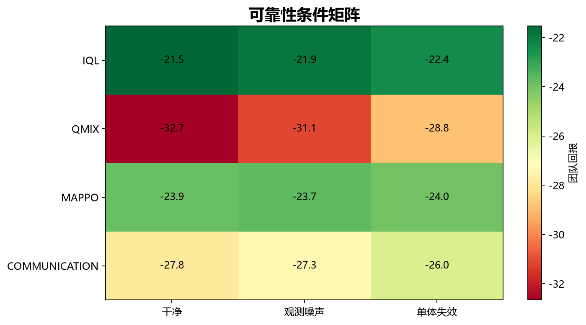
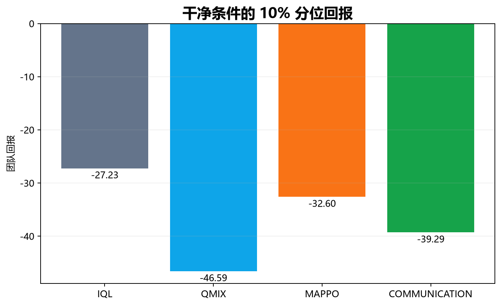

# 训练成功不等于团队可靠：多智能体最终审计


多智能体阶段已经比较了独立学习、参数共享、价值分解、集中 Critic 和消息通道。最后一篇在另一组未见种子上测试四个代表模型：IQL、QMIX、MAPPO 和通信 PPO。

## 1. 三种审计条件

- 干净：只更换环境随机种子；
- 观测噪声：每个局部观测加入标准差 0.1 的高斯噪声；
- 单体失效：`agent_0` 的动作被强制设为静止。

每个条件运行 30 局。模型选择只使用训练期间的固定评估，审计数据不参与挑选检查点。

## 2. 可靠性矩阵



| 模型 | 干净回报 | 观测噪声 | 单体失效 |
|---|---:|---:|---:|
| IQL | -21.53 | -21.90 | -22.44 |
| QMIX | -32.66 | -31.12 | -28.84 |
| MAPPO | -23.86 | -23.67 | -23.98 |
| 通信 PPO | -27.80 | -27.34 | -26.03 |

IQL 在四个模型中干净回报最好，观测噪声只造成小幅下降。MAPPO 对两种扰动也不敏感，但基础成绩较低。

QMIX 和通信策略在单体失效后反而提高，不能解释为容错能力。更可能的原因是失效智能体原本就在采取有害动作；强制静止减少了干扰。这是一个很有价值的诊断：团队中“有三个策略在运行”不等于三个成员都在贡献。

## 3. 尾部表现



均值会隐藏少数极差布局，因此还要查看 10% 分位与最差回报。当前所有学习策略都没有接近规则匹配基线，更没有形成高全覆盖率。这个系列证明了各个算法组件可运行，也展示了短预算协作学习的真实困难，但不能把它包装成可靠团队。

## 4. 从第 32 篇到第 39 篇

```text
共享环境与规则基线
  → IQL 非平稳性
  → 参数共享与身份
  → VDN 信用分配
  → QMIX 非线性混合
  → IPPO / MAPPO 与 CTDE
  → 可学习通信与消融
  → 噪声、失效和尾部风险
```


多智能体强化学习的难点不在于复制三份单智能体网络，而在于解释成员动作及其团队贡献，并验证部分成员失效后任务能否继续完成。

本阶段以可靠性审计收尾。下一阶段转向离线强化学习，研究无法继续与环境交互时的数据与评估问题。
