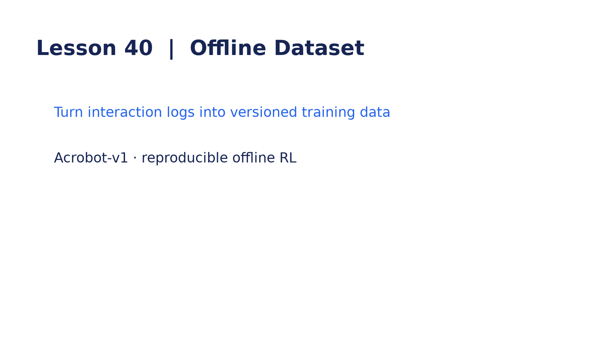
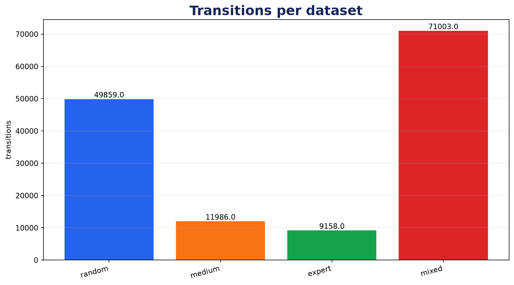
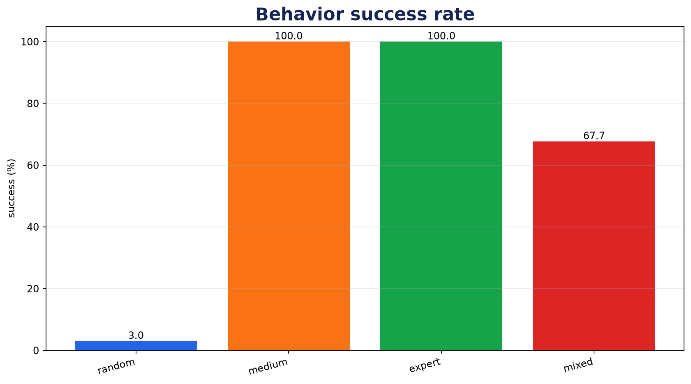
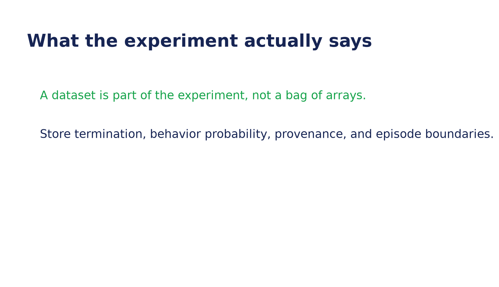

# 不能再和环境交互时，如何制作离线强化学习数据集



在线强化学习一边试错一边收集经验；离线强化学习只能使用一份固定日志。数据来源的变化也改变了实验的可信边界。我们从 `Acrobot-v1` 开始，把在线 DQN 的不同训练阶段整理成可复现的数据集。

## 1. 一条 transition 还不够

每条记录保存 `observation`、`action`、`reward`、`next_observation`、`terminated`、`truncated`、`episode_id`、行为策略动作概率和来源。最后三项尤其重要：没有轨迹边界就无法做轨迹重要性采样；没有行为概率就无法计算概率比；没有来源就无法解释混合数据。

## 2. 四份数据



| 数据集 | transition | 局数 | 行为成功率 | 平均回报 |
|---|---:|---:|---:|---:|
| random | 49,859 | 100 | 3% | -498.56 |
| medium | 11,986 | 100 | 100% | -118.86 |
| expert | 9,158 | 100 | 100% | -90.58 |
| mixed | 71,003 | 300 | 67.67% | -236.00 |



随机数据最多，却几乎没有成功轨迹；专家数据最少，却把高质量动作集中在任务相关区域。`mixed` 是三种分布的并集，既增加覆盖，也引入相互冲突的动作，不能简单视为“更好的 expert”。

## 3. 防止数据泄漏

训练集和验证集按完整 episode 切分，不能随机拆 transition，否则同一条轨迹的前后状态会同时出现在两边。模型选择只看固定数据上的验证指标，最终在线环境评估使用另一组种子，并且绝不反向参与选 checkpoint。

```powershell
python .\离线强化学习\train_behavior_dqn.py
python .\离线强化学习\collect_dataset.py
python .\离线强化学习\compile_dataset_report.py
```



可复现的离线数据集需要同时记录行为策略、轨迹边界、版本和来源。后续结论不能超出数据实际覆盖的范围。
