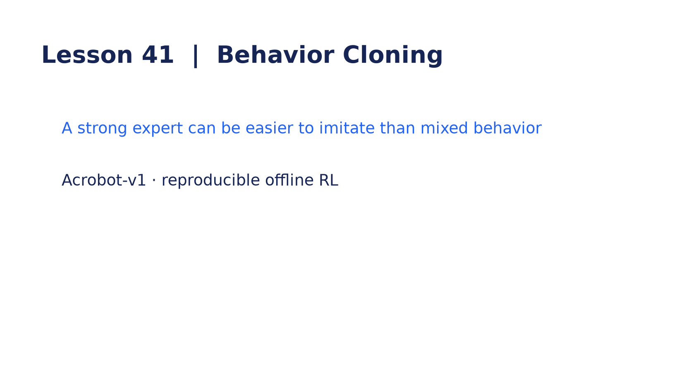
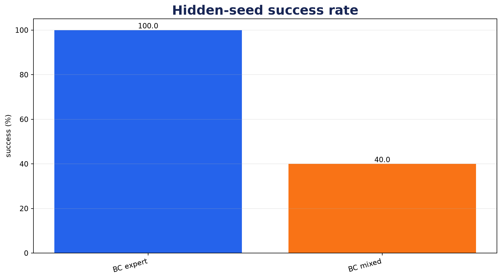
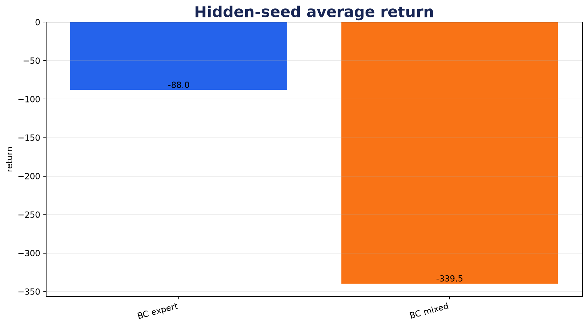
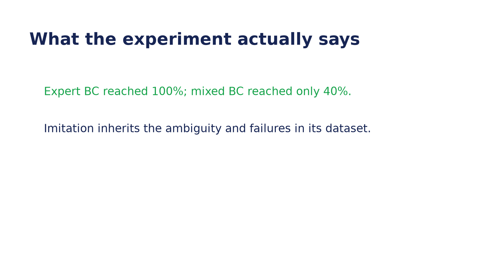

# 不与环境交互，只模仿历史动作能学会控制吗



行为克隆把强化学习暂时变成监督学习：输入状态，预测数据中的动作。训练过程不需要环境、奖励或 Bellman 目标，是检查数据能否直接支撑策略的最简单基线。

## 1. 目标函数

策略网络输出三个动作的 logits，最小化交叉熵：

```text
L_BC = - E_(s,a)~D log pi(a|s)
```

这里没有“比示范更好”的机制。数据中某个状态附近若同时出现好动作、随机动作和早期失败动作，网络只能学习它们的条件分布折中。

## 2. 专家与混合数据的反差



| 训练数据 | 未见种子成功率 | 平均回报 | P90 步数 |
|---|---:|---:|---:|
| expert | 100% | -88.01 | 101.3 |
| mixed | 40% | -339.52 | 500 |

专家 BC 的表现甚至略优于采集专家数据时的平均回报；混合 BC 则经常耗尽 500 步。`mixed` 包含大量随机和中等阶段动作，监督标签本身没有表达统一目标，并非网络突然失去分类能力。



```powershell
python .\离线强化学习\train_offline.py --mode bc --dataset datasets\acrobot\expert.npz
```

训练入口不导入 Gymnasium，也不会调用 `env.step()`。在线评估是训练结束后的独立审计。



行为克隆适合作为离线 RL 的第一条基线：如果高质量数据连 BC 都学不好，应先检查数据和表示；如果混合数据 BC 明显下降，再考虑能区分动作质量的价值学习方法。
