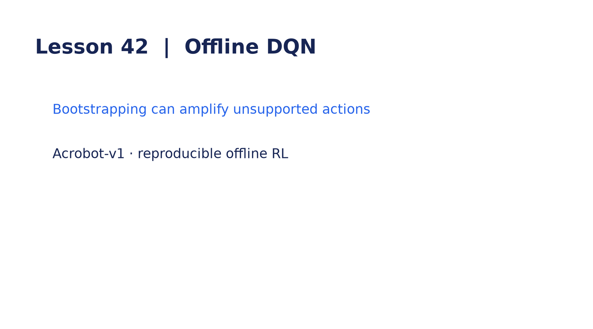
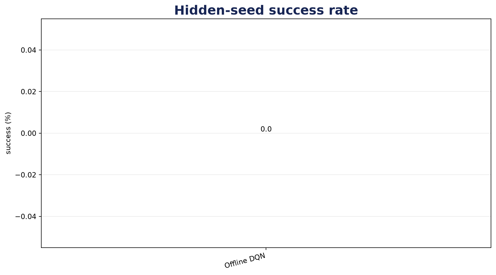
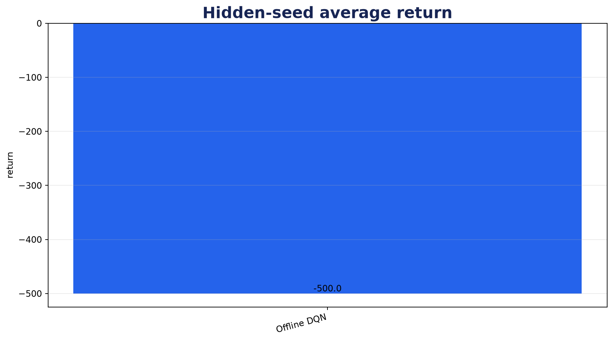
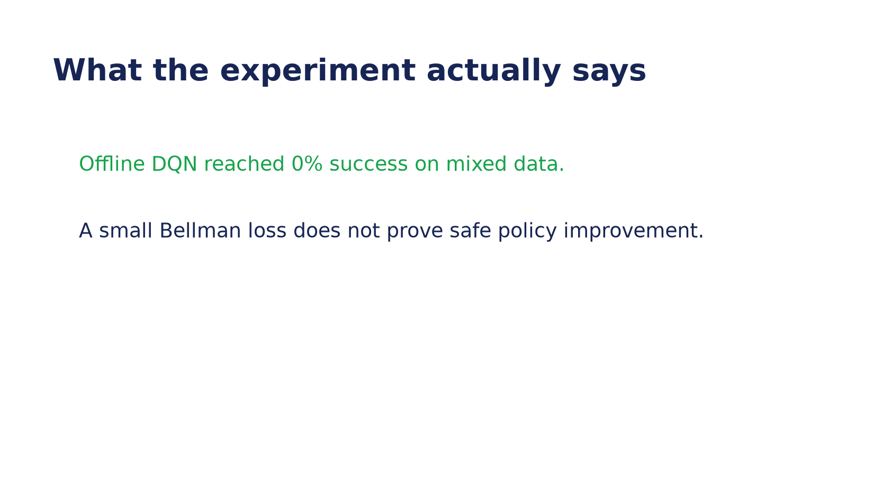

# 把 DQN 搬到固定数据上，为什么 Q 值会骗自己



最直接的离线 RL 想法是：把 replay buffer 冻结，然后继续训练 DQN。代码确实能运行，但 Bellman 目标包含下一个状态上的最大值，这会把数据之外的动作带进训练。

## 1. 外推误差如何形成

```text
y = r + gamma Q_target(s', argmax_a Q_online(s', a))
```

固定数据只监督实际执行过的动作。某个未执行动作即使因为初始化或拟合误差被高估，`max` 也会选中它；这个虚高目标随后又被回归到当前 Q 值，误差能够自举放大。在线 DQN 还能执行该动作并获得纠正数据，离线 DQN 没有这个机会。

## 2. 隐藏种子评估结果



在 71,003 条 mixed transition 上训练 10,000 次梯度更新，按离线验证 Bellman loss 选出的 checkpoint，在 100 个未见种子上成功率为 **0%**，平均回报为 **-500**。



验证 loss 可以下降，训练过程也没有报错，但部署策略仍然完全失败。Bellman 一致性衡量的是模型对自身目标的拟合，不等价于策略实际回报。

## 3. 正确的基线定位

普通离线 DQN 应保留为外推误差基线，供后续方法比较。实验需要同时记录数据动作的 Q、非数据动作的 Q 以及二者差距，不能只看总 loss。

```powershell
python .\离线强化学习\train_offline.py --mode dqn --dataset datasets\acrobot\mixed.npz
```



固定数据上的 `max Q` 是一种没有现场证据的乐观选择。下一篇引入 CQL，主动降低数据外动作的价值。
