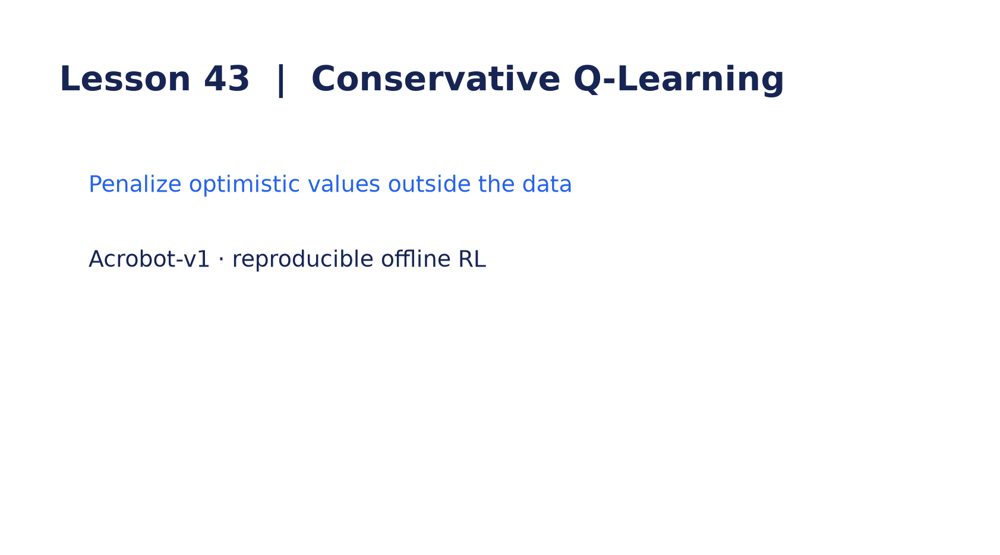
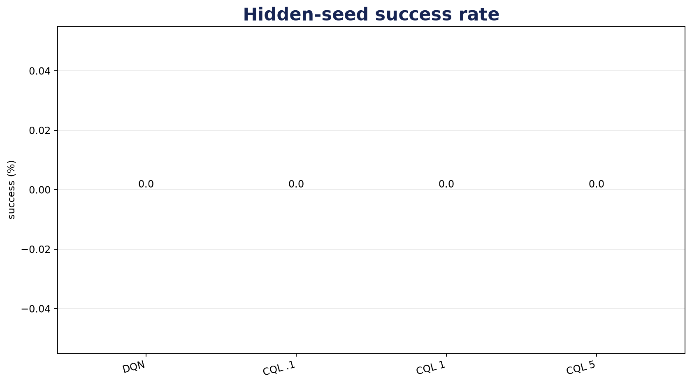
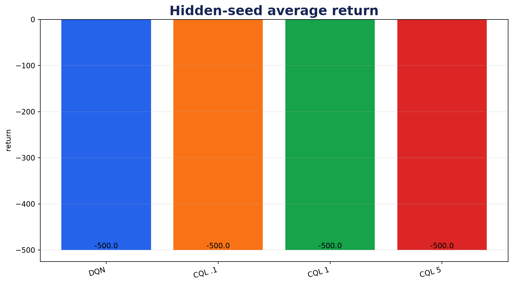
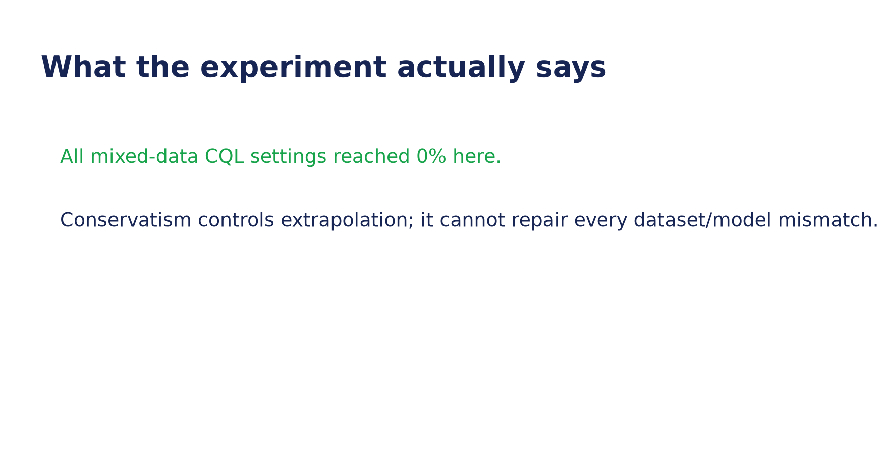

# 保守 Q 学习能否压住离线 DQN 的盲目乐观



CQL 在 Bellman loss 之外加入保守项，让所有动作的 `logsumexp Q` 下降，同时保留数据动作的 Q：

```text
L_CQL = L_Bellman + alpha [logsumexp_a Q(s,a) - Q(s,a_data)]
```

直觉是：没有数据支持的动作不要轻易给高分。

## 1. 三档保守强度



我们在相同 mixed 数据、相同网络和 10,000 次更新下比较普通 DQN，以及 `alpha=0.1/1/5`。CQL 确实把未见动作相对数据动作的 Q 差距压低，但四个策略在 100 个未见种子上都得到 0% 成功率和 -500 平均回报。



## 2. 为什么“更保守”仍然不成功

保守正则针对过高估计，不会自动解决混合数据中的动作冲突、有限模型容量和 checkpoint 选择困难。`alpha` 太小可能压不住外推，太大又可能把有价值动作一起压低。结果说明 CQL 提供了一种归纳偏置，但不能保证策略成功。

```powershell
python .\离线强化学习\train_offline.py --mode cql --cql-alpha 1 --dataset datasets\acrobot\mixed.npz
```

## 3. 保留失败的意义

如果只展示稍后 expert 数据上的成功结果，就会误导读者认为 CQL 可以忽略数据构成。保留 mixed 数据负结果，才能在第 45 篇分离算法和数据质量的影响。



CQL 能改变 Q 值的乐观程度，但不能创造数据中不存在的可靠决策证据。遇到失败时要同时检查数据支持、正则强度和策略选择指标。
