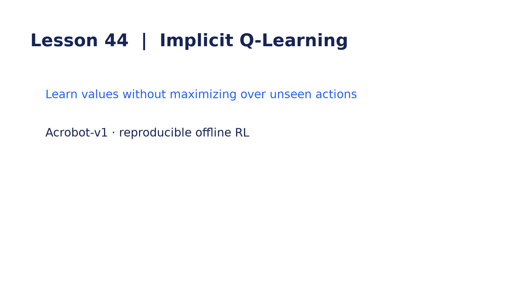
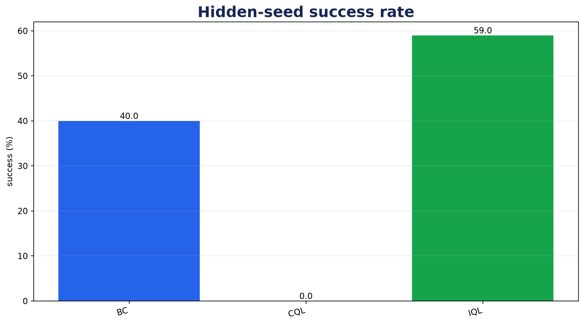
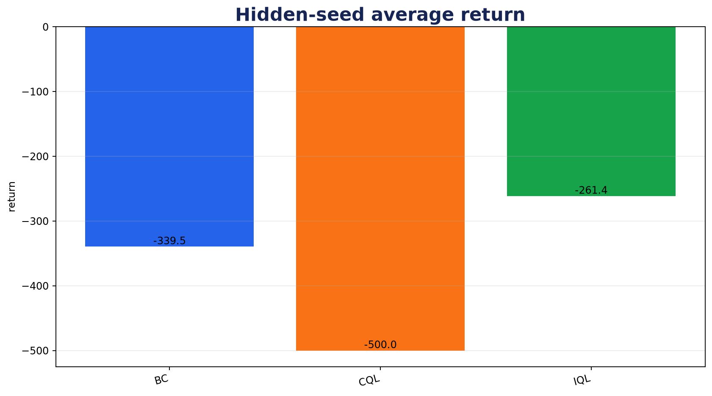
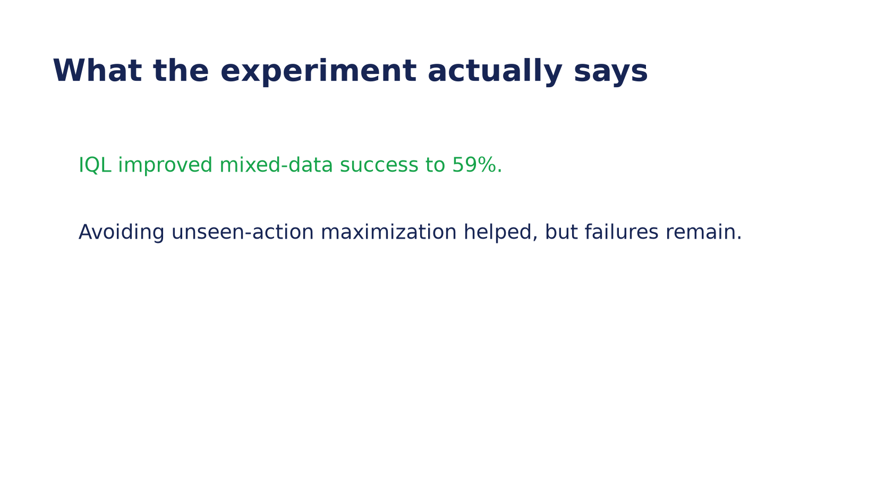

# 不对陌生动作取最大值，IQL 如何学习离线策略



IQL 的关键选择是：训练价值时不显式对数据外动作做最大化。它学习状态价值 `V(s)`、数据动作价值 `Q(s,a)`，再用优势加权行为克隆提取策略。

## 1. 三个更新

`V` 用 expectile 回归偏向数据中较好的动作；`Q` 的目标使用 `V(s')`；策略只在数据动作上做加权监督：

```text
w(s,a) = clip(exp(beta * (Q(s,a)-V(s))), max=100)
L_pi = - E w(s,a) log pi(a|s)
```

这条路径避免了普通 DQN 在目标中选择从未见过的动作。

## 2. 相同 mixed 数据的比较



| 方法 | 成功率 | 平均回报 |
|---|---:|---:|
| BC | 40% | -339.52 |
| CQL | 0% | -500.00 |
| IQL | 59% | -261.42 |



IQL 在本次固定预算下最好，但 41% 的 episode 仍然失败，P90 步数仍为 500。结果支持“IQL 更适合这份 mixed 数据”，不支持“IQL 总是优于 CQL”。

```powershell
python .\离线强化学习\train_offline.py --mode iql --dataset datasets\acrobot\mixed.npz
```

## 3. 两个敏感参数

`expectile` 决定 `V` 多偏向高 Q 动作；`beta` 决定优势权重有多尖锐。二者过大时，少数估计误差可能支配策略；过小时，IQL 会退回接近普通行为克隆。



IQL 的优势不是凭空探索，而是在固定数据内部更谨慎地挑选动作。本实验中它显著改善 mixed 数据策略，但仍需要可靠性审计。
