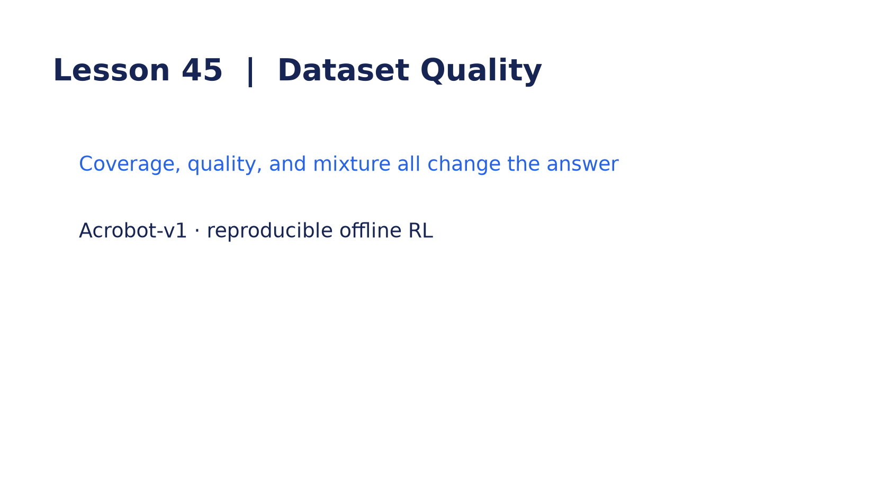
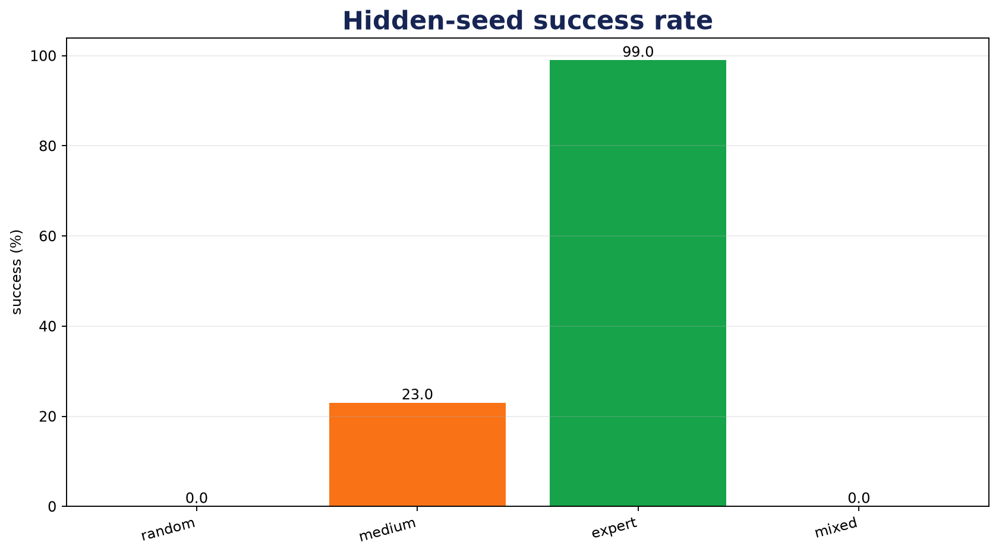
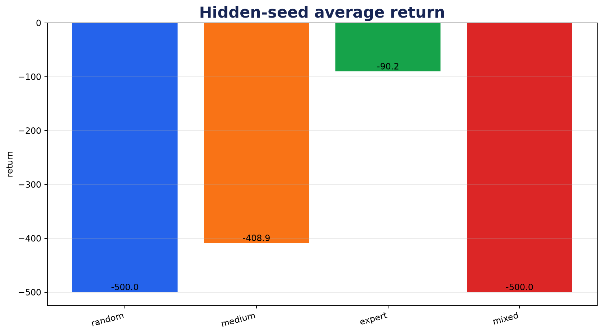
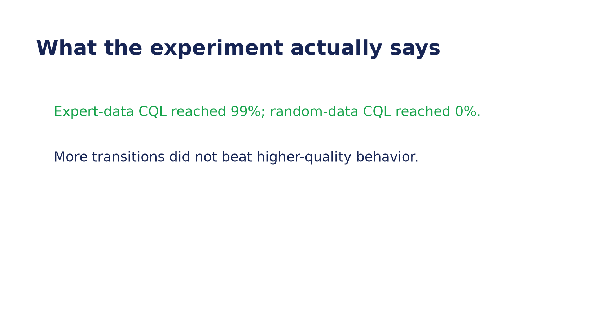

# 离线强化学习里，数据越多就一定越好吗

为了单独观察数据质量，我们固定 CQL 的网络、超参数和更新次数，只替换 random、medium、expert 与 mixed 数据。

## 1. 四份数据，四种结果

| 数据 | transition | CQL 成功率 | 平均回报 |
|---|---:|---:|---:|
| random | 49,859 | 0% | -500.00 |
| medium | 11,986 | 23% | -408.87 |
| expert | 9,158 | 99% | -90.23 |
| mixed | 71,003 | 0% | -500.00 |

最大的 mixed 数据和第二大的 random 数据都失败；最小的 expert 数据几乎完全成功。因此 transition 数量不是独立的质量指标。

## 2. 覆盖与质量不是同一个轴

随机策略覆盖了大量状态，但几乎没有成功任务的动作链。专家策略覆盖较窄，却提供了高度一致的控制信号。混合数据扩大覆盖的同时，也混合了互相矛盾的行为。数据设计需要同时检查部署状态覆盖、动作质量和来源标记。

## 3. 应该怎样改进

可以把 `source` 加入采样权重，平衡不同来源；按回报过滤或重新加权 episode；扩大专家的初始状态覆盖；或者训练条件策略显式告诉模型当前数据来源。任何处理都应另存新版本，不能静默改写原始数据。

本次对照中，数据质量比 transition 数量更能解释性能差异。算法无法从大量失败轨迹中自动还原一条稳定专家策略。
