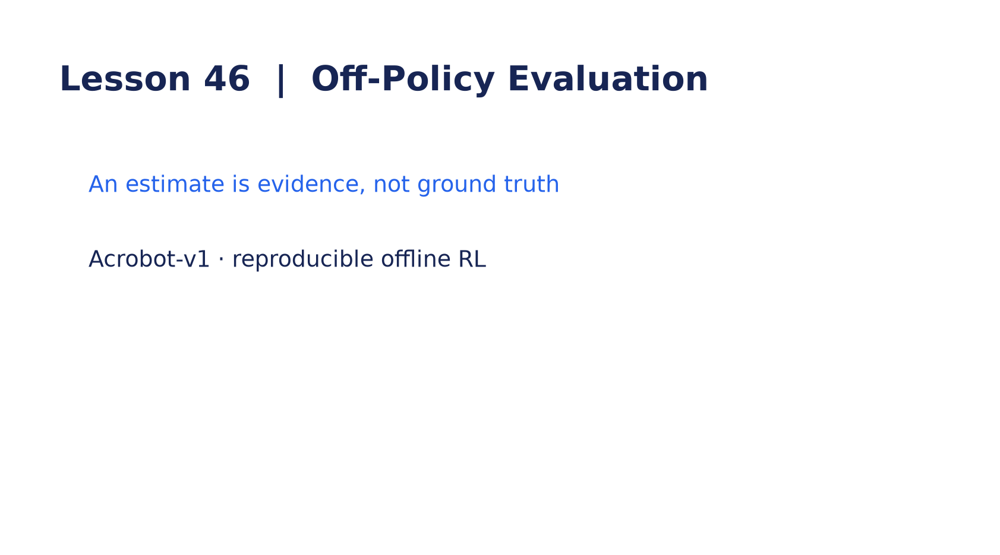
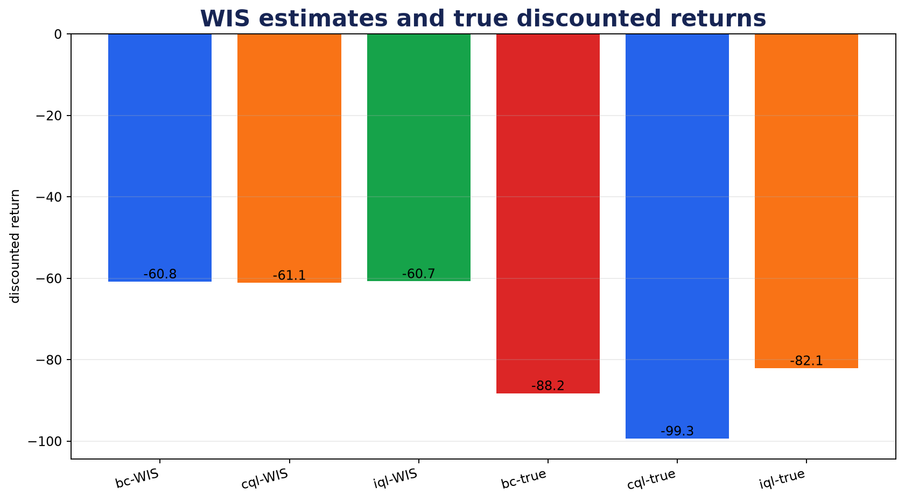
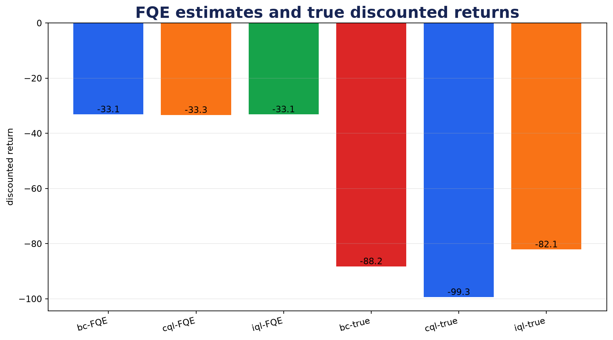
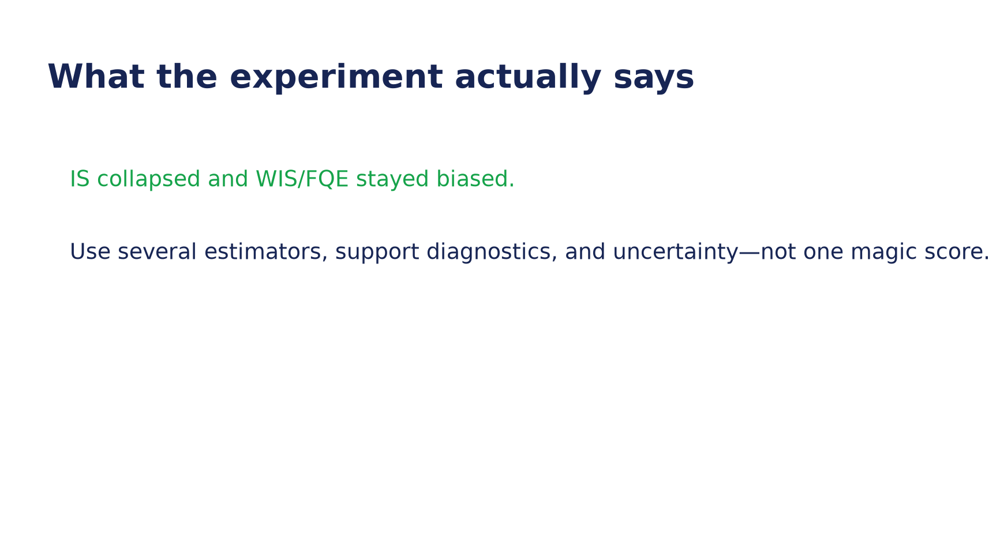

# 不能上线试跑时，如何评估离线策略



真实离线场景通常不能把每个候选策略都部署试跑。本篇实现轨迹重要性采样（IS）、加权重要性采样（WIS）和 Fitted Q Evaluation（FQE），再用仅供审计的环境回报检查估计偏差。

## 1. 三种估计器

IS 用目标策略与行为策略的整条轨迹概率比重加权回报；WIS 再把权重归一化；FQE 固定候选策略，用数据反复拟合它的 Bellman 期望。三者依赖的假设不同，因此失败方式也不同。

## 2. 估计与真值



| 策略 | IS | WIS | FQE | 审计真值 |
|---|---:|---:|---:|---:|
| BC | -0.007 | -60.78 | -33.10 | -88.20 |
| CQL | 约 0 | -61.11 | -33.33 | -99.34 |
| IQL | -0.001 | -60.71 | -33.10 | -82.07 |



普通 IS 因长轨迹概率连乘而几乎塌缩到零。WIS 和 FQE 数值更稳定，却明显高估三种策略，而且没有可靠地区分排序。这说明估计器可计算不等于可相信。

## 3. 部署前的正确用法

同时报告多种估计、有效样本量、最大/最小 log weight、bootstrap 区间和策略对数据的支持程度。若候选策略与行为策略差距太大，应拒绝给出高置信结论，而不是输出一个看似精确的小数。

```powershell
python .\离线强化学习\benchmark_off_policy_evaluation.py
```



OPE 的任务不是制造一个“离线真值”，而是量化我们在现有数据支持下究竟知道多少、不知道多少。
