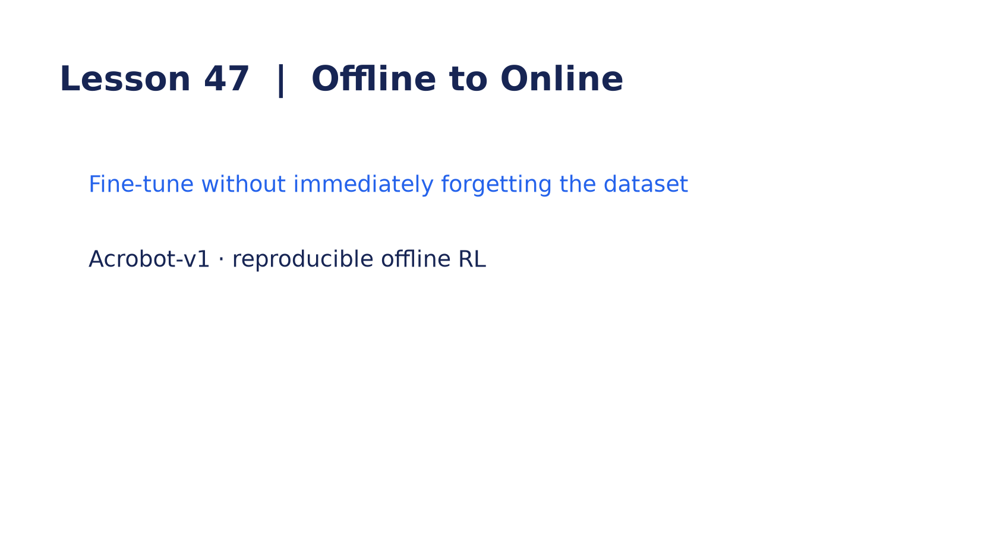
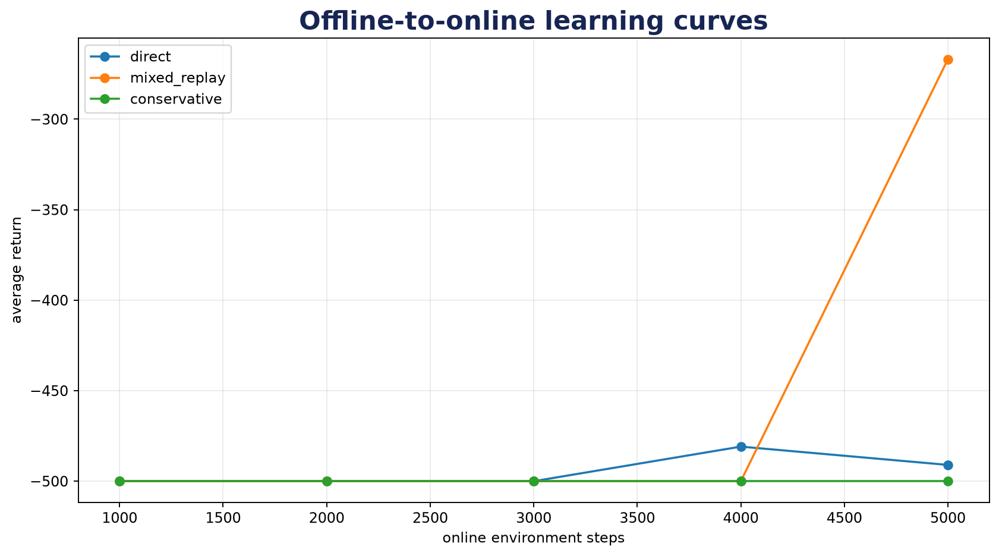
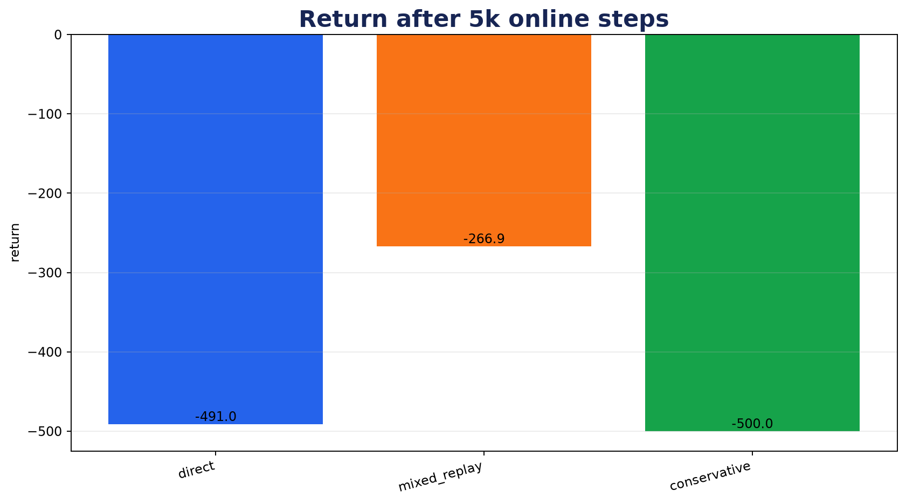
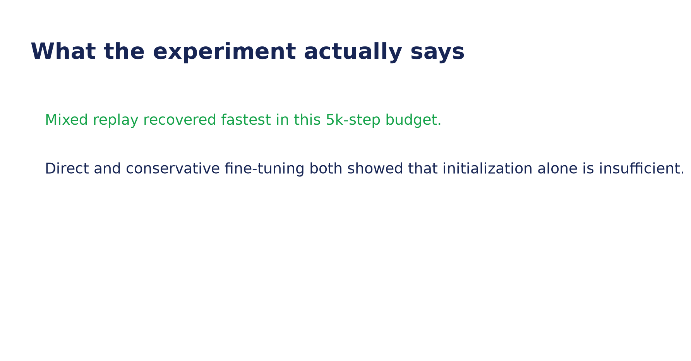

# 离线策略拿到少量交互预算后，应该怎样微调



完全离线训练结束后，如果获得 5,000 步交互预算，直接在线更新可能迅速忘记原数据；过度保守又可能一直不适应。实验从 mixed-data CQL checkpoint 出发比较三种方案。

## 1. 三条路线

- `direct`：只用新在线 replay 做 DQN 更新；
- `mixed_replay`：每批一半新数据、一半原离线数据；
- `conservative`：混合 replay，同时保留 CQL 正则。

三者使用相同环境步数、探索率与评估种子。

## 2. 5,000 步结果



| 方法 | 最终成功率 | 最终平均回报 |
|---|---:|---:|
| direct | 5% | -491.00 |
| mixed replay | 65% | -266.85 |
| conservative | 0% | -500.00 |



mixed replay 在最后一个评估点明显恢复，而 direct 只有轻微改善。固定强度的保守正则在短预算内没有摆脱原来的失败策略；这次结果只能说明正则强度和新旧数据比例需要随阶段调整，不能据此否定保守微调。

## 3. 防止“刚上线就学坏”

部署系统还应保留安全回退 checkpoint，限制动作，持续比较新旧策略，并在在线数据覆盖不足时提高离线 replay 比例。评估种子不能参与梯度更新，最优 checkpoint 也应根据预先约定的指标选择。

```powershell
python .\离线强化学习\finetune_offline.py
```



离线初始化不是终点。短预算下，新旧数据混合提供了本实验最好的稳定性—适应性折中，但结论仍需要扰动和尾部测试。
