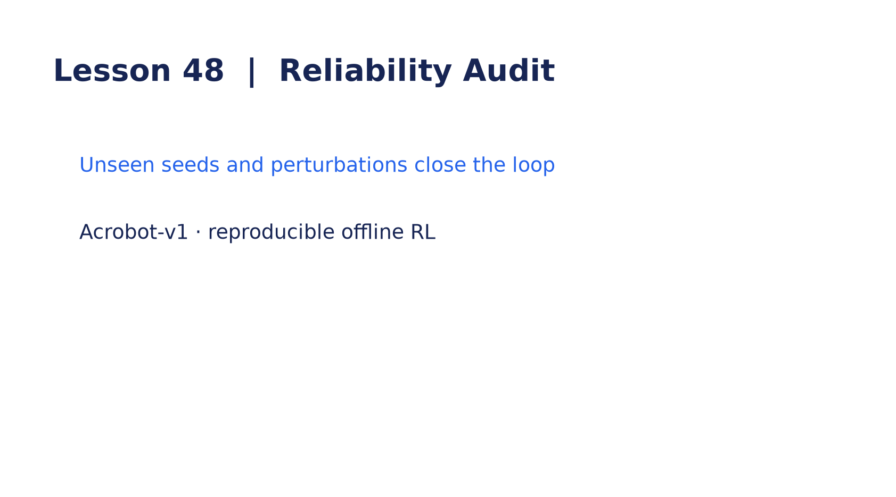
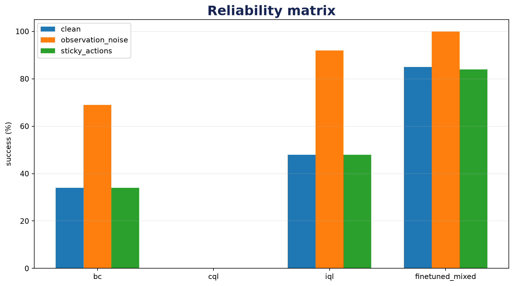
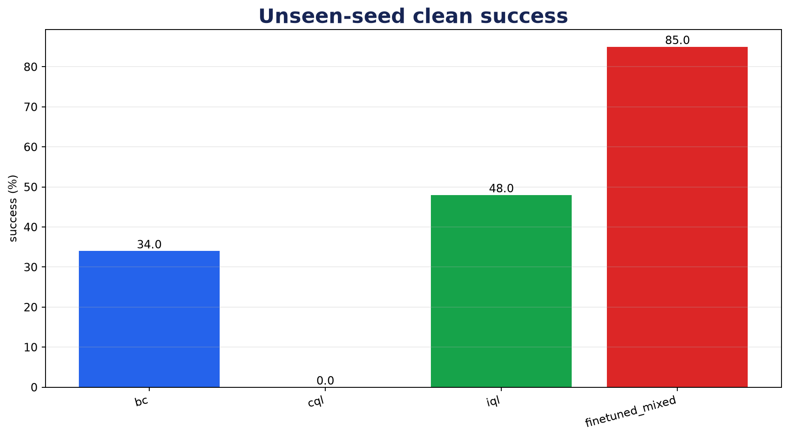
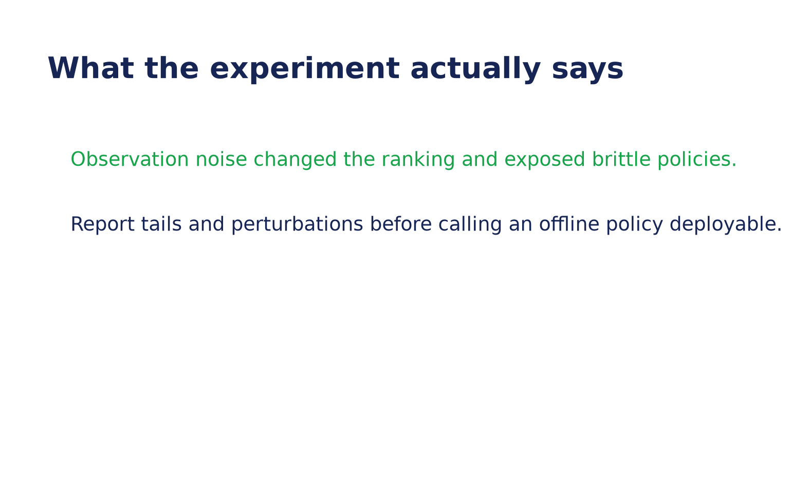

# 离线训练成功等于可以部署吗：最终可靠性审计



最后一篇不再添加算法，而是在 100 个全新种子上审计 BC、CQL、IQL 和 mixed-replay 微调策略，并加入观测噪声与 20% sticky action。

## 1. 可靠性矩阵



| 策略 | 干净成功率 | 观测噪声 | Sticky action |
|---|---:|---:|---:|
| BC mixed | 34% | 69% | 34% |
| CQL mixed | 0% | 0% | 0% |
| IQL mixed | 48% | 92% | 48% |
| 微调 mixed replay | 85% | 100% | 84% |



微调策略在三种条件下最好；CQL mixed 始终失败。值得注意的是，高斯观测噪声反而提高了 BC、IQL 和微调策略的成功率。不能把这解释为“噪声让策略更鲁棒”，更合理的判断是噪声改变了离散动作边界，偶然打破了某些失败循环。这本身就是策略脆弱性的证据。

## 2. 均值之外

审计报告保留每局结果、P90 步数和最差回报。成功率相同的策略也可能有完全不同的尾部风险；扰动后均值改善，也不代表每个初始状态都改善。部署门槛应预先规定，而不是看完结果再移动标准。

## 3. 第 40–48 篇形成的闭环

```text
版本化数据 → BC 基线 → 离线 DQN 失败
→ CQL 保守价值 → IQL 数据内策略改进
→ 数据质量 → OPE → 少量在线微调 → 可靠性审计
```



这一阶段最可信的结果不是某个算法“获胜”，而是建立了一套不依赖漂亮曲线的证据链：数据来源清楚、训练不偷用环境、模型选择与最终测试隔离、负结果保留、部署前检查扰动和尾部风险。离线强化学习阶段到此闭环。
