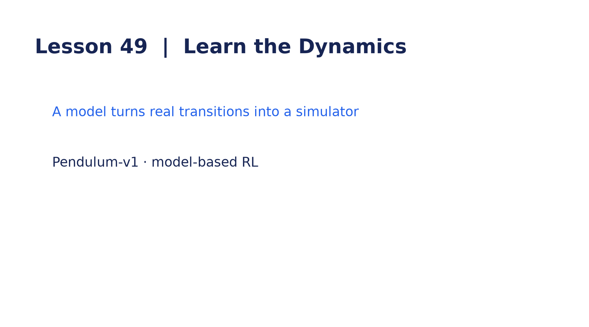
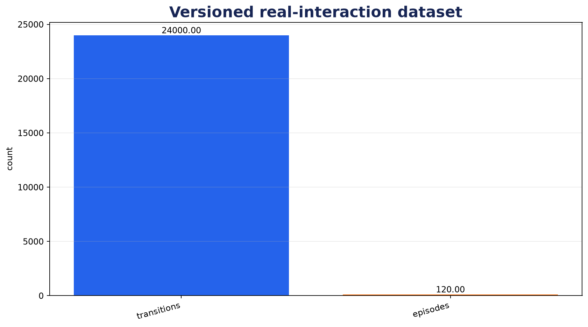
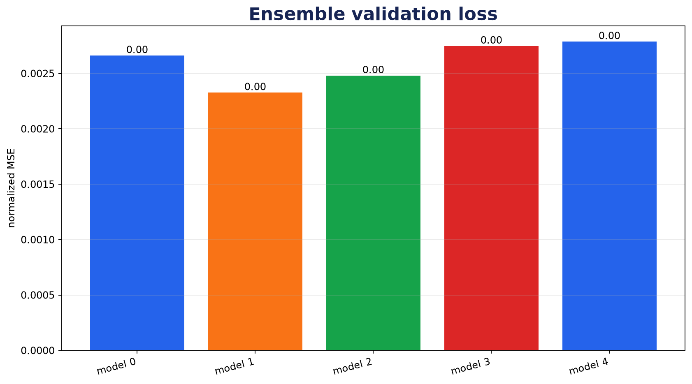
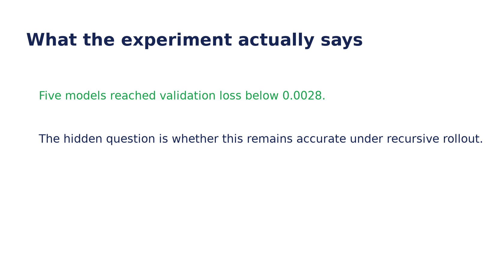

# 不直接学习策略，先学习环境会怎样变化



前面的价值学习和策略梯度都在直接学习“该做什么”。模型式强化学习先预测：给定当前状态和动作，环境下一步会变成什么样、得到多少奖励？本阶段统一使用连续动作环境 `Pendulum-v1`。

## 1. 版本化真实数据



采集 120 个完整 episode，共 24,000 条 transition。三分之一使用独立随机动作，三分之一使用平滑随机动作，三分之一使用带噪声的能量启发式动作。每条数据保存当前观测、物理力矩、奖励、下一观测和 episode ID；训练与验证按完整轨迹拆分。

## 2. 学习状态增量与奖励

网络输入三维观测和一维动作，输出三维状态增量与奖励。输入和目标分别标准化，预测后重新归一化 `cos(theta), sin(theta)`，避免模型产生不合法角度表示。

```text
input  = [cos(theta), sin(theta), velocity, torque]
target = [next_observation - observation, reward]
```

我们用 bootstrap 数据训练五个独立模型，为后续模型分歧实验做准备。



五个模型的最佳归一化验证损失在 0.0023–0.0028 之间；单步状态 RMSE 约 0.024，奖励 RMSE 约 0.17–0.25。这说明模型学会了验证分布上的局部动力学，但还不能证明它可以递归模拟几十步。

```powershell
python .\模型式强化学习\collect_dynamics_data.py
python .\模型式强化学习\train_dynamics.py
```



动力学模型的训练 loss 只是起点。下一篇把模型预测重新作为输入，检查误差如何沿时间累积。
