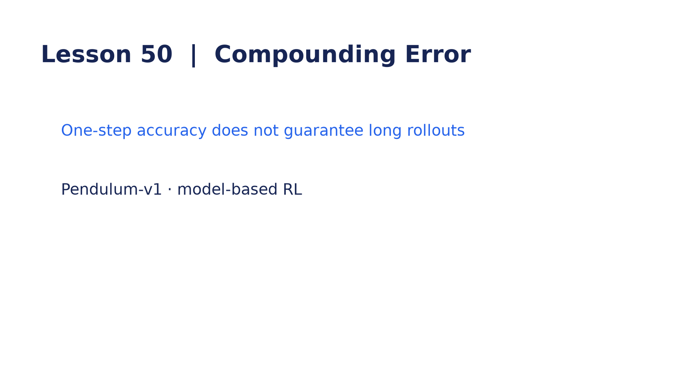
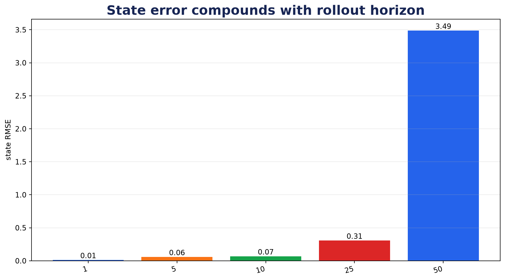
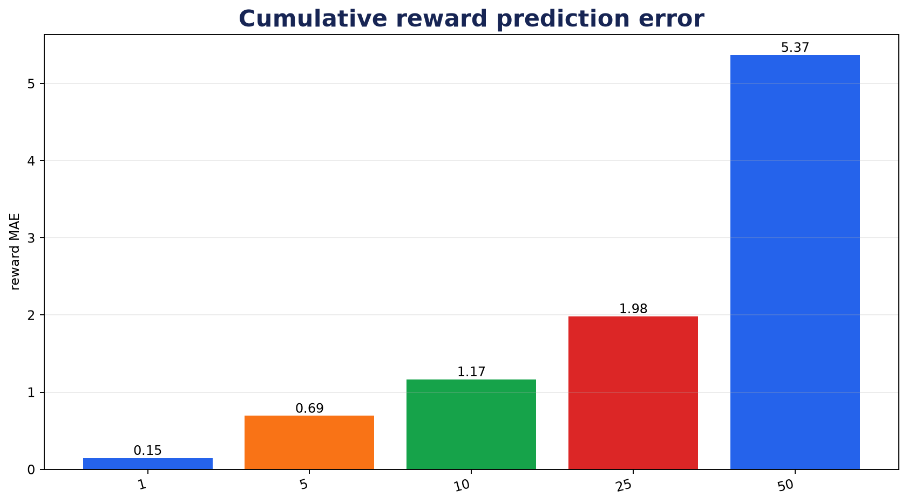
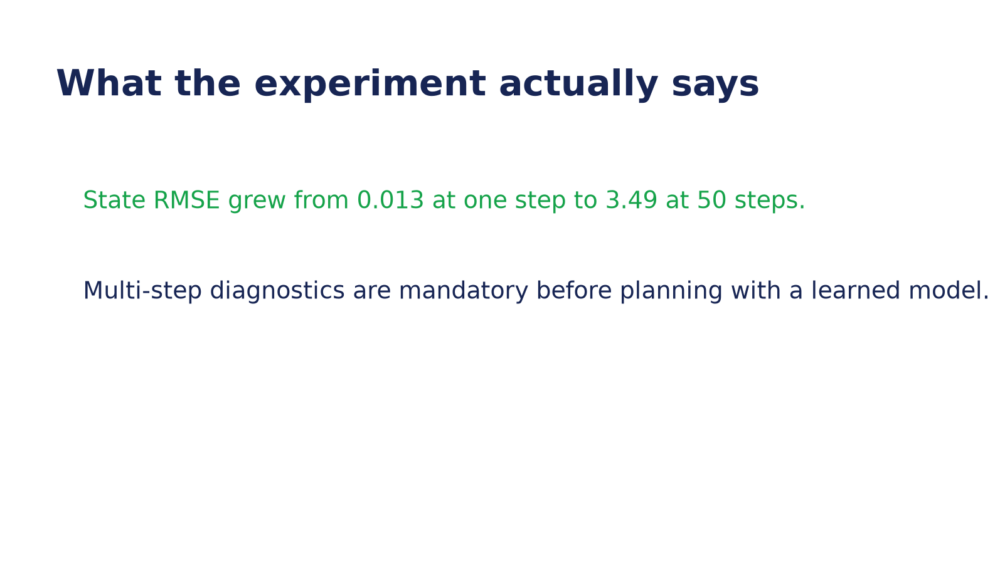

# 单步预测很准，为什么滚动几十步就错了



监督学习验证集每次都给模型真实状态；规划时，第二步开始接收到的却是模型自己预测的状态。一个很小的偏差会改变下一次输入，形成训练时没有见过的分布。

## 1. 开环 rollout 实验

固定初始状态和 50 个随机动作：真实环境执行一次，学习模型从同一起点递归执行同一动作序列。分别在 1、5、10、25、50 步统计状态误差和累计奖励误差，共测试 40 条隐藏轨迹。



| 视野 | 状态 RMSE | 累计奖励 MAE |
|---:|---:|---:|
| 1 | 0.013 | 0.15 |
| 5 | 0.059 | 0.69 |
| 10 | 0.069 | 1.17 |
| 25 | 0.308 | 1.98 |
| 50 | 3.488 | 5.37 |



50 步状态误差是单步的约 260 倍。误差并非线性累加：预测状态一旦偏离真实轨迹，后续每一步都在分布外继续推理。

## 2. 为什么 MPC 仍可能工作

长开环模拟失败，不代表模型完全无用。MPC 每次只执行规划序列的第一个动作，下一时刻重新读取真实观测并重算计划。真实状态反馈会定期切断误差链。

```powershell
python .\模型式强化学习\rollout_diagnostics.py
```



以后报告动力学模型时，必须同时给出单步验证误差和多步 rollout 误差。只展示单步 loss 会严重高估模型作为模拟器的能力。
