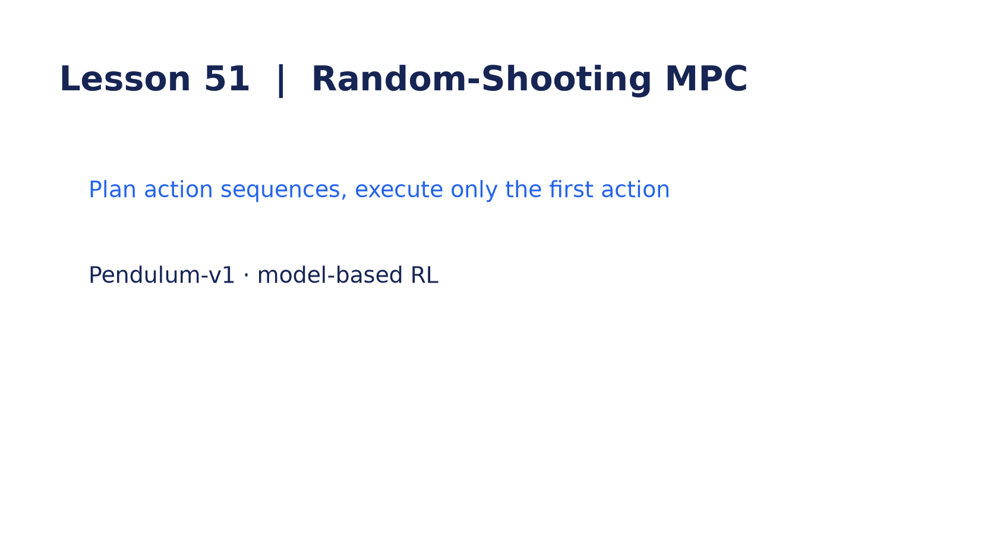
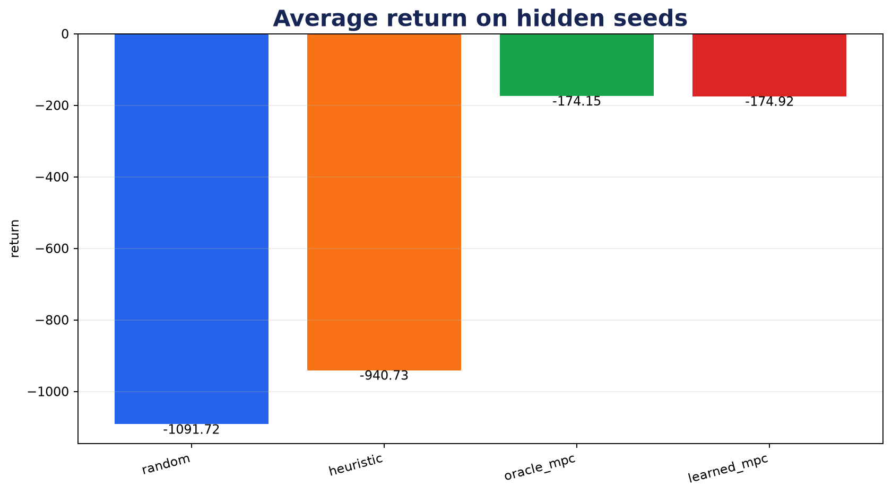
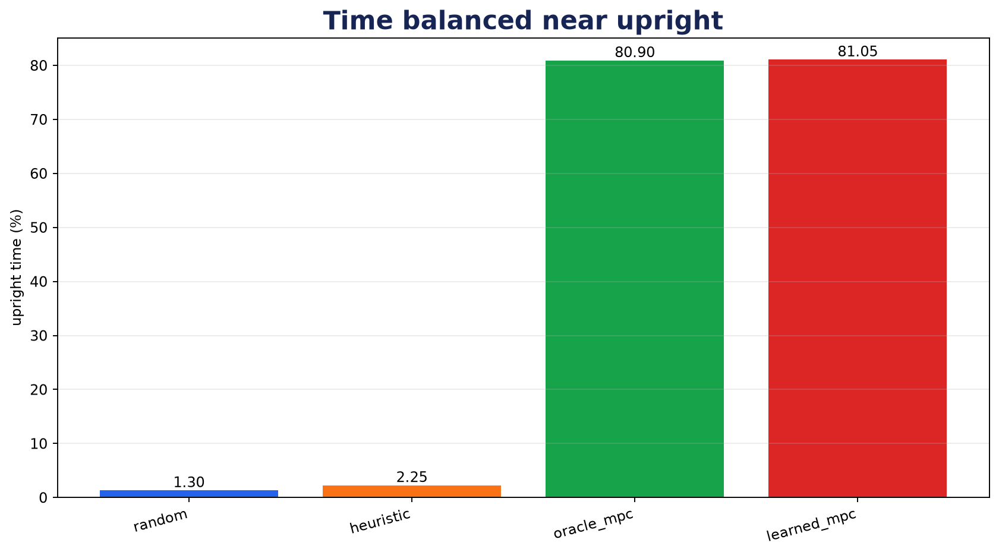
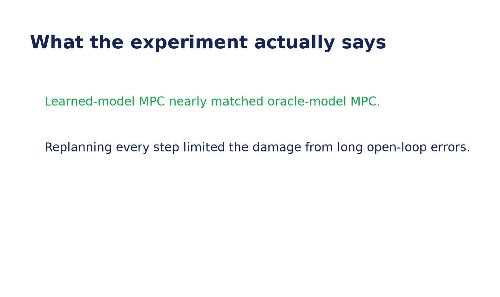

# 有了环境模型，如何用随机射击规划动作



随机射击 MPC 的做法很直接：生成许多候选动作序列，用模型计算每条序列的累计奖励，执行得分最高序列的第一个动作，然后重新规划。

## 1. 公平比较

规划视野设为 20，每一步采样 256 条动作序列。比较随机控制、能量启发式、真实动力学方程 MPC，以及学习动力学 MPC。四种方法使用相同的 10 个隐藏种子。



| 方法 | 平均回报 |
|---|---:|
| 随机控制 | -1091.72 |
| 启发式 | -940.73 |
| 真实模型 MPC | -174.15 |
| 学习模型 MPC | -174.92 |



学习模型规划几乎追平真实方程规划。上一节已经证明 50 步开环预测会崩溃；这里仍能成功，得益于 receding horizon：每次规划完整序列，但只执行第一步。

```text
观测真实状态 → 模型评价候选序列 → 执行第一个动作 → 重新观测
```

随机射击的缺点是绝大多数候选序列质量很差。动作维度、规划视野增加后，需要的样本数会迅速膨胀。



模型不必成为完美的长期模拟器才有控制价值。频繁重规划可以让一个局部准确的模型产生很强的闭环控制器。
