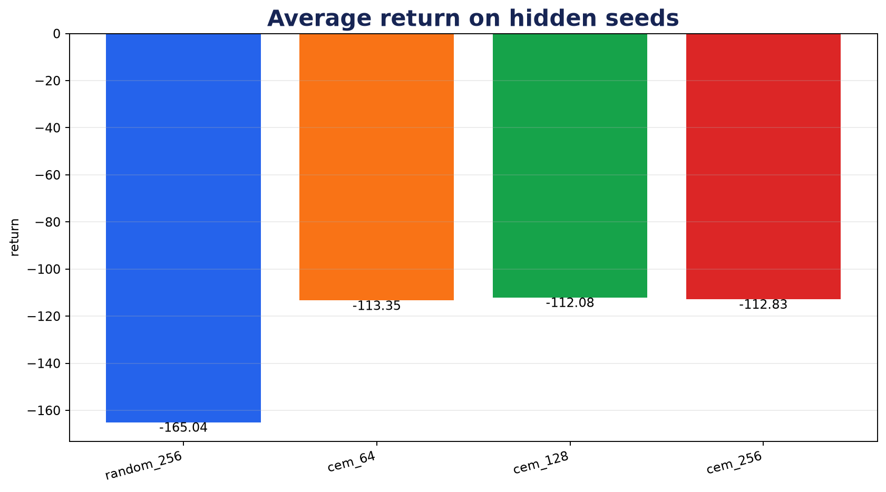
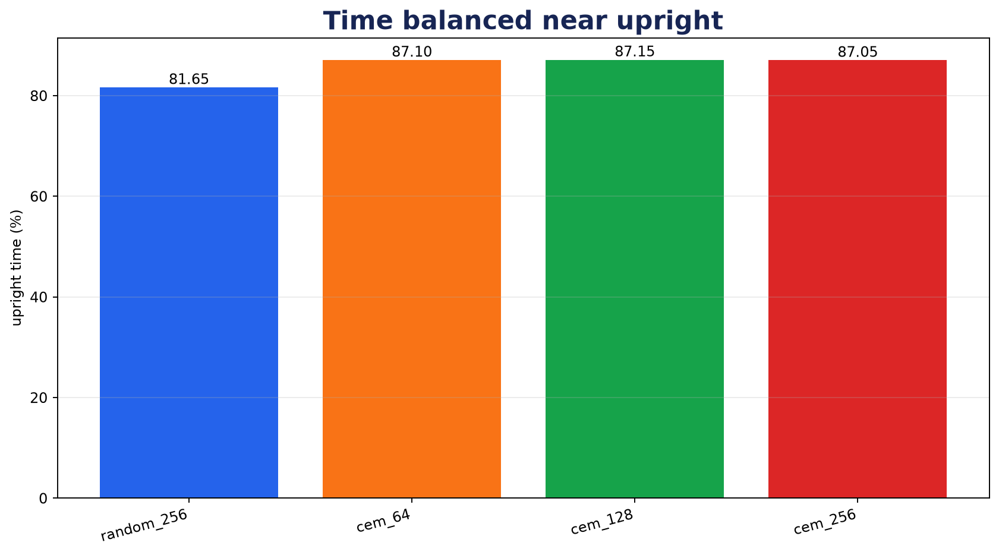
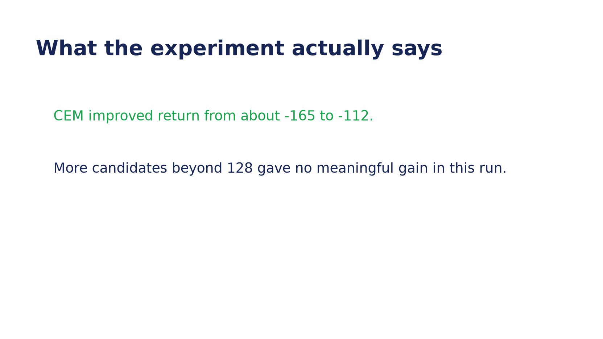

# 随机搜索太浪费，CEM 如何逐轮缩小动作范围


CEM 不再每次从整个动作范围均匀采样。它先从一个宽高斯分布生成序列，保留得分最高的精英，再用精英均值和标准差产生下一轮候选。

## 1. 实现流程

```text
初始化 mean=0, std=2
→ 采样动作序列
→ 模型 rollout 并排序
→ 用前 10% 更新 mean/std
→ 重复三轮，执行 mean 的第一个动作
```



| 方法 | 平均回报 |
|---|---:|
| 随机射击 256 | -165.04 |
| CEM 64 | -113.35 |
| CEM 128 | -112.08 |
| CEM 256 | -112.83 |



仅 64 个候选的 CEM 已明显超过 256 个候选的均匀随机搜索。候选从 128 增加到 256 没有继续改善，说明规划计算量也存在收益递减。

## 2. CEM 的局限

CEM 会主动寻找模型预测中的高奖励区域，因此也更容易利用模型误差。搜索器越强，并不必然代表真实控制越好。后续需要模型集成和不确定性诊断约束这种倾向。



本实验中 CEM 用更少的候选获得更高回报，但 128 个候选已经足够；继续堆计算没有带来可靠收益。
