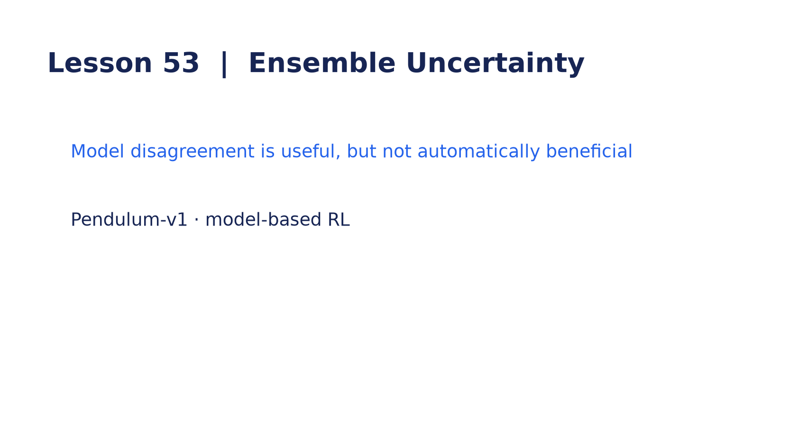
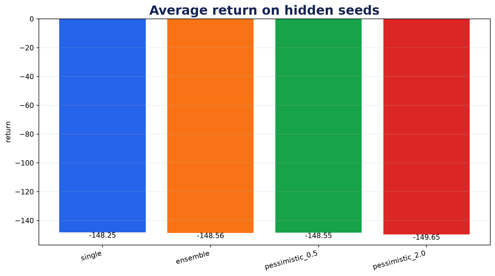
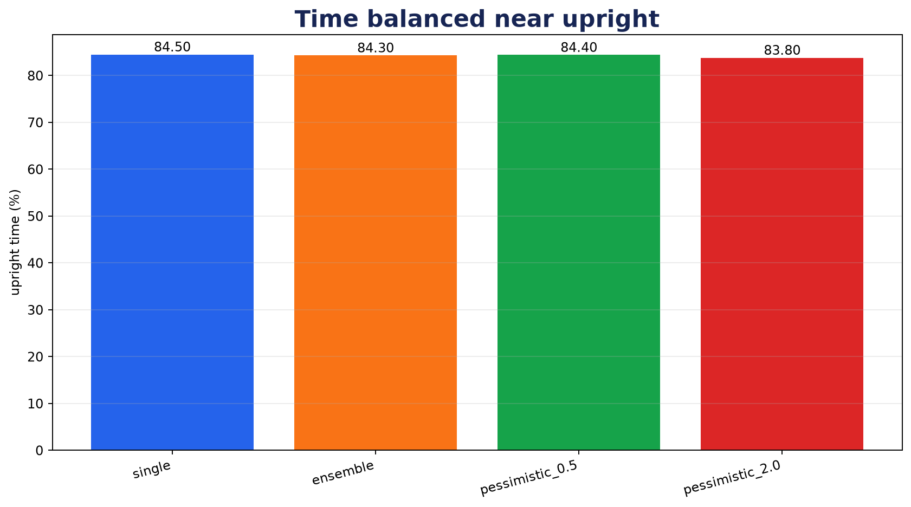
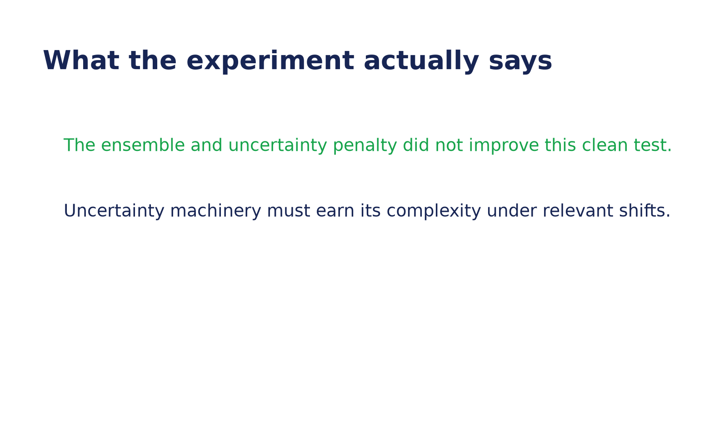

# 一个模型说得很自信，真的可信吗



单个神经网络只输出一个预测，它不会主动告诉规划器哪些状态没有数据支持。模型集成让五个 bootstrap 模型分别预测，用它们的分歧近似认知不确定性。

## 1. 悲观规划

规划时使用模型预测奖励的均值，并扣除分歧惩罚：

```text
planning_reward = mean_reward - lambda * ensemble_disagreement
```

比较单模型、五模型均值、`lambda=0.5` 和 `lambda=2.0`。为控制计算量，使用 5 个隐藏种子、15 步视野和 64 个 CEM 候选。



四种方法平均回报分别为 -148.25、-148.56、-148.55 和 -149.65，差异很小；强惩罚反而略差。



## 2. 为什么没有明显提升

当前数据覆盖充分，测试动力学与训练一致，规划视野也不长，因此五个模型在关键区域高度一致。不确定性机制主要在分布偏移或长视野优化时才可能显示价值。没有差异时，不能仅凭理论宣布它“更安全”。



模型集成提供了可用的分歧信号，但本次干净测试并未证明回报收益。复杂度必须通过相关扰动和尾部结果来证明价值。
