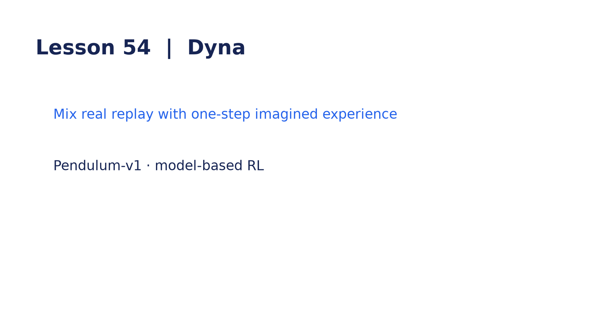
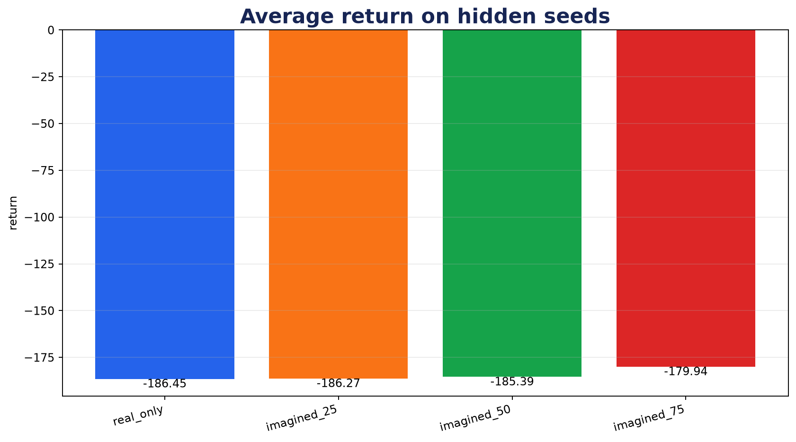
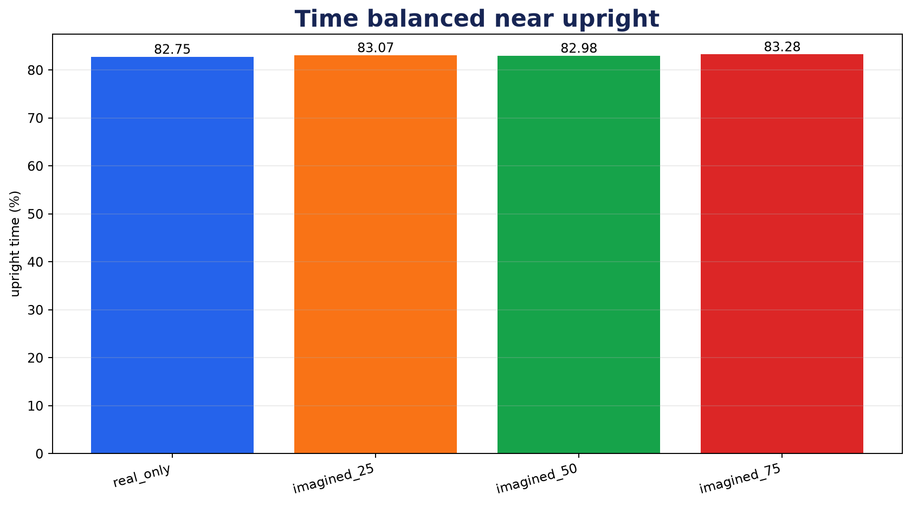
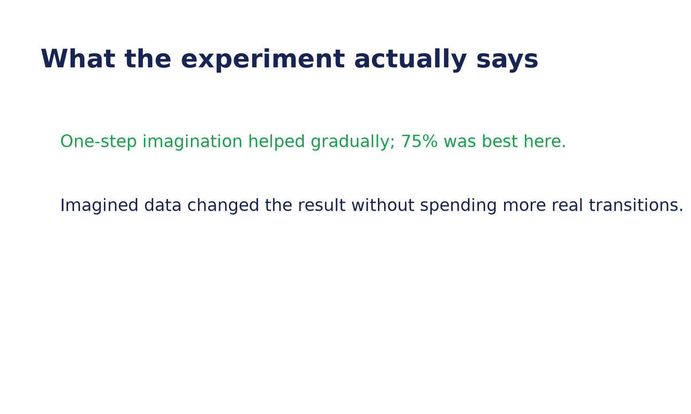

# 真实经验不够时，Dyna 如何用想象数据补训练

Dyna 在真实 replay 之外，让动力学模型生成 transition，再把两类数据混合训练策略。实验固定 4,000 条真实 transition、SAC 网络和 6,000 次更新，只改变每个 batch 中的想象数据比例。

## 1. 单步想象

从真实数据状态出发，当前策略采样一个动作，模型预测下一状态和奖励。只生成一步可以限制误差累积，也保证起点位于真实数据分布。

| 想象比例 | 平均回报 |
|---:|---:|
| 0% | -186.45 |
| 25% | -186.27 |
| 50% | -185.39 |
| 75% | -179.94 |

想象比例提高带来渐进改善，但幅度不大。这个结果支持“模型数据在当前配置有帮助”，不代表比例可以无限增加；100% 模型数据会失去真实 transition 的锚点。

## 2. 样本效率口径

四个实验消耗相同数量的真实数据。模型生成 transition 不计入真实环境预算，但会增加计算成本，因此报告中还要记录生成数量和梯度更新量。

Dyna 用计算换取更少的真实交互。本次 75% 单步想象数据最好，但增益远小于从随机策略到模型规划的提升。
