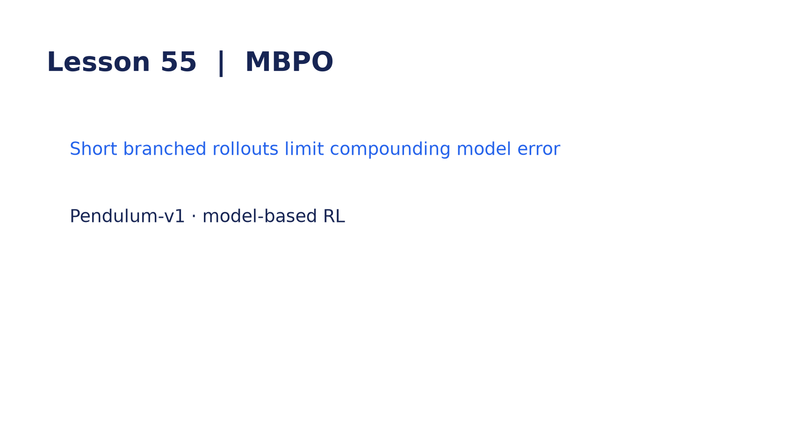
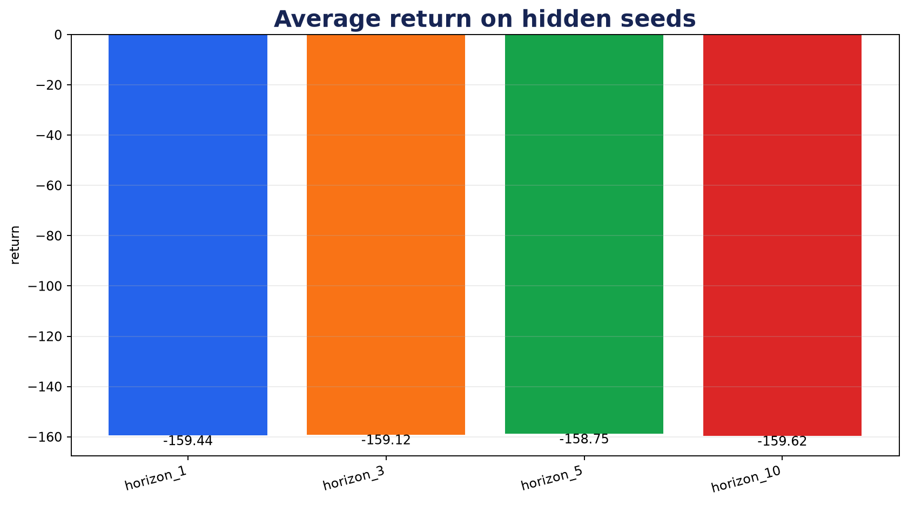
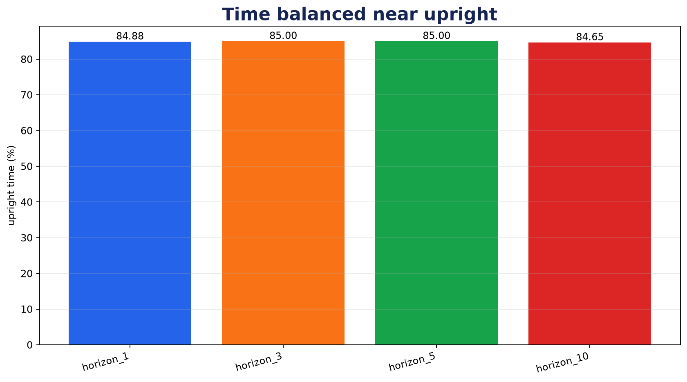
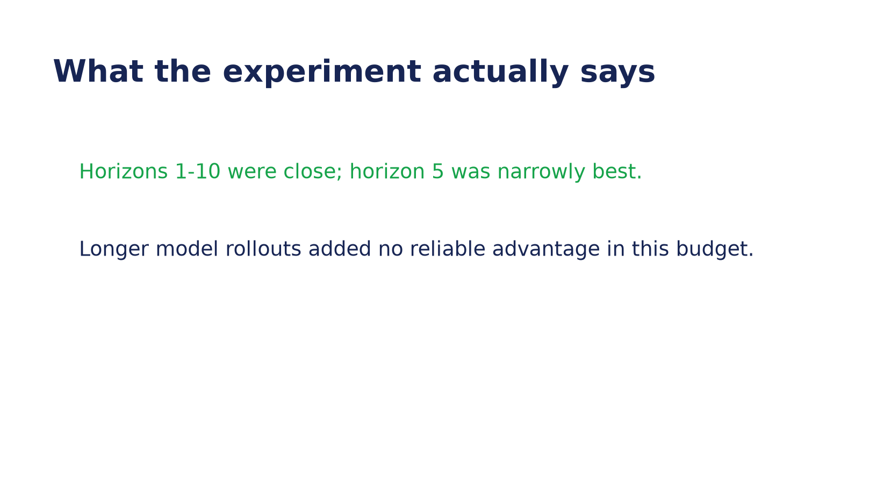

# 想象轨迹越长越好吗：实现简化版 MBPO

更长的模型 rollout 可以快速制造大量训练数据，也会把策略带到模型从未见过的状态。MBPO 的核心思路不是追求长模拟，而是从真实 replay 状态频繁分叉出较短的模型轨迹。

## 1. 固定想象比例，改变长度

四个实验都使用 50% 真实数据和 50% 模型数据，真实数据预算和训练更新相同，只比较 1、3、5、10 步 rollout。

| 模型 rollout | 平均回报 |
|---:|---:|
| 1 | -159.44 |
| 3 | -159.12 |
| 5 | -158.75 |
| 10 | -159.62 |

四种结果非常接近，5 步仅以不到 1 分的优势最好，10 步开始回落。结合第 50 篇的误差曲线，当前证据不支持“想象越长越好”。

## 2. 与 Dyna 的差异

本实现从真实状态分叉，沿当前策略连续生成模型 transition；训练 batch 仍保留一半真实数据。这样既让策略看到自己可能访问的状态，又用真实样本约束价值学习。

MBPO 的关键是控制模型偏差，而不是最大化虚拟数据量。本次 1–10 步差异很小，应把较短 rollout 作为更省计算、更谨慎的默认值。
