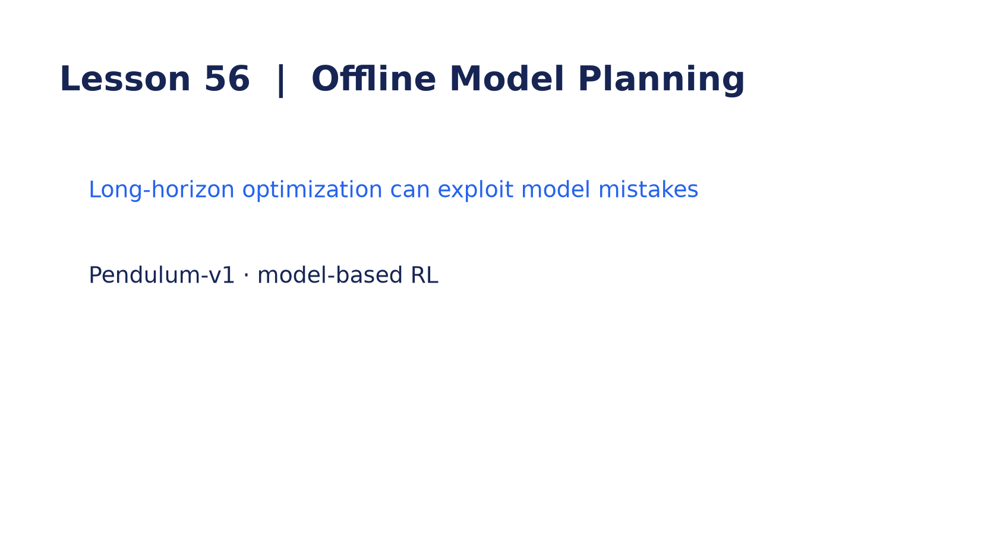
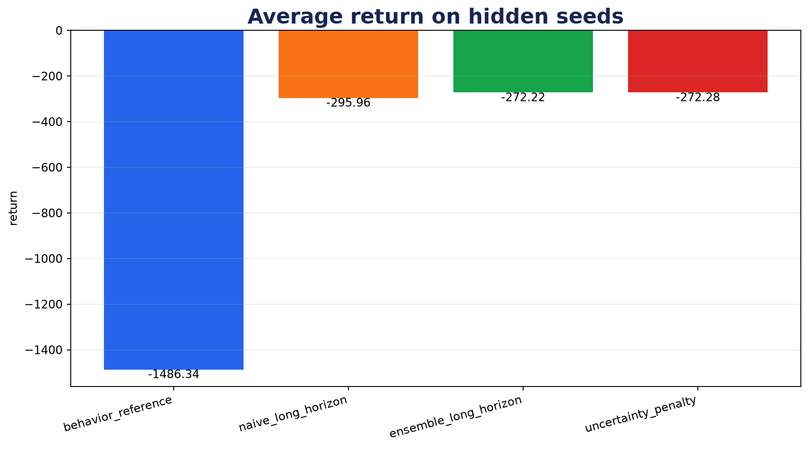
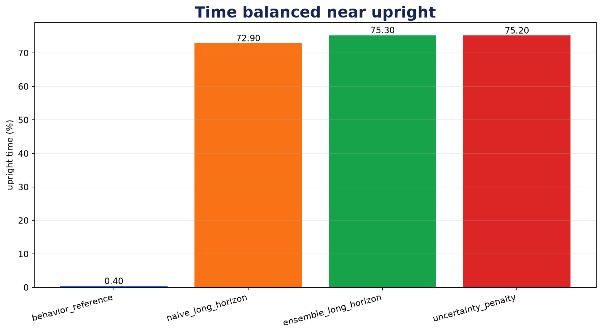
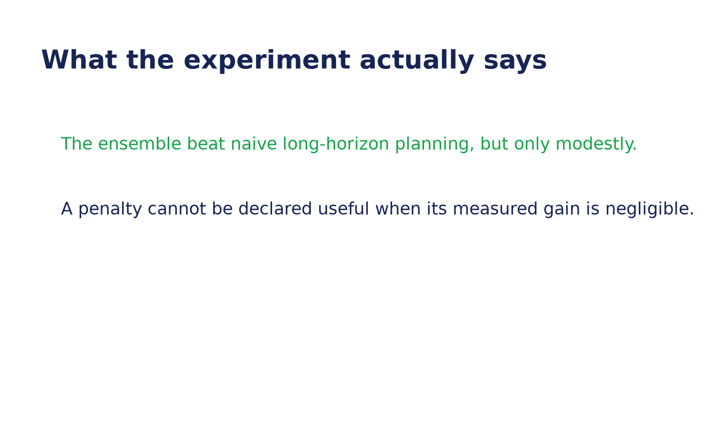

# 固定数据上直接规划，模型会不会钻漏洞

离线模型规划同时面临两种分布偏移：模型在数据外状态不准确，优化器又会主动寻找预测奖励最高的动作序列。搜索器可能把模型误差当成高回报机会。

## 1. 长视野 CEM

在同一固定数据训练出的模型上，把规划视野拉长到 30，比较单模型、模型集成和分歧惩罚。能量启发式仅作为数据行为参考。

| 方法 | 平均回报 |
|---|---:|
| 行为参考 | -1486.34 |
| 单模型长视野 | -295.96 |
| 集成长视野 | -272.22 |
| 集成 + 不确定性惩罚 | -272.28 |

集成比单模型改善约 24 分，说明单模型规划确实更容易被局部误差影响；但加入 `lambda=1` 后几乎没有进一步提升。不能把相同结果解读成“惩罚保证安全”。

## 2. 离线部署门槛

实际离线规划还应限制动作与状态范围、检查候选轨迹离数据的距离、报告模型分歧，并用保守 OPE 或小规模安全试验筛选策略。模型预测回报不能作为唯一指标。

长视野优化放大模型误差；模型集成在本实验有小幅收益，但固定强度的不确定性惩罚没有证明额外价值。
