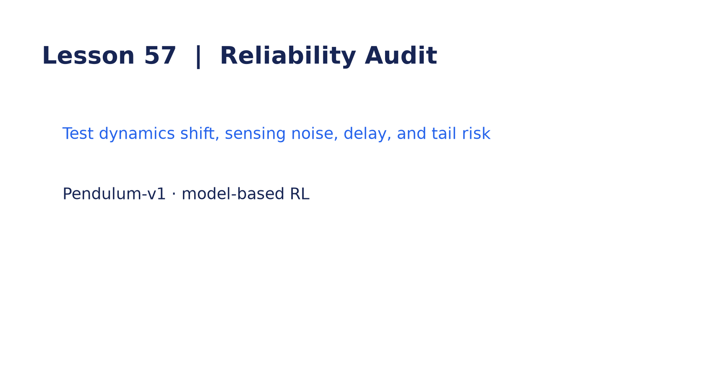
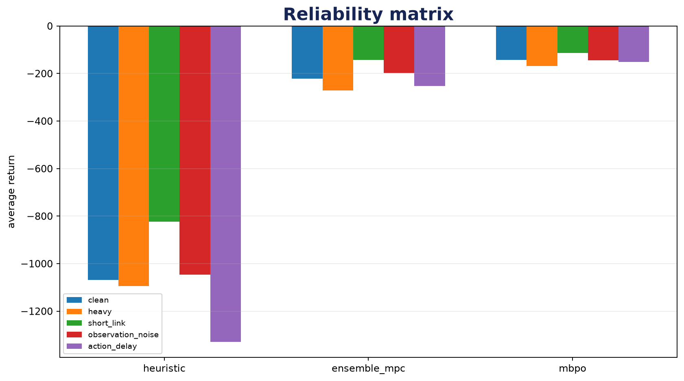
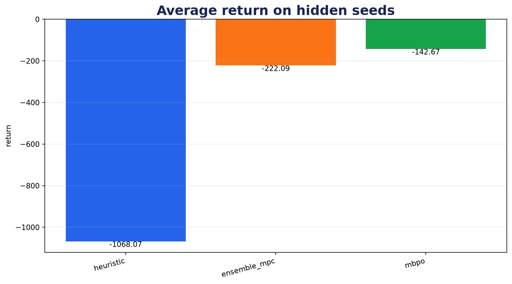
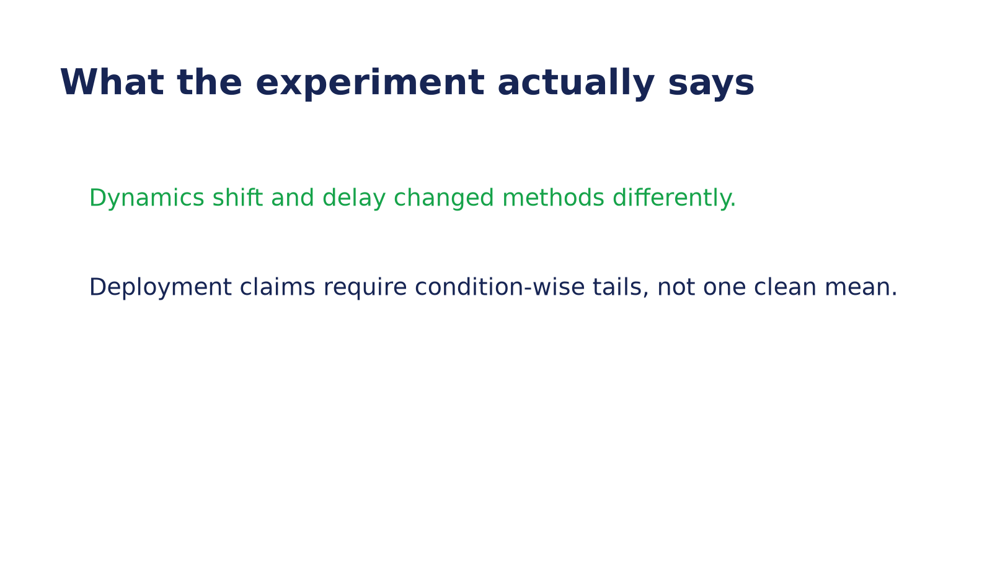

# 模型式强化学习最终可靠性审计



最后一篇使用完全未参与训练和调参的种子，对启发式、集成 MPC 和 MBPO 策略进行统一审计。测试条件包括质量增加、连杆缩短、观测噪声和两步动作延迟。

## 1. 条件矩阵



| 方法 | 干净 | 质量增加 | 连杆缩短 | 观测噪声 | 动作延迟 |
|---|---:|---:|---:|---:|---:|
| 启发式 | -1068.07 | -1094.58 | -823.59 | -1046.34 | -1328.60 |
| 集成 MPC | -222.09 | -270.92 | -141.73 | -197.42 | -252.25 |
| MBPO | -142.67 | -168.21 | -113.29 | -143.97 | -151.50 |



MBPO 在五种条件下均取得最佳平均回报；集成 MPC 在质量增加和动作延迟下下降明显。连杆缩短反而让两种学习方法改善，说明“参数变化”不等于统一难度增加，必须逐条件解释。

## 2. 在线规划与固定策略

MPC 每一步都重新优化，能够利用当前观测，但它的模型仍按原始动力学训练；动作延迟破坏了模型假设。MBPO 执行时不需要模型 rollout，推理更快，本次对延迟也更稳定。不过五个种子的结果仍不足以形成真实系统安全保证。

## 3. 第 49–57 篇闭环

```text
真实动力学数据 → 单步模型 → 多步误差
→ Random Shooting MPC → CEM → 模型集成
→ Dyna → MBPO → 离线规划风险 → 可靠性审计
```



模型让智能体用计算代替部分真实交互，也会向优化器暴露可利用的近似误差。因此报告需要同时列出真实交互预算、模型误差、规划计算、分布偏移与尾部表现。模型式强化学习部分在此结束。
